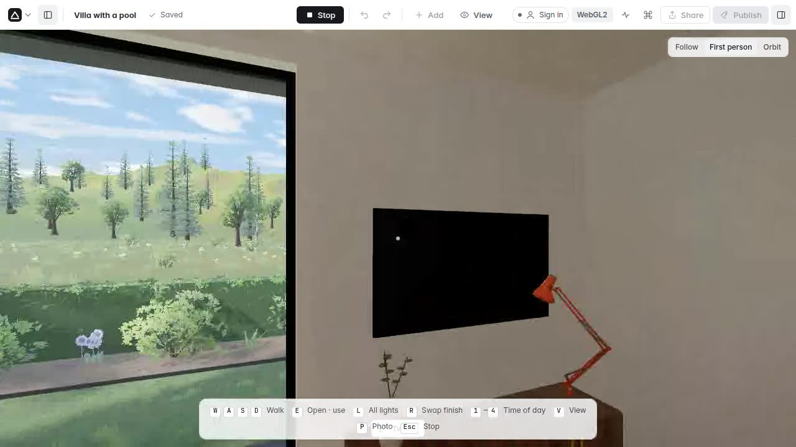
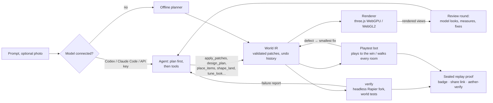
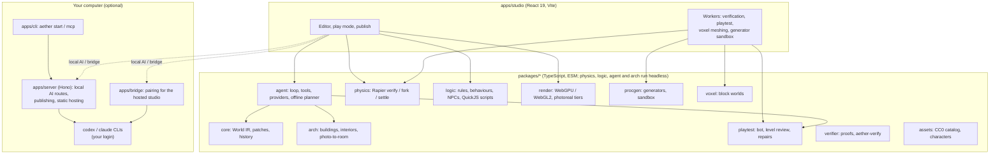

# Aether

> **Describe a world. Aether builds it, checks that it works, and lets you play it.**

Aether is a browser studio that turns plain-language prompts into interactive
3D: outdoor worlds, games you can win, physics machines, and architecture you
can walk through. The worlds have working logic. Doors swing on physics joints,
dominoes topple, coins count up and win screens trigger. Before a world reaches
you, Aether runs its checks headless and a bot plays the game to the end. If
something is broken, the agent repairs it.

- **Hosted studio:** <https://aether-studio-lyart.vercel.app>. It runs offline
  or with your own API key. To use Codex or Claude Code there, see
  [Connect an AI](#connect-an-ai).
- **On your computer:** one command, and your own Codex or Claude Code login
  (below).
- **Demo video (2 minutes):** attached to the [v0.1.0 release](https://github.com/StarAtNyte/aether/releases/tag/v0.1.0).
  The repository is private for now, so the video lives on the Releases page, not in the tree.

[](https://github.com/StarAtNyte/aether/releases/tag/v0.1.0)

## Highlights

- **Prompt to world.** Outdoor worlds, games, physics machines and buildings from a sentence, built by an agent that plans first, then places things through measuring tools and edits the world with small validated patches.
- **Photo to room.** Rebuilds a room from a photograph: shell, furniture and decor, with an advisory room-size estimate from a depth network (`measure_room`) and an AI judge loop that compares render and photo.
- **Generation brief and richness review.** The model plans what a space needs and how elaborate it should be; after the build, a review compares the result with the plan and sends shortfalls back.
- **Baked light, 60 fps on integrated GPUs.** Bundled lightmaps for interiors, a studio render that is the default view, adaptive resolution and a light chain while the view moves.
- **A real model library.** CC0 models and textures (Kenney, Poly Haven, ambientCG) plus first-party crafted parts: venues, streets, harbours, seven regional house types, gyms, clinics, furniture.
- **Verified playable games.** Physics tests, a playtest bot that plays to the win and repairs defects, and sealed replay proofs that `aether-verify` re-runs.
- **Publish and share.** Standalone web builds, share links that carry the whole world, videos, stills, GLB and floor plans.
- **Agent-ready.** An MCP server (`aether mcp`) and the `aether` command line.

| | | |
| --- | --- | --- |
|  |  |  |
|  |  |  |

Stills from the real-time renderer on an Intel integrated GPU (`scripts/world-stills.ts`).


## Quick start

You need **Node.js 24** (see `.nvmrc`), npm 10 or newer, and a WebGL2 browser.
Chrome or Edge use WebGPU; Firefox and Safari use the WebGL2 path.

```bash
git clone https://github.com/StarAtNyte/aether && cd aether
npm ci
npx aether start --open        # builds the studio once, starts it in the background, opens http://127.0.0.1:4280
```

On first open you choose **Sign in with ChatGPT (Codex)**, **Claude Code** (if
its CLI is signed in on this computer) or **Continue offline**. No API key is
needed. `npx aether stop` stops the server, and `npx aether doctor` checks
Node, the build, the port and both CLIs.

To work on Aether itself with hot reload:

```bash
npm run dev:server   # API server on http://localhost:8787 (terminal 1)
npm run dev          # studio on http://localhost:5173, proxies /api (terminal 2)
```

Then type a prompt, for example *"a night forest adventure: collect 5 lanterns,
avoid the wolves, reach the shrine to win"* or *"a two-storey modern house with
a pool, open-plan living room, kitchen and two bedrooms"*. Keep chatting to
refine it, then press **Play**. [docs/USER_GUIDE.md](docs/USER_GUIDE.md)
covers prompting, chat edits, play mode, the badges, photo-to-room and
publishing.

## Featured worlds

Fifteen featured projects ship with the studio and open from the home page.
Each was built from the prompt on its card. Each passes its physics checks,
and the bot plays the games to their win screens in the test suite. Blockfall
and Sakura River are the exceptions: they use their own game loops, which the
general bot does not drive.

| | | |
| --- | --- | --- |
| <br>**Highland Trail**: log six survey stakes, cross the footbridge, reach the summit | <br>**Lantern Isles**: find twelve lanterns across floating islands | <br>**The Hollow Gate**: buy the key, slip past the guard, outwit the wolves |
| <br>**Chain Reaction**: five Rube Goldberg machines, every bounce checked | <br>**Kart Canyon**: three laps, checkpoints, boost pads, two rivals | <br>**Blockfall**: mine, craft and survive the night in a block world |
| <br>**Neon Rain City**: a wet downtown at night, find five neon cats | <br>**Kyoto Temple Lanterns**: a story in four chapters | <br>**Painterly Meadow**: a steam train in a wildflower valley |
| <br>**Four-Seasons Garden**: switch seasons with the 1 to 5 keys | <br>**Orbital Lab**: low gravity, five power cells, restart the reactor | <br>**Sakura River Journey**: paddle a canoe through four seasons |
| <br>**Casa del Patio**: a courtyard house above Sintra, every drawer opens | <br>**Skyline Penthouse**: walk it, switch the lights, change the hour | <br>**Dusk House by the Lake**: explode it, cut it, walk to the jetty |

Four more example rooms, rebuilt from CC0 or public-domain photographs, are
listed under **More worlds**: a hotel bedroom, a twin room, a four-poster
bedroom and a vaulted bedroom. The photo credit is on each card. They are saved runs of the photo flow
(`npm run showcase:photo-rooms`).

Five worlds the agent generated from a prompt are listed under **Generated by
the agent**: a forest lantern hunt, a medieval market village, a modern pool
house, a two-bedroom apartment and a Scandinavian living room. They are saved
exactly as generated (the prompt is on each card), open like any template and
can be changed by chat.

The list and its order live in
[`apps/studio/src/showcase/manifest.ts`](apps/studio/src/showcase/manifest.ts).
`npm run showcase:bake -- --check` confirms that every saved world still
matches what its prompt builds (the photo rooms and the agent-generated
worlds are re-validated and re-verified instead).

## What is different

**1. The world is data, and the AI edits it with patches.** Every world is
one validated JSON document, the World IR
([`packages/core/src/schema.ts`](packages/core/src/schema.ts)). It holds
entities, shapes, materials, physics, joints, lights, behaviours, rules, NPCs,
buildings, tests and generator code. The model never touches the renderer. It
sends typed patches. Each patch is checked against the schema, cross-references,
size limits and prototype pollution, then stored as one undoable history step.
In the public benchmark, a small edit is a median 230-token patch, against
7,716 tokens to re-emit the whole world, and 8 of 130 edits changed anything
unrequested ([docs/BENCHMARK.md](docs/BENCHMARK.md)).

**2. The AI is the decision-maker. Code gives it tools and checks.** With
Codex or Claude Code connected, the model plans the layout first, then places
things through measuring tools. Some tools refuse nonsense: a bed through a
wall, a painting over a window, a stair that lands in a wall. The model then
looks at rendered views of its own result and fixes what it sees, round after
round. It also grades the look the way a photographer would (`tune_look`:
white balance, exposure, tints, fog, lamp strength), stored in the world as one
undo step. On a subscription login there is no fixed round cap: the loop ends when
the model approves its result or progress stalls. Paid API keys keep a finite
cap. Without a model, a deterministic offline planner builds from the same
parts, and the studio tells you it is offline. See
[docs/AGENT_TOOLS.md](docs/AGENT_TOOLS.md).

**3. Physics as unit tests.** `verify` builds a headless copy of the
[Rapier](https://rapier.rs) physics world with the game rules attached. It
fast-forwards the copy and checks the world's tests: `stable`, `noOverlap`,
`reaches`, `eventually`, `moves`, `topples`, `staysAbove`, `navigable` (every
room reachable on foot) and `npcs` (patrols reachable, nobody stuck). In the
benchmark it runs at a median 561 times real time (the slowest case was 136
times), and forking a running simulation costs 0.79 ms. Failures go back to
the model as a repair turn ("1/30 dominoes toppled; not: domino-1…").

**4. A bot plays it, and repairs what blocks it.** After every build and
edit, a playtest bot plays the game in a worker. It drives the real character
controller: it plans routes and jumps over a navigation graph sampled from the
physics world, fetches keys, talks to shopkeepers and steers round enemies. In
a building it walks to every room. When it finds a defect (an unreachable
pickup, a win target higher than the number of coins, a doorway narrower than
the player, enemies the player cannot survive), it applies the smallest fix as
one undoable step and plays again. The badge says **Verified playable** or
**Verified walkable** only after a passed run on exactly the world on screen.

**5. Sealed replay checks anyone can re-run.** The physics verdict and the
bot's winning run are sealed into one content-hashed proof file, signed with
Ed25519 if you choose to sign it. Share links and published games carry the
proof, and `aether-verify` re-simulates it in Node or in the browser. This is a
**deterministic replay check, not a formal proof**. It shows that the
author's checks pass on this exact world and engine version. It does not show
that the game is fun or bug-free ([docs/PROOFS.md](docs/PROOFS.md)).

```bash
npx aether-verify seal apps/studio/public/templates/worlds/chain-reaction.json --out proof.json
npx aether-verify proof.json --world apps/studio/public/templates/worlds/chain-reaction.json
#  ok   replay  10/10 checks passed over 15.167s of simulation, 16 moving bodies matched to 1 mm
#  ok   bot     a bot played it to the win again on this device (15 s of play)
```

**6. Small edits by chat.** After the first build, every message refines the
current world. "Make the sofa dark green velvet", "floral wallpaper on the
bedroom's back wall", "move the lamp a bit left", "make the wolves slower" and
"collect 15 coins to win" are resolved by name, type, room, position,
selection or conversation. Each becomes the smallest patch, shown as a
one-line diff with Undo. Common edits run locally in about a millisecond with
no model call (199 of 199 cases in `npm run eval:edits`). When a model writes
a patch, a guard refuses any change to objects the request did not name, and
the model tries again. Lights, zones and decor attached to an object move with
it (`attachedTo`).

## What you can make

- **Outdoor worlds and games.** Carved terrain with streams, lakes and
  footbridges, woods and ground cover, draped trails, physical sky and water.
  Collect-and-reach games, races with laps and checkpoints, story chapters,
  physics machines, a HUD, title, win and lose screens.
- **Characters from a sentence.** "A guard who patrols the gate and chases me
  when he sees me", "a shopkeeper who sells a key". NPCs have behaviour graphs,
  sight and hearing, factions and dialogue trees. The player and NPCs are
  rigged, animated human models (Microsoft Rocketbox, MIT) on one shared
  skeleton.
- **Architecture.** A building plan with storeys, rooms, doors, windows,
  fitted stairs, a roof and a site compiles into mitred walls with real
  openings, furnished rooms and gardens. A building check confirms every room
  is reachable on foot and every door swing is clear. Views: cutaway, exploded
  storeys, section cut, x-ray, a floor plan with areas, and a floor plan with areas. In walk mode doors, drawers, taps and light switches work, and a mug
  can be picked up and thrown.
- **A room from a photo.** With a vision model connected, Aether reads the
  photo several times and merges the readings into one description. It builds
  the shell, the furniture and the decor, renders the result from the photo's
  camera, and a panel of AI judges compares render and photo item by item. The
  judges decide whether a round helped; the measured fidelity (openings,
  inventory, placement, colour) is shown as advice and never decides. The best
  state the judges preferred is kept, and a round they find worse is rolled
  back. The model also sets the room's light and colour from what it sees.
  Offline it says plainly that it cannot do this.
- **Graphics quality.** Settings → Graphics has Auto, Low, Medium, High and
  Ultra. Medium adds a composite pass and grain; High adds ambient occlusion,
  temporal anti-aliasing and contact shadows; Ultra adds reflections, sun
  shafts, glow and lens fringing. Medium and above soften sun shadows with
  distance from the caster (contact hardening); High, Ultra and stills add
  focus cascades around what you look at. On Auto, a performance
  governor first lowers the resolution and then gives up costs one at a time
  (baked light volume, cascades, post effects, particles) while frames stay
  slow. Choosing a tier yourself turns it off.
- **Block worlds.** Endless seeded voxel terrain with biomes, caves, ores and
  water, meshed in workers. A survival mode adds mining, crafting, health,
  hunger, day and night, and mobs.
- **Publishing.** A standalone web build of the game (a zip for any static
  host, or, from the local app, a deploy to your own Netlify, Vercel, GitHub
  Pages or itch.io account through their CLIs), share
  links that carry the whole world in the URL fragment, directed videos, 4K
  stills (including a path-traced still), GLB and glTF models, and floor plans
  as SVG or PDF.

## Connect an AI

| Option | Where | Cost per prompt |
| --- | --- | --- |
| **Codex on this computer** (ChatGPT login) | `aether start`: found automatically, or **Settings → AI connection → Sign in with ChatGPT** | your subscription |
| **Claude Code on this computer** | `aether start` with a signed-in `claude` CLI, or `npx aether login --claude` | your subscription |
| **Codex / Claude Code for the hosted studio** | `npx aether start --origin https://aether-studio-lyart.vercel.app`, then enter the pairing code in the hosted studio | your subscription |
| **Your own API key** (Anthropic, OpenAI, OpenRouter, Google Gemini) | **Settings → AI connection**. The browser calls the provider directly, and the key stays in the tab unless you choose to remember it | the provider's prices |
| **On-device model** (WebLLM, experimental) | Settings, WebGPU only, opt-in download | none |
| **Offline planner** (fallback, not the main path) | always available; reads English only and builds from a fixed vocabulary. The studio says when it is in use | none |

When you use Codex or Claude Code locally, Aether runs your own login in a
worker process. Plain model calls run with every tool, shell, file and network
permission disabled. Deep build mode lets a coding agent write a new asset
generator inside a throwaway folder with the network off, and Aether
validates the result again before using it. The hosted studio never uses the
operator's account.

**Drive Aether from your agent (MCP).** `aether mcp` is an MCP server on stdio
with tools such as `create_world`, `edit`, `apply_patch`, `verify`,
`playtest`, `replay`, `render_still` and `export`:

```bash
claude mcp add aether -- node /abs/path/to/aether/apps/cli/bin/aether.mjs mcp --project-dir /abs/path/to/my-world
codex  mcp add aether -- node /abs/path/to/aether/apps/cli/bin/aether.mjs mcp --project-dir /abs/path/to/my-world
```

It works offline with the built-in planner. [docs/MCP.md](docs/MCP.md) has the
details.

## How it works





[docs/ARCHITECTURE.md](docs/ARCHITECTURE.md) covers the design: patch
semantics, the verification algorithm, sandboxes, the agent's turn layout and
prompt caching, photo-to-room, the bot, and rendering.
[docs/CONTRACTS.md](docs/CONTRACTS.md) pins the public API of each package.

## Limits, stated plainly

- **Looks.** The renderer is real time. Flagships and generated worlds use PBR
  materials, HDR skies, baked light for interiors, AO and grading, but they
  are not a Blender Cycles still. Distant canyon walls show facets, some
  library models are stylised (kart drivers, farm animals), and flames are
  glowing cones. Software-GPU and weak machines (four cores or less) get the lower quality
  tiers.
- **The offline planner** reads English only and knows a fixed vocabulary
  (21 themes and 40+ library objects). In the benchmark it got 53 of 57
  in-vocabulary prompts fully right, but only 3 of 19 prompts outside its
  vocabulary. Anything ambitious needs a connected model.
- **Model runs take minutes.** With Codex, a forest game took 14 calls and
  222 s, and a house 16 calls and 270 s. A chat edit takes seconds to under a
  minute. Each call re-reads a cached prompt preamble of about 33k tokens.
- **The bot proves wins, not losses.** A won run shows that a game can be won.
  A lost run is not proof that it cannot be: the bot can still lose to enemies
  faster than the player, and it does not dodge during jumps. Blockfall's and
  Sakura River's own game loops are outside the general bot.
- **Replay checks** are deterministic re-simulation. They are not formal
  proofs, and a world with no tests passes trivially. A proof is tied to the
  engine version.
- **Photo-to-room** needs a vision model and minutes of calls. Measured
  fidelity in recorded runs was 0.78 to 0.84 (advisory; AI judges give the
  verdict). Vaulted ceilings, cornices,
  sash windows and some door styles cannot be built yet. The final item pass
  rate still varies from run to run (83 to 100% in the latest three runs).
- **WebGPU and hardware.** The WebGPU path is tested on a few machines (an Intel integrated GPU and an NVIDIA card on Linux, plus software WebGPU in CI). Other GPUs, drivers and browsers may differ; the WebGL2 path is the fallback and the studio chooses it silently where WebGPU fails.
- **Live model checks.** The Codex and Claude Code paths were run live by hand on recorded prompts and photos; CI runs everything on the offline planner and never calls a paid model, so a provider-side change can break them without a red build.
- **Hosted studio:** a browser tab cannot run Codex. Use the bridge, your own
  key, or the offline planner.

## Project status

Aether is at **0.1.0, a pre-release**: the framework, studio, CLI, MCP server and bridge work end to end and are covered by
over 500 test files, a headless smoke run on every featured prompt and Playwright suites. The API surface (World IR,
package exports, MCP tools) can still change before a stable release. The change history is in [CHANGELOG.md](CHANGELOG.md)
and the measured detail in [docs/REVIEW_LOG.md](docs/REVIEW_LOG.md). The repository is private for now.

Contributions are welcome: see [CONTRIBUTING.md](CONTRIBUTING.md), [SECURITY.md](SECURITY.md) and the
[code of conduct](CODE_OF_CONDUCT.md). What the non-`main` branches are: [docs/BRANCHES.md](docs/BRANCHES.md).

## Documentation

| Document | What it covers |
| --- | --- |
| [USER_GUIDE.md](docs/USER_GUIDE.md) | Prompting, chat edits, play mode, badges, photo-to-room, publishing |
| [AGENT_TOOLS.md](docs/AGENT_TOOLS.md) | The tools the AI uses to build, look, measure and fix |
| [ARCHITECTURE.md](docs/ARCHITECTURE.md) | How it works, package by package |
| [CONTRACTS.md](docs/CONTRACTS.md) | Public APIs, schemas, events |
| [PROOFS.md](docs/PROOFS.md) | Replay proof format, verifier, threat model |
| [BENCHMARK.md](docs/BENCHMARK.md) | Reproducible benchmark: winnability, edits vs regeneration, proof speed |
| [MCP.md](docs/MCP.md) | Aether as an MCP server |
| [GENERATION_BRIEF.md](docs/GENERATION_BRIEF.md) | The plan before a build and the richness review after it |
| [WRITEUP.md](docs/WRITEUP.md) | Product write-up: problem, approach, evidence, limits |
| [SECURITY.md](docs/SECURITY.md) | Threat model, sandboxes, local hardening |
| [DEPLOYMENT.md](docs/DEPLOYMENT.md) | Vercel, local app, Docker, Fly.io, Render |
| [ASSETS.md](docs/ASSETS.md) · [THIRD_PARTY.md](docs/THIRD_PARTY.md) | Asset library, licences, credits, AI disclosure |
| [REVIEW_LOG.md](docs/REVIEW_LOG.md) | Engineering log: every stage with measurements and open issues |
| [DESIGN.md](docs/DESIGN.md) · [WEBGPU.md](docs/WEBGPU.md) · [RESEARCH_LOG.md](docs/RESEARCH_LOG.md) | UI design, renderer notes, engine experiments |

## The `aether` command

| Command | What it does |
| --- | --- |
| `aether start` (default) | Builds the studio if missing or stale, starts the server **detached**, prints `http://127.0.0.1:<port>` (4280 or the next free port). `--open`, `--port N`, `--no-build`, `--rebuild`, `--foreground`, `--origin URL` (also act as the bridge for a hosted studio) |
| `aether stop` / `status [--json]` / `logs [-f] [-n N]` | Stop, show status, read the log |
| `aether login [--device-auth] [--claude]` / `logout [--claude]` | Sign in to Codex with your own ChatGPT account, or to Claude Code |
| `aether pair` | A fresh pairing code and link for a hosted studio (needs `start --origin`) |
| `aether doctor` | Checks Node, dependencies, the build, the port, disk space, and both CLIs |
| `aether mcp [--project-dir DIR] [--provider auto\|offline\|local]` | MCP server on stdio, confined to one project folder |

The server binds 127.0.0.1 only. `--host 0.0.0.0` is refused without
`--allow-lan`, which adds an access token. State lives in
`$XDG_STATE_HOME/aether` or `~/.local/state/aether` (`%LOCALAPPDATA%\Aether`
on Windows). See [docs/SECURITY.md](docs/SECURITY.md).

## Development

| Command | What it does |
| --- | --- |
| `npm run typecheck` | `tsc --noEmit` across every package, app, script and test |
| `npm test` | All Vitest unit and integration tests (over 500 test files; no network) |
| `npm run smoke` | The real agent loop with the offline planner on every featured prompt plus block-world, architecture and asset prompts; every world is re-verified headless |
| `npm run bench` / `bench:quick` | The public benchmark ([docs/BENCHMARK.md](docs/BENCHMARK.md)); `bench:quick` fails when a documented claim stops holding |
| `npm run eval:edits` | Small-edit evaluation: 199 prompts over the default projects |
| `npm run build` then `npm run start` | Production build, then studio + API on one origin (port 8787) |
| `npm run e2e` | Playwright against the built studio: Chromium WebGPU, Chromium WebGL2, Firefox WebGL2 |
| `npm run e2e:verified` · `e2e:refine` · `e2e:arch` · `e2e:gameplay` · `e2e:publish` · `e2e:voxel` · `e2e:ux` | Focused browser suites (bot verification and repair, chat edits, architecture, playing flagships to the win, publishing, block worlds, UX) |
| `npm run showcase:bake` / `showcase:thumbs` / `showcase:photo-rooms` | Rebuild the featured worlds from their prompts; render their covers; rebuild the photo example rooms from their recorded runs |
| `npm run eval:photo` / `eval:design` | Replay the recorded photo-to-room runs; compare the AI design path with the offline planner |
| `npx tsx scripts/bot-probe.ts <world.json \| prompt:… \| plan:…>` | Run the playtest bot headless on one world and print timings |

Every script is in [`package.json`](package.json). For browsers, run
`npx playwright install chromium firefox` once. On a Linux machine without a
display, the Firefox suites run headed under `xvfb-run`
(`tests/e2e/support/firefox-gl.sh`).

Sharing a dev server through a tunnel (for example Cloudflare Quick Tunnel):
the dev and preview servers answer to `localhost` only. Name the tunnel host
once, comma separated, and start as usual:
`AETHER_DEV_ALLOWED_HOSTS=.trycloudflare.com npm run dev`. Vite accepts a
leading dot as a wildcard for subdomains. Point the dev proxy at a server on
another address with `AETHER_API_TARGET` (default `http://localhost:8787`).

Environment variables (`.env`, see `.env.example`) are documented in
[`apps/server/README.md`](apps/server/README.md#configuration) and
[docs/DEPLOYMENT.md](docs/DEPLOYMENT.md). No key is required. The hosted
build has no server key at all.

## Research inspirations

These papers shaped the ideas. No code, models, weights, datasets or assets
were copied from them.

| Work | What it inspired |
| --- | --- |
| PWM, [arXiv:2609.10540](https://arxiv.org/abs/2609.10540) | Explicit, code-defined world state as the source of truth, rendered live instead of by a video model |
| CoDeR, [arXiv:2609.26458](https://arxiv.org/abs/2609.26458) | Agents writing executable world code; the patch IR and generators written by a coding model |
| SceneMosaic, [arXiv:2609.05594](https://arxiv.org/abs/2609.05594) | Generate, validate, repair with physics stabilisation |
| PAT3D, [arXiv:2511.21978](https://arxiv.org/abs/2511.21978) | Simulation-in-the-loop settling (`settle`) |
| SceneSmith, [arXiv:2602.09153](https://arxiv.org/abs/2602.09153) | Designer, critic and orchestrator stages |
| Articraft, [arXiv:2605.15187](https://arxiv.org/abs/2605.15187) | Parts-and-joints SDK with an edit-execute-repair loop |
| ESG, [arXiv:2609.15392](https://arxiv.org/abs/2609.15392) | Machine-checkable scene timelines (`eventually`, `topples`) |
| WorldBench, [arXiv:2610.10622](https://arxiv.org/abs/2610.10622) | Grading worlds by running them: "physics as unit tests" |
| 3DCodeBench, [arXiv:2606.01057](https://arxiv.org/abs/2606.01057) | A small typed `GeneratorApi` and the base-at-ground convention |

## Licence, third parties and AI disclosure

- **Licence:** [MIT](LICENSE), © 2026 Aether contributors.
- **Third parties:** every dependency and every bundled asset (Kenney, Poly
  Haven and ambientCG CC0 models, textures and HDRIs; Microsoft Rocketbox
  characters under MIT; Quaternius farm animals under CC0; the Khronos glTF
  sample Fox, partly CC-BY 4.0 with its credit kept; fonts under OFL 1.1) is listed with its licence, source and credit line in
  [docs/THIRD_PARTY.md](docs/THIRD_PARTY.md). Only permissive licences are
  used. In-app credits appear in the credits panel, on end-of-game screens and
  in exported `CREDITS.txt` files.
- **AI disclosure:** this codebase was written with AI coding assistants
  under human direction and review. At runtime, the
  model you connect writes patches, generator code and scripts. All of it is
  validated, and code runs sandboxed (a locked-down worker pool for
  generators, QuickJS in WebAssembly for scripts). A few library assets were
  generated with AI; they are marked in
  [docs/THIRD_PARTY.md](docs/THIRD_PARTY.md).
