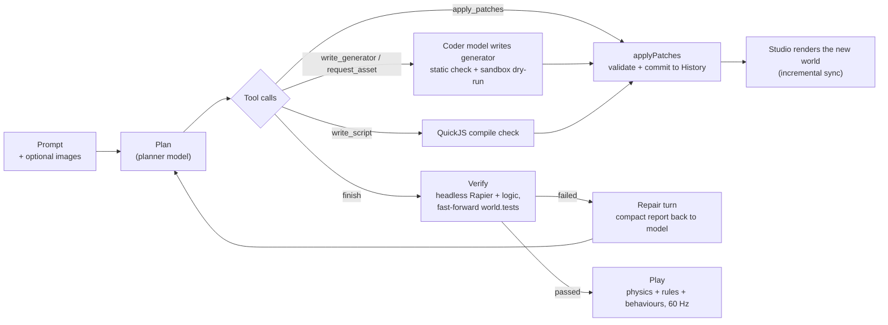
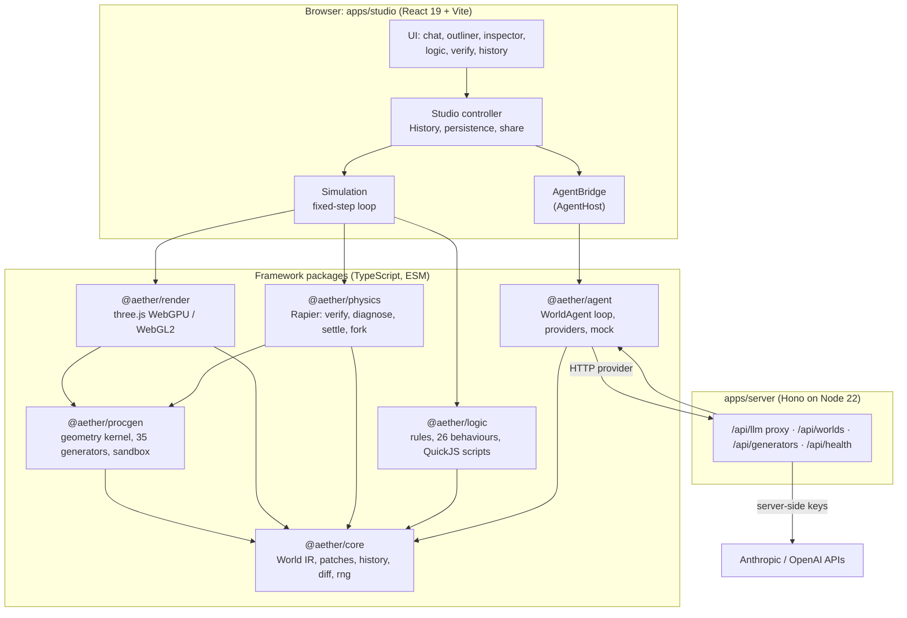

# Aether

> **Speak a world into being — then watch the AI prove it works.**

Aether is an AI-native WebGPU/WebGL2 framework and browser studio. You describe
a world in plain language. Aether turns it into interactive 3D with physics,
gameplay rules and behaviours, then **proves the mechanics work** before you
press Play. It does this by fast-forwarding a headless copy of the physics
simulation and running the world's own tests ("the domino chain topples", "the
player can reach the flag", "the coin counter reaches 10").

Built for the **Victoria VR AI Builder Hackathon 2026**.


| Domino run | Coin island | Bowling alley | Lakeside camp |
| --- | --- | --- | --- |
|  |  |  |  |

| Default world in the editor | Play mode |
| --- | --- |
|  |  |

---

## Contents

- [Why Aether](#why-aether)
- [Features](#features)
- [Quick start](#quick-start)
- [Scripts](#scripts)
- [How a prompt becomes a playable world](#how-a-prompt-becomes-a-playable-world)
- [Architecture](#architecture)
- [Security model](#security-model)
- [Performance](#performance)
- [Testing](#testing)
- [Deployment](#deployment)
- [Hackathon submission notes](#hackathon-submission-notes)
- [Research inspirations](#research-inspirations)
- [Licence, third parties and AI disclosure](#licence-third-parties-and-ai-disclosure)

---

## Why Aether

Most prompt-to-3D tools stop at a pretty scene. The hard part of a *world* is
that things have to **work**: doors swing, dominoes fall, timers count down
and goals can be reached. Aether treats every world as a program with
explicit state, so the AI can be held to account:

1. The LLM **never edits the scene directly**. It emits small, typed
   **patches** against a validated World IR (intermediate representation),
   which keeps every change inspectable, undoable and diffable.
2. Every world can carry **tests**. Aether runs them in a headless
   [Rapier](https://rapier.rs) simulation with the world's rules attached. It
   fast-forwards seconds of gameplay in milliseconds and sends failures
   straight back to the model as a repair turn.
3. Everything the AI writes as code (custom geometry generators, behaviour
   scripts) runs in a **sandbox** with time, memory and size limits.

## Features

- **World IR plus patch-based editing.** One zod-validated JSON document
  ([`packages/core/src/schema.ts`](packages/core/src/schema.ts)) holds
  entities, shapes, materials, physics, joints, lights, behaviours, rules,
  state, HUD, custom generators, scripts and tests. There are 19 patch
  operations (`add`, `update`, `remove`, `rename`, `addRule`,
  `setEnvironment`, `defineGenerator`, `addTest` and so on). Each is
  validated, reference-checked, protected against prototype pollution and
  limit-checked, and errors are written for the LLM to read.
- **Self-verifying physics.** `verify` builds an isolated headless physics
  world from the document, fast-forwards it with gameplay logic attached and
  checks 7 test kinds: `stable`, `noOverlap`, `reaches`, `eventually`,
  `moves`, `topples` and `staysAbove`. Static `diagnose` finds
  interpenetrations, floating objects and broken joints, with concrete fixes
  ("move crate-3 up to y=1.25"). `settle` drops objects and writes their rest
  poses back as patches. `fork()` and `snapshot()`/`restore()` clone a running
  simulation.
- **Procedural generator library.** 35 deterministic built-in generators
  (trees, rocks, houses, towers, bridges, windmills, vehicles, terrain,
  islands, mountains, crystals, portals and more), built on a typed-array
  geometry kernel and seeded simplex noise. Each has variants, parameters,
  several materials and auto-derived colliders. All geometry is procedural,
  so the project ships no third-party 3D assets.
- **AI-written generators, sandboxed.** The coder model can write new
  generators against a small, typed `GeneratorApi`. Their source is checked
  statically, run in a locked-down Web Worker pool with a watchdog, and its
  output is re-validated (NaN checks, vertex caps) on the main thread.
- **Logic: rules, behaviours and scripts.** WHEN/IF/THEN rules (11 triggers,
  17 actions), 26 built-in behaviours (`patrol`, `door`, `collectible`,
  `vehicle`, `npc`, `launcher` and others) and custom per-entity scripts that
  run in **QuickJS compiled to WebAssembly**. Scripts get no host functions,
  exchange JSON only, run on a per-call time budget and have memory and stack
  caps. The whole runtime is deterministic: same seed and inputs give the same
  run.
- **WebGPU with WebGL2 fallback.** three.js r186 `WebGPURenderer`, ACES tone
  mapping, bloom, procedural skies driven by time of day, fog, weather
  particles, soft shadows fitted to the scene, and orbit, follow and
  first-person cameras.
- **Offline mock mode.** With no API key (or when the backend is unreachable),
  a deterministic offline planner builds worlds for 18 themes (dominoes,
  coins, parkour, bowling, castle, city, haunted forest, space, volcano and
  more) and supports edit commands ("add 5 trees", "make the ball bouncy",
  "remove the tent"). Its worlds pass the same physics verification.
- **Undo, branches and time travel.** Every agent or user edit is a history
  commit. You can undo and redo, check out any past state without losing
  later ones, create named branches, export and import JSON, and share links.
- **Studio UI.** Streaming chat with diff chips and verify badges, an 8-prompt
  example gallery, outliner, inspector with a validated JSON editor, rule
  cards, a verification panel with "Fix with AI", a history timeline, a play
  HUD, a performance overlay and a low-power mode.

## Quick start

Requirements: **Node.js 22 or newer** and npm 10 or newer. A GPU browser
(Chrome or Edge for WebGPU; any WebGL2 browser works).

```bash
git clone <this repository> aether && cd aether
npm install

# Optional: live LLM mode. Without keys everything still works in offline mock mode.
cp .env.example .env
#   then set ANTHROPIC_API_KEY=... and/or OPENAI_API_KEY=...

npm run dev:server   # API server on http://localhost:8787 (terminal 1)
npm run dev          # Studio on http://localhost:5173, proxies /api (terminal 2)
```

Open <http://localhost:5173>, pick an example card or type a prompt such as
*"Build a domino run that knocks over a bell tower"* and watch the agent plan,
patch, verify and repair. Press **Play** (WASD to move, Space to jump, Esc to
stop).

**Production build, one process, same origin:**

```bash
npm run build        # builds apps/studio/dist
npm run start        # serves studio + API on http://localhost:8787
```

### Environment

API keys live **only on the server** (`.env` at the repo root, or real
environment variables, which take precedence). The main settings:

| Variable | Purpose |
| --- | --- |
| `ANTHROPIC_API_KEY`, `OPENAI_API_KEY` | Upstream keys (server only). With neither set the server runs in mock mode. |
| `AETHER_PROVIDER` | `anthropic` (default), `openai` or `mock` |
| `AETHER_PLANNER_MODEL`, `AETHER_CODER_MODEL`, `AETHER_CRITIC_MODEL` | Anthropic model per role |
| `AETHER_OPENAI_PLANNER_MODEL`, `AETHER_OPENAI_CODER_MODEL`, `AETHER_OPENAI_CRITIC_MODEL` | OpenAI model per role |
| `PORT`, `HOST`, `NODE_ENV` | Listener; `production` turns on static hosting and HSTS |
| `ALLOWED_ORIGINS` | CORS allowlist (default `http://localhost:5173`) |
| `AETHER_DAILY_TOKEN_BUDGET` | Daily LLM token cap (default 2,000,000) |
| `TRUST_PROXY_HOPS` | Set to `1` behind Fly.io, Render or Railway |

The complete list (rate limits, storage, timeouts, generator validation) is in
[`apps/server/README.md`](apps/server/README.md#configuration).

### Studio URL flags

| Flag | Effect |
| --- | --- |
| `?safe=1` | Boot into the starter world. The last saved world stays one Undo away. This also happens automatically after a crash during start-up. |
| `?reset=1` | Same recovery path as `?safe=1` |
| `?debug=1` | Verbose logging and exposes `window.__aether` (also on in dev builds) |

## Scripts

| Command | What it does |
| --- | --- |
| `npm run dev` | Vite dev server for the studio (port 5173, `/api` proxied to 8787) |
| `npm run dev:server` | API server with `tsx watch` (port 8787) |
| `npm run build` | Production build of the studio into `apps/studio/dist` |
| `npm run start` | Production server: API plus the built studio on one origin |
| `npm run typecheck` | `tsc --noEmit` across every package, app, script and test |
| `npm test` | All Vitest unit and integration tests (capped at 2 workers) |
| `npm run smoke` | Runs the real agent with the offline mock against 13 prompts and re-verifies every world headless |
| `npm run e2e` | Playwright browser test of the built studio on WebGPU and WebGL2 (run `npm run build` first) |

## How a prompt becomes a playable world



1. **Prompt.** Your text, plus optional reference images, goes to the planner
   together with a compact, deterministic text summary of the current world.
   The two are wrapped in explicit tags so the model can tell data from
   instructions.
2. **Plan.** The planner model gets a byte-stable system prompt (about 11k
   tokens, cached by the provider). It covers the World IR, every patch
   operation, the generator and behaviour catalogs, the rule docs, the test
   kinds and worked examples. It replies with a short plan and tool calls.
3. **Patches.** `apply_patches` sends typed operations through
   `applyPatches`, which never throws: each rejected patch comes back with its
   index and an LLM-readable reason. Accepted batches become one undoable
   History commit marked `agent`.
4. **Code where needed.** When no built-in generator fits, the coder model
   writes one. It is checked statically, dry-run in the Worker sandbox and
   retried once with the error. Behaviour scripts are test-compiled in QuickJS.
5. **Verify.** When the model calls `finish` after making edits, Aether runs
   `verify`. It builds an isolated headless physics world, attaches the
   world's rules and behaviours, and steps at a fixed 60 Hz until every test is
   decided, the time horizon is reached or the compute budget runs out.
   Static diagnostics run as well, and any error-level diagnostic (such as
   an interpenetration) fails verification.
6. **Repair.** On failure, a compact report goes back as a new turn ("1/30
   toppled within 10s; not: domino-1…", "crate-3 overlaps table by 0.12m").
   The loop is bounded by `maxRepairs`, `maxTurns` and a tool-call budget.
7. **Play.** Press Play: physics, logic and the player controller run on a
   fixed timestep. Stop restores the document exactly, because nothing that
   happens during play is written back to it.

## Architecture



| Package | Responsibility |
| --- | --- |
| [`@aether/core`](packages/core) | World IR (zod), `applyPatches`, `invertPatches`, `diffWorlds`, `History` with branches, selectors, deterministic rng and hashes, world summaries for LLM context |
| [`@aether/procgen`](packages/procgen) | Typed-array geometry kernel (no three.js), noise, 35 built-in generators, `GeneratorApi`, LRU cache, Worker sandbox (browser) and `node:vm` sandbox (`@aether/procgen/node`, tests and server) |
| [`@aether/physics`](packages/physics) | Rapier 0.21 wrapper: incremental sync, joints, character controller, events, snapshots and forks, `verify`, `diagnose`, `settle` |
| [`@aether/logic`](packages/logic) | Deterministic gameplay runtime: rules engine, 26 behaviours, QuickJS script sandbox, host-agnostic through `LogicHost` |
| [`@aether/render`](packages/render) | `WorldRenderer`: WebGPU/WebGL2, incremental `SceneSync`, instanced scatter, environment, cameras, picking, ghost preview, debug overlays, screenshots |
| [`@aether/agent`](packages/agent) | `WorldAgent` plan → patch → verify → repair loop, tools, system prompt, Anthropic, OpenAI, HTTP and mock providers |
| [`apps/server`](apps/server) | LLM proxy with server-held keys, world share links, generator cache, static hosting, hardening |
| [`apps/studio`](apps/studio) | The editor and player |

The dependency graph has no cycles. `physics`, `logic`, `procgen` and `agent`
never import three.js or the DOM, so they run headless in Node (tests,
server, smoke) as well as in the browser. The full design, covering patch
semantics, history, the verification algorithm, sandbox layers, render sync,
the agent loop and providers, is in
**[docs/ARCHITECTURE.md](docs/ARCHITECTURE.md)**. The public API of each
package is pinned in [docs/CONTRACTS.md](docs/CONTRACTS.md).

## Security model

All LLM output and all user input are treated as untrusted.

- **Keys stay on the server.** The browser talks only to `/api/llm`. The
  server picks the model from an allowlisted role, so clients cannot choose
  arbitrary models. Upstream errors map to fixed codes and secrets are
  scrubbed from logs.
- **Validation at every boundary.** Patches, worlds, tool inputs, imports,
  share links, generator output and script intents are size-, depth- and
  node-capped, screened for `__proto__`, `constructor` and `prototype` keys,
  and then zod-validated.
- **Layered sandboxes for AI-written code:**
  - *Generators* go through a static token screen first. They then run in a
    Web Worker pool with shadowed globals, neutralised constructors, frozen
    intrinsics, no network and a watchdog that terminates runaway workers.
    Output is re-validated on the main thread (shape, NaN, vertex and size
    caps).
  - *Scripts* run in QuickJS/WASM with no host functions. `Date`, `Promise`,
    `Proxy` and `RegExp` are removed, `eval` and `Function` are stubbed, and
    `Math.random` is seeded. Each script gets a 2 ms call budget (disabled
    after repeated overruns), per-script memory and stack limits, and a shared
    heap budget. At most 32 validated intents are accepted per call.
  - *Server-side generator dry-runs* (`node:vm`, which is not a security
    boundary) are **off by default**. When enabled they run in a
    heap-capped `worker_threads` Worker with a terminate watchdog and a
    bounded queue.
- **Server hardening.** CORS allowlist and foreign-origin guard, per-IP token
  buckets, a daily token budget, per-route body limits, an upstream timeout
  with abort on client disconnect, a strict CSP, `nosniff`, COOP,
  `X-Frame-Options: DENY`, HSTS in production, JSON-only errors with no stack
  traces, atomic and capped file storage, and share links with a hashed edit
  token.
- **Model URLs.** These must be same-origin, `blob:`, glTF `data:` or `https`
  on an explicit allowlist, which is empty by default.
- **The UI never renders AI text as HTML.**

## Performance

- **Instancing.** `scatter` shapes (forests, grass, rocks) are drawn with GPU
  instancing and one shared matrix buffer. Device budgets cap them (150k
  instances or 12M triangles by default), and large layers skip shadows.
- **Zero-allocation hot loops.** Physics writes packed
  `[p, q]` transforms into a reused `Float32Array`, which the renderer
  consumes without allocating. Logic reuses per-tick scratch state, and script
  calls are round-robin capped per tick.
- **Incremental sync.** `diffWorlds` has a reference-equality fast path
  (patches share structure, so unchanged entities keep their identity).
  Render and physics rebuild only what changed. A pure move teleports a
  body, and colour-only edits never touch physics.
- **Caching.** Geometry and materials are reference-counted caches keyed by
  stable JSON. Generator output sits in an LRU cache keyed by id, params,
  seed and source hash, with in-flight dedupe.
- **Responsive UI.** Rendering in edit mode happens on demand. Verification
  yields to the browser every 8 ms. Rapier (a multi-MB WASM chunk) loads
  lazily on the first Play or Verify. Stats and HUD updates go to React at
  4 Hz, never every frame.
- **Measured.** 1000 dynamic boxes step in about 2.3 ms on average (8 ms
  budget). 1000 patches apply in about 40 ms. All 35 built-in generators run
  in about 0.4 s in total. A 1000-entity logic tick takes under 2 ms. The
  offline smoke run takes under a second per prompt.

## Testing

| Layer | Command | Coverage |
| --- | --- | --- |
| Unit and integration | `npm test` | About 990 Vitest tests across 55 files: patch semantics and inverses (including seeded random sequences), sandbox escapes, prototype-pollution payloads, physics benchmarks (domino chains topple and fail as expected), logic determinism, provider wire formats against a fake `fetch`, and server hardening. No test makes a network call. |
| Smoke | `npm run smoke` | The real `WorldAgent` with the mock provider runs on 13 prompts, including all 8 gallery examples. Every resulting world is re-validated and re-verified independently. |
| End to end | `npm run build && npm run e2e` | Real Chromium against the production server in mock mode. It boots, checks the canvas is not blank, runs four prompts, plays with keyboard input, stops and checks exact restore, then undo/redo, inspector edit and export. Runs on both WebGPU and forced WebGL2, and any console error fails the run. |
| Types | `npm run typecheck` | Strict TypeScript, zero errors |

Install the browser for e2e once with `npx playwright install chromium`.

## Deployment

The judged demo is one container that serves the API and the built studio
from the same origin:

```bash
docker build -f apps/server/Dockerfile -t aether .
docker run -p 8787:8787 \
  -e ANTHROPIC_API_KEY=... \
  -e AETHER_DAILY_TOKEN_BUDGET=2000000 \
  -v aether-data:/data aether
```

The image is multi-stage on `node:22-slim`, runs as non-root and includes a
`HEALTHCHECK` on `/api/health`. SIGTERM drains requests gracefully. Fly.io,
Render and Railway notes are in
[`apps/server/README.md`](apps/server/README.md#deploying) (set
`TRUST_PROXY_HOPS=1` and mount a volume at `/data`).

**Keeping the demo alive through judging.** The submission deadline is
11 November 2026, 16:30 CEST, and winners are announced on 25 November 2026.
The rules require the demo to stay accessible during judging *and*
publication, so plan for it to stay up well beyond that date:

- Disable scale-to-zero or auto-stop (for example, keep at least one machine
  running on Fly.io) and point an uptime monitor at `/api/health`.
- Keep `AETHER_DAILY_TOKEN_BUDGET` set and the provider account funded. When
  the budget is spent or keys fail, the studio falls back to the offline mock
  automatically, so judges always get a working world.
- Do not redeploy material changes after the deadline without the
  organizer's permission. Tag the submitted commit.

## Hackathon submission notes

- **Suggested focus category:** *AI-generated 3D scenes*. Secondary fit:
  *Browser-native creative tools*. Judges may test prompts outside the chosen
  category. The offline mock covers 18 themes and the live models handle
  free-form prompts.
- **What it does:** turns natural language into interactive 3D worlds
  (scenes plus physics plus gameplay logic) in the browser and verifies the
  mechanics by simulation before play.
- **Problem or opportunity:** prompt-to-3D output is usually static and
  unverifiable. Creators still have to wire up logic by hand and find out by
  playtesting that it is broken. Aether makes the AI write the logic *and* the
  tests, and proves them.
- **How AI is used:** a planner model edits the World IR through typed tool
  calls. A coder model writes procedural generators and behaviour scripts that
  run sandboxed. Verification reports drive a bounded self-repair loop.
- **How users interact:** chat (text, optionally with reference images), an
  example gallery, direct editing in the inspector, outliner and logic panels,
  Play mode with keyboard controls, history with branches, and share links.
- **Technologies:** TypeScript, three.js (WebGPU/WebGL2), Rapier (WASM),
  QuickJS (WASM), React, Zustand, Vite, Hono, zod, Anthropic and OpenAI APIs.
  See [docs/THIRD_PARTY.md](docs/THIRD_PARTY.md).
- **Created during the hackathon:** all code in this repository. The first
  commit is dated 12 October 2026, inside the official build period
  (11 Sep – 11 Nov 2026). No pre-existing project code was reused.

## Research inspirations

These papers shaped the *ideas* behind Aether. No code, models, weights,
datasets or assets were copied from any of them. Everything here is an
original TypeScript implementation.

| Work | What inspired us |
| --- | --- |
| PWM, [arXiv:2609.10540](https://arxiv.org/abs/2609.10540) | Explicit, code-defined world state and rules as the source of truth, separate from rendering. We render it in real time in the browser instead of with a video model. |
| CoDeR, [arXiv:2609.26458](https://arxiv.org/abs/2609.26458) | Agents write executable Three.js code for world rules and dynamics, with diffusion only rendering it. Aether keeps the code-defined world and renders it live instead. This inspired the patch IR and the generators written by the coder model. |
| SceneMosaic, [arXiv:2609.05594](https://arxiv.org/abs/2609.05594) | Generate, then validate and repair with physics stabilisation and a critic/actor loop. We use deterministic code for geometry and support checks and the LLM for semantics. |
| PAT3D, [arXiv:2511.21978](https://arxiv.org/abs/2511.21978) | A simulation-in-the-loop step settles a generated scene under gravity and removes intersections. This became `settle`. |
| SceneSmith, [arXiv:2602.09153](https://arxiv.org/abs/2602.09153) | Designer, critic and orchestrator agents build scenes in stages and estimate physical properties, keeping collisions low. This shaped the agent's plan, verify and repair loop. |
| Articraft, [arXiv:2605.15187](https://arxiv.org/abs/2605.15187) | An LLM writes code against a parts-and-joints SDK, and a test harness feeds results back in an edit-execute-repair loop. This shaped the joint spec (doors, wheels, drawbridges) and the generator repair loop. |
| ESG, [arXiv:2609.15392](https://arxiv.org/abs/2609.15392) | An LLM writes a machine-checkable scene graph with physical properties and a timeline of events, which simulation then makes happen on schedule. This inspired world tests such as `eventually` and `topples`. |
| WorldBench, [arXiv:2610.10622](https://arxiv.org/abs/2610.10622) | Grades LLM-written Three.js worlds by running them, and finds that judges reading only the code miss missing features. This led to "physics as unit tests": Aether runs every world headless before calling it done. |
| 3DCodeBench, [arXiv:2606.01057](https://arxiv.org/abs/2606.01057) | Finds that most failures in LLM-written 3D code are API mismatches and floating parts. This informed the small, typed `GeneratorApi` and the base-at-ground convention. |

## Licence, third parties and AI disclosure

- **Licence:** [MIT](LICENSE), © 2026 Aether contributors.
- **Third-party components:** every runtime and development dependency, with
  its exact version and licence, is listed in
  **[docs/THIRD_PARTY.md](docs/THIRD_PARTY.md)**. Everything shipped to users
  is permissively licensed (MIT or Apache-2.0).
- **Assets:** there are no third-party 3D models, textures, fonts, images or
  audio. Geometry is generated procedurally, sounds are synthesised with
  WebAudio oscillators, and the UI uses the system font stack. The screenshots
  in `docs/screenshots` were captured from this app.
- **AI disclosure:** this codebase was written with AI coding assistants
  (Claude Code and Codex) under human direction and review. At runtime the app
  calls Anthropic Claude and/or OpenAI models through the server proxy.
  AI-generated 3D content is produced at runtime *as code* (procedural
  generators and scripts) and runs sandboxed. Details are in
  [docs/THIRD_PARTY.md](docs/THIRD_PARTY.md#ai-disclosure).
