# Aether

> **Speak a world into being — then watch the AI prove it works.**

Aether is an AI-native WebGPU/WebGL2 framework and browser studio. You describe
a world in plain language. Aether turns it into interactive 3D with physics,
gameplay rules and behaviours, then **proves the mechanics work** before you
press Play. It does this by fast-forwarding a headless copy of the physics
simulation and running the world's own tests ("the domino chain topples", "the
player can reach the flag", "the coin counter reaches 10").

**Run it on your computer with one command** (Node.js 22+):

```bash
git clone https://github.com/StarAtNyte/aether && cd aether && npm ci && npx aether start --open
```

It builds the studio, starts Aether in the background and prints a local link
(`http://127.0.0.1:4280`). On first open, sign in with your **own** ChatGPT
account (Codex), use Claude Code if it is signed in, or continue offline.
`npx aether stop` stops it. The hosted copy of the studio works in any browser
with your own API key, with your own Codex login through that same command
(`npx aether start --origin <hosted address>`), or offline.

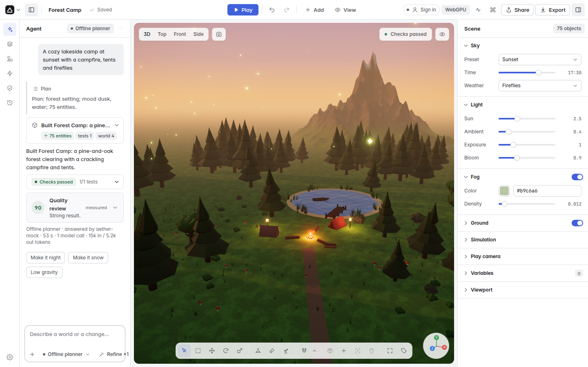

| Domino run | Coin island | Bowling alley | Lakeside camp |
| --- | --- | --- | --- |
| 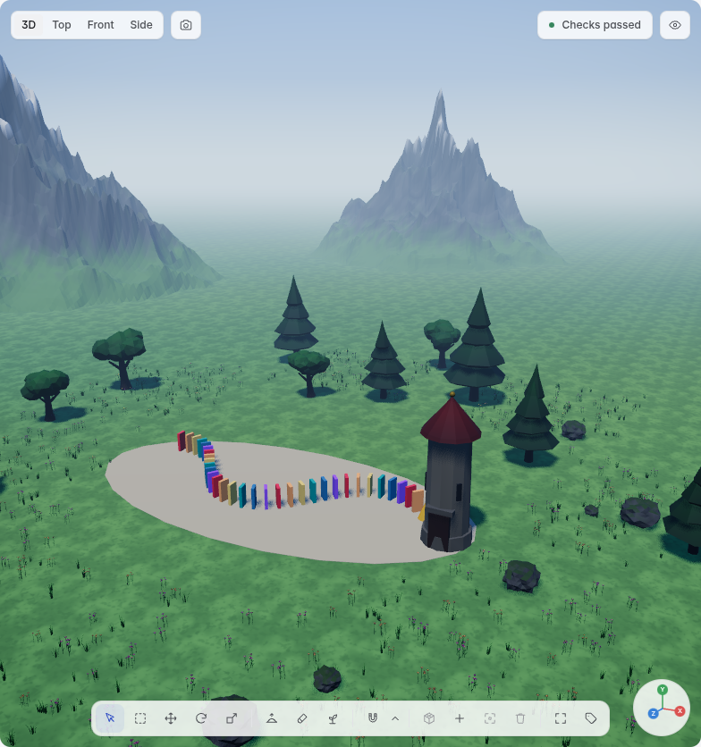 | 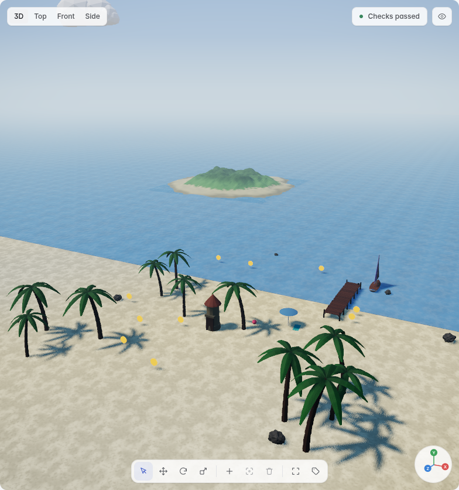 | 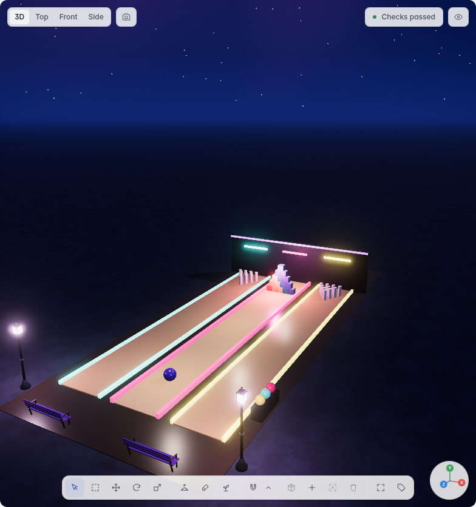 | 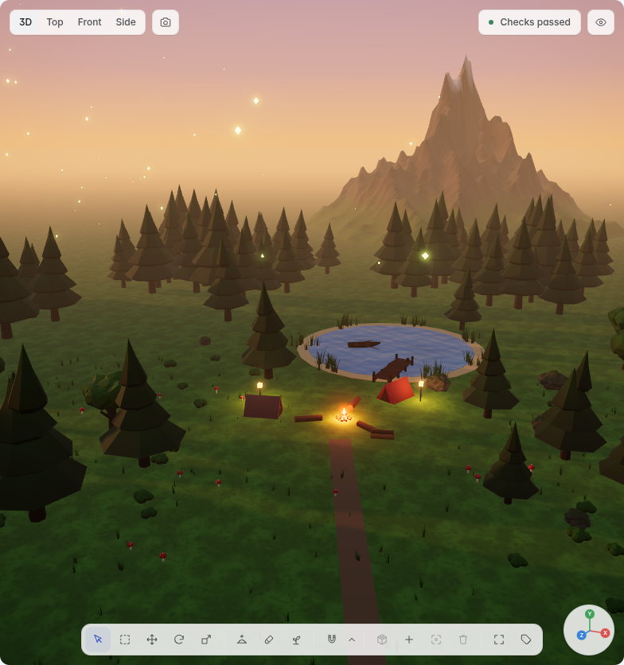 |

| Apartment, studio render (cutaway) | Living room close-up | Villa, exploded storeys | Floor plan with room areas |
| --- | --- | --- | --- |
| 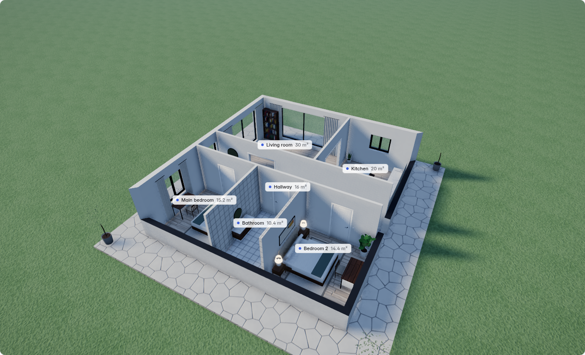 | 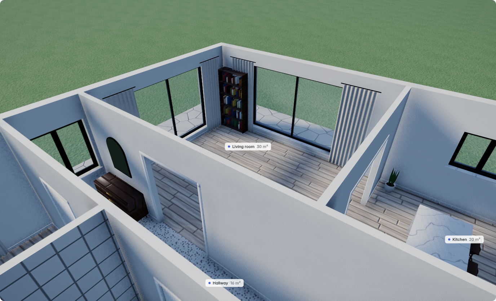 | 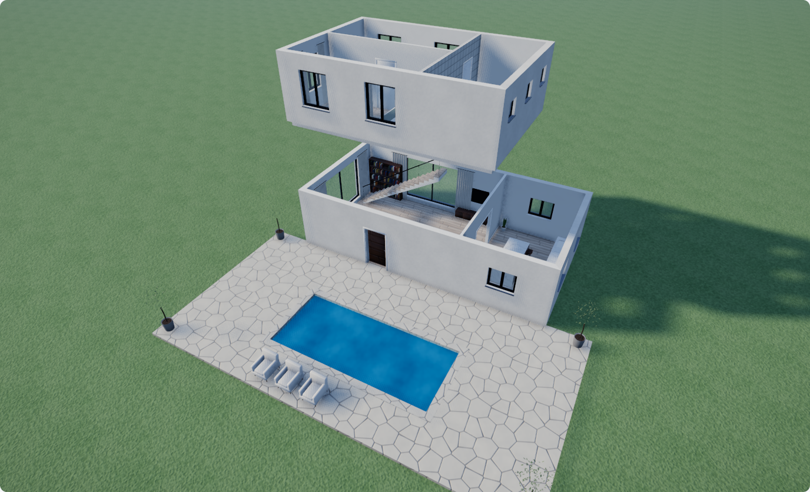 | 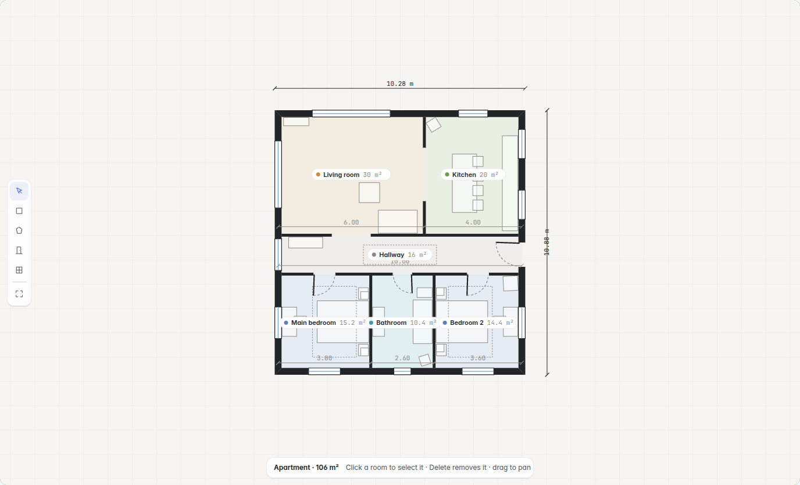 |

| Villa living room (one storey shown) | Café | Living room with a fireplace, at night | Villa, section cut |
| --- | --- | --- | --- |
| 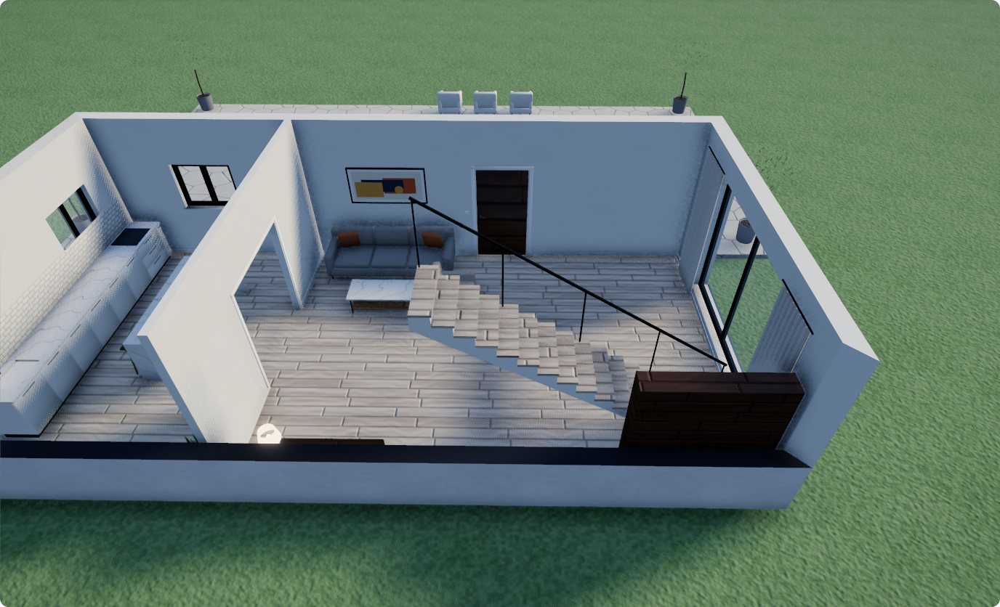 | 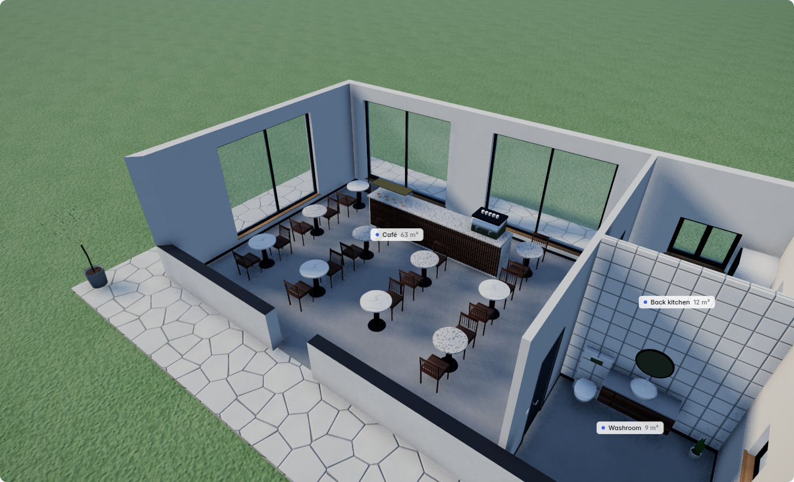 | 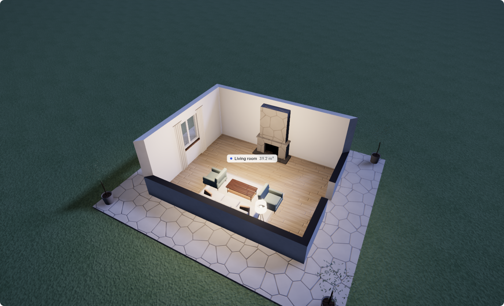 | 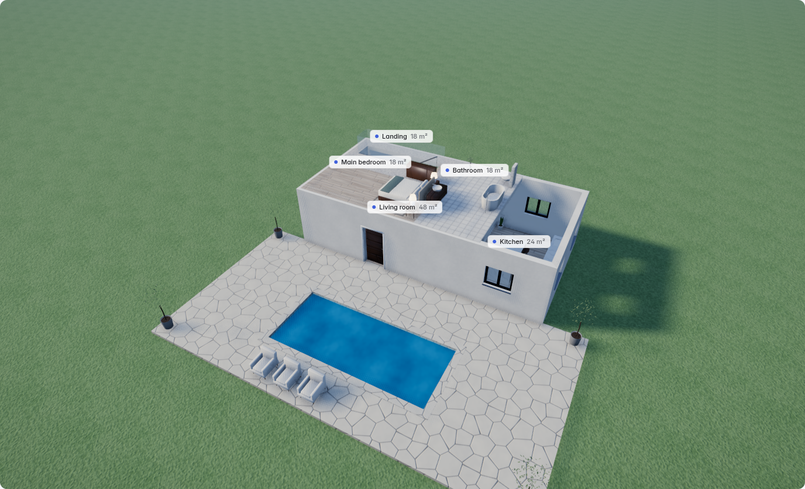 |

| Projects home | Starter scene in the editor | Play mode | Phone |
| --- | --- | --- | --- |
| 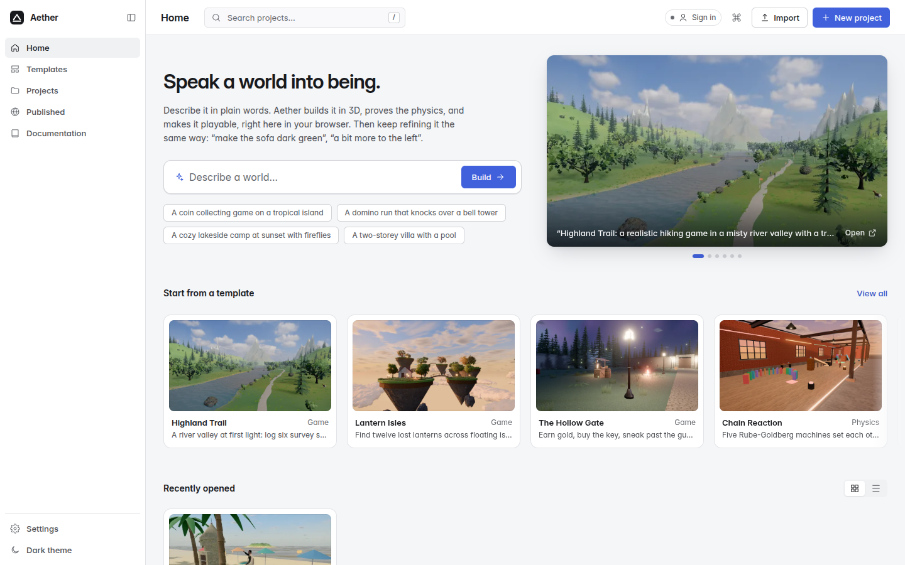 | 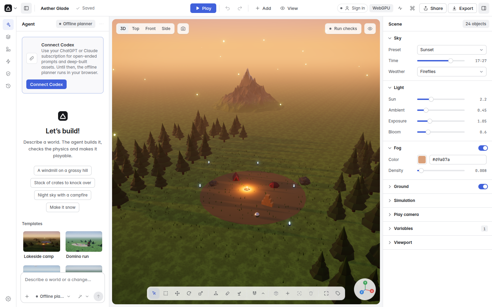 | 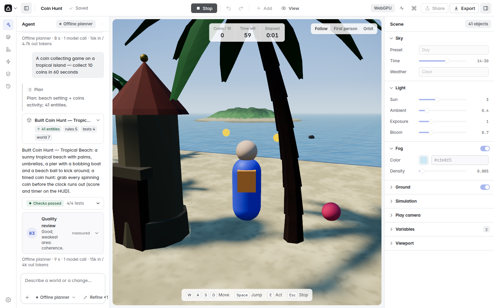 | 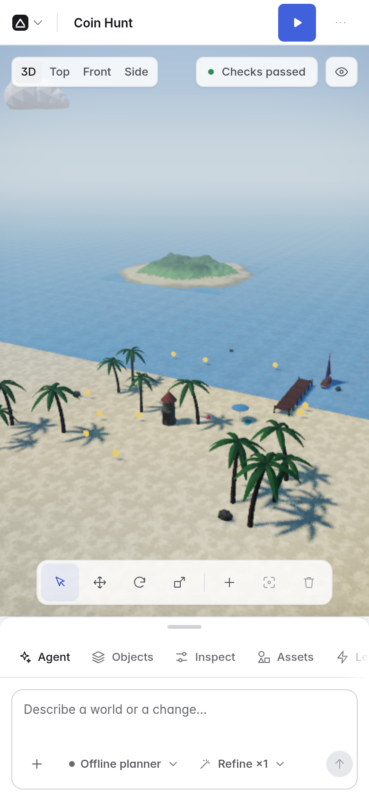 |

---

## Contents

- [Why Aether](#why-aether)
- [Features](#features)
- [Quick start](#quick-start)
- [Scripts](#scripts)
- [How a prompt becomes a playable world](#how-a-prompt-becomes-a-playable-world)
- [Architecture](#architecture)
- [Security model](#security-model)
- [Performance](#performance)
- [Testing](#testing)
- [Deployment](#deployment)
- [Research inspirations](#research-inspirations)
- [Licence, third parties and AI disclosure](#licence-third-parties-and-ai-disclosure)

---

## Why Aether

Most prompt-to-3D tools stop at a pretty scene. The hard part of a *world* is
that things have to **work**: doors swing, dominoes fall, timers count down
and goals can be reached. Aether treats every world as a program with
explicit state, so the AI can be held to account:

1. The LLM **never edits the scene directly**. It emits small, typed
   **patches** against a validated World IR (intermediate representation),
   which keeps every change inspectable, undoable and diffable.
2. Every world can carry **tests**. Aether runs them in a headless
   [Rapier](https://rapier.rs) simulation with the world's rules attached. It
   fast-forwards seconds of gameplay in milliseconds and sends failures
   straight back to the model as a repair turn.
3. Everything the AI writes as code (custom geometry generators, behaviour
   scripts) runs in a **sandbox** with time, memory and size limits.

## Features

- **World IR plus patch-based editing.** One zod-validated JSON document
  ([`packages/core/src/schema.ts`](packages/core/src/schema.ts)) holds
  entities, shapes, materials, physics, joints, lights, behaviours, rules,
  state, HUD, custom generators, scripts and tests. There are 19 patch
  operations (`add`, `update`, `remove`, `rename`, `addRule`,
  `setEnvironment`, `defineGenerator`, `addTest` and so on). Each is
  validated, reference-checked, protected against prototype pollution and
  limit-checked, and errors are written for the LLM to read.
- **A real asset library, an AI forge and your own files.** 364 curated
  assets ([docs/ASSETS.md](docs/ASSETS.md)): CC0 models from Kenney and
  Poly Haven (furniture, kitchens, bathrooms, plants, trees, rocks, city
  buildings, road tiles, street props, vehicles, food, tools), 41 animated
  people and animals that walk, run and idle from their actual movement,
  five photographic HDR skies, and eight AI-forged originals. Everything is
  real-world sized, meshopt-compressed with LODs and physics colliders, and
  searchable with synonyms ("couch" finds the sofa). Drag a tile into the
  viewport and it lands on the floor under the cursor, against a wall or
  under a ceiling, with a live preview. The agent searches the library
  (`search_assets`), the offline planner dresses streets and rooms with it,
  and furnished buildings get photographed furniture that suits their style.
  **Create from an image or text**: a connected model rebuilds the object as
  an editable parametric generator, renders it from four sides, critiques it
  against your photo and patches its own code until it matches — every pass
  is shown live. Import your own GLB / glTF models, images (framed posters)
  and HDR skies (validated, stored in the browser), export a world as a
  `.zip` package with every file it uses, and every source is credited in
  the credits panel, on the end-of-game screen and in `CREDITS.txt`.
- **Real-life architecture, verified.** Ask for "a modern two-bedroom
  apartment", "a small café interior", "a two-storey villa with a pool" or
  "an office floor with meeting rooms" and the agent writes a building plan
  (`@aether/arch`): rooms on storeys, doors, windows, stairs, a roof, a site.
  It compiles into mitred walls with real openings (no CSG), floors,
  ceilings, swinging and sliding doors, framed windows, stairs, roofs and a
  procedural furniture kit with realistic proportions in five styles, lit by
  real lamps. Then it is **checked like a building inspector would**: every
  room reachable on foot through a 5 cm navigation grid, every door swing
  free, all furniture standing on the floor without overlaps. The building
  bar gives a doll's-house cutaway, walls down, exploded and single storeys,
  x-ray, a section cut, a daylight study and a **studio render** (ambient
  occlusion, soft shadows, temporal anti-aliasing that refines while the view
  rests). The 2D floor plan shows rooms with their areas and dimensions, and
  you can draw rooms, doors and windows on it. Press Walk for a first-person
  walkthrough: E opens doors and flips light switches, 1–4 change the time of
  day, L switches every light, R swaps finishes, P is photo mode.
- **Block worlds with a full game kit.** Ask for "a minecraft-like
  survival world" or "a village of block houses" and the world gets endless,
  seeded voxel terrain (`@aether/voxel`): biomes, caves, ores, trees, water
  and lava, palette-compressed 16 × 16 × 128 chunks, greedy meshing with
  ambient occlusion and smooth sky/torch light, generated and meshed in up to
  two Web Workers and streamed around the player. The agent builds with
  block edits (boxes, spheres, stairs, castles, houses, towers, bridges,
  pixel art, block letters) anchored to the generated ground. Press Play for
  a first-person survival game: break and place blocks, a hotbar and
  inventory, crafting, tools, health and hunger, fall/lava/drowning damage,
  a day/night cycle, animals by day and zombies and spiders at night,
  synthesized sounds, and saves that persist in the browser (export and
  import as files). On phones and tablets: a stick to move, drag to look,
  tap to place, touch and hold to break. The camera frames what was built
  from the side where no hill hides it. Same look and parity on WebGPU and
  WebGL2.
- **Self-verifying physics.** `verify` builds an isolated headless physics
  world from the document, fast-forwards it with gameplay logic attached and
  checks 7 test kinds: `stable`, `noOverlap`, `reaches`, `eventually`,
  `moves`, `topples` and `staysAbove`. Static `diagnose` finds
  interpenetrations, floating objects and broken joints, with concrete fixes
  ("move crate-3 up to y=1.25"). `settle` drops objects and writes their rest
  poses back as patches. `fork()` and `snapshot()`/`restore()` clone a running
  simulation. Verification runs in background workers, and worlds with
  several tests are verified as parallel forks: the checks panel fills in
  test by test ("12 s of physics in 340 ms · 2 parallel workers") while the
  viewport stays fully interactive.
- **Procedural generator library.** 36 deterministic built-in generators
  (trees, rocks, houses, towers, bridges, windmills, vehicles, terrain and canyons,
  islands, mountains, crystals, portals, high-detail colossal sculptures and more), built on a typed-array
  geometry kernel and seeded simplex noise. Each has variants, parameters,
  several materials and auto-derived colliders. All geometry is procedural,
  so the project ships no third-party 3D assets.
- **AI-written generators, sandboxed.** The coder model can write new
  generators against a small, typed `GeneratorApi`. Their source is checked
  statically, run in a locked-down Web Worker pool with a watchdog, and its
  output is re-validated (NaN checks, vertex caps) on the main thread.
- **Logic: rules, behaviours and scripts.** WHEN/IF/THEN rules (11 triggers,
  17 actions), 26 built-in behaviours (`patrol`, `door`, `collectible`,
  `vehicle`, `npc`, `launcher` and others) and custom per-entity scripts that
  run in **QuickJS compiled to WebAssembly**. Scripts get no host functions,
  exchange JSON only, run on a per-call time budget and have memory and stack
  caps. The whole runtime is deterministic: same seed and inputs give the same
  run.
- **Hundreds of millions of triangles, drawn by the screen, not the scene.**
  Two engines inside the renderer, both pure CPU planning plus ordinary
  draws, so WebGPU, WebGL2 and Firefox behave identically:
  *virtual geometry* (Nanite-style) splits every part with 20k+ triangles
  into 128-triangle clusters, builds a cluster LOD hierarchy with our own
  quadric-error simplifier in a worker, and draws a crack-free,
  view-dependent cut per instance (frustum and normal-cone culled);
  *scatter fields* turn any layer of 2 000+ instances (up to a million per
  layer) into spatial chunks with automatic LOD meshes, culled per chunk and
  spent against a per-GPU triangle budget, far chunks first. The built-in
  showcase — "a canyon with a million trees and ancient statues", also a
  template — holds 236 M triangles and draws about 1.5 M (≈ 157× fewer),
  at the same median frame time (33 ms in Firefox on an integrated GPU) as
  the full-detail renderer needs for a tenth of that forest; the viewport shows both
  numbers, and the camera button flies through any world. Vegetation fields sway in a procedural wind, and the post
  pass applies a colour grade derived from the sky (split tone, saturation,
  contrast). Research notes and numbers: [`docs/RESEARCH_LOG.md`](docs/RESEARCH_LOG.md),
  [`experiments/`](experiments).
- **WebGPU with WebGL2 fallback.** three.js r186 `WebGPURenderer`, ACES tone
  mapping, bloom and a soft vignette, weather particles, soft shadows fitted
  to the content, and orbit, follow (it steps in front of obstacles) and
  first-person cameras. Firefox uses WebGL2 by default (WebGPU only on
  known-good GPUs) and gets the same look. The renderer can be forced to
  either backend in Settings.
- **Art-directed by policy, whatever the model writes.** Seven distinct sky
  presets (day, dawn, sunset, night, overcast, space, studio). Each one aims
  the sun to rake across the default view, and nights get a moon rim light, a
  starfield and a galactic band. Fog scales with the size of the world:
  content stays crisp and distant mountains stay atmospheric. Auto-framing
  composes an elevated three-quarter shot of the meaningful content with sky
  in frame. Lava and water get procedural glowing cracks and ripples, and new
  worlds *materialize*, growing out of the ground in a ripple from the centre.
- **Codex or Claude Code on this computer.** Run Aether locally and it uses
  the Codex or Claude Code login you already have, with no bridge to pair:
  sign in from Settings ("Sign in with ChatGPT" / "Sign in to Claude"), add
  and switch between several Codex accounts, and pick model and effort.
  **Deep build** (on by default) hands each new asset to a coding agent that
  writes the generator in a private scratch folder, renders and checks it,
  and fixes what the checker finds, with live progress in the chat; Aether
  validates the final result again before using it. Conversations continue
  per project, and each turn shows the models that answered and its token
  usage. Hosted copies never use this.
- **AI connections that cost nothing per prompt.** Settings → AI connection
  (and the model picker under the prompt) offers: the **offline planner**
  (always available); the **local Aether Bridge**, which runs the
  Codex or Claude Code CLI you are already signed in to (ChatGPT or Claude
  subscription, no API key) with every tool disabled; **on-device AI** with
  WebLLM (experimental, opt-in download, WebGPU); and an optional
  **bring-your-own API key** (Anthropic, OpenAI, OpenRouter or Google
  Gemini) that the browser sends straight to that provider, never to
  Aether's server; it stays in the tab unless you tick "remember on this
  device", and a per-session call cap with a token estimate guards it. Pick
  the model, reasoning effort and the number of quality refinement rounds per
  project; a status badge shows connected / not signed in / bridge offline,
  and any failure falls back to the offline planner with a visible notice.
- **3D quality loop.** After every build the world is scored against a
  written rubric (composition, materials, lighting, scale, detail, coherence
  with the prompt, physical validity) from four rendered views plus scene
  heuristics, critiqued by a vision model when one is connected, and improved
  in targeted rounds while it is below the threshold. The score and its
  breakdown appear quietly in the chat.
- **Offline planner and generator library.** With no AI connection (or when
  it is unreachable) a deterministic planner builds worlds for 18 themes
  (dominoes, coins, parkour, bowling, castle, city, haunted forest, space,
  volcano and more), supports edit commands ("add 5 trees", "make the ball
  bouncy", "remove the tent") and places any of 40+ library objects by name
  (lighthouse, pagoda, piano, ferris wheel, steam locomotive, hot air
  balloon…): procedural generators written ahead of time by a coding model,
  validated, and loaded on demand. Its worlds pass the same physics
  verification.
- **Undo, branches and time travel.** Every agent or user edit is a history
  commit. You can undo and redo, check out any past state without losing
  later ones, create named branches, export and import JSON, and share links.
- **Projects home.** Every world is a project saved in the browser
  (IndexedDB, validated on load, quota-aware), with rendered thumbnails,
  "Recently opened" (grid or list), search, sort, rename, duplicate, delete
  with Undo, `.aether.json` export and drag-and-drop import. New projects
  start from a prompt, an empty or starter scene, or one of 8 templates with
  real rendered previews.
- **Editor.** A quiet, professional layout: icon rail (Agent, Objects,
  Assets, Logic, Checks, History) and panel on the left, the viewport in the
  middle, a sectioned inspector on the right (scene settings when nothing is
  selected: sky, time of day, light, fog, ground, gravity, play camera,
  variables). The agent streams plans, diff chips and check results; the
  composer takes reference images. Assets places ready-made objects (rendered
  preview tiles) and materials by click or drag. The viewport has camera
  presets, a tool dock, an axis gizmo, optional object labels and a
  performance overlay (off by default).
- **Full editing, not just a viewer.** Click, shift-click and marquee
  selection in sync with the outliner; move / rotate / scale gizmos (W/E/R)
  in local or world space with pivot choice, numeric input and grid, angle,
  surface and vertex snapping; align and distribute; duplicate, copy/paste
  across projects, group, reparent by drag, hide and lock. Procedural objects
  expose their parameters as live sliders (regenerated in a worker), seed
  re-roll and scatter density, and can be baked to an editable mesh.
  Mesh edit mode (Tab) works on vertices, edges and faces with soft
  selection, extrude, inset, subdivide, smooth, merge by distance, normal
  fixes and UV unwrap, and colliders follow the mesh. Sculpt and paint
  brushes (raise, lower, smooth, flatten, noise, vertex colour, scatter paint
  with erase) have size, strength, falloff and pen pressure, with one undo
  step per stroke. A material editor with eyedropper, visual WHEN/IF/THEN
  rule cards, behaviour and physics forms (joints are drawn in the
  viewport) and editable checks with "Run checks" complete the set. The
  agent sees your hand edits and never touches locked objects. A command palette (Ctrl/⌘+K)
  searches actions, objects, assets, templates and projects; every control
  has a tooltip with its shortcut. Light theme by default (follows the system
  on first visit), dark theme one click away.
- **Responsive.** Three columns on wide screens with resizable, balanced
  side panels; one panel at a time on laptops; slide-over drawers on
  tablets; on phones the viewport sits above a bottom sheet (drag handle,
  tabs, prompt always visible) and play mode shows a touch stick with jump
  and act buttons. An automated layout test checks 8 sizes in Chromium and
  Firefox for overflow, clipped controls, unellipsized text and overlapping
  overlays.

## Quick start

Requirements: **Node.js 22 or newer** and npm 10 or newer. A GPU browser
(Chrome or Edge for WebGPU; any WebGL2 browser works).

```bash
git clone https://github.com/StarAtNyte/aether && cd aether
npm ci
npx aether start --open      # or: npm run aether -- start --open
```

No API key is needed: everything works with the offline planner, and signing
in uses your own Codex / Claude Code login.

### The `aether` command

| Command | What it does |
| --- | --- |
| `aether start` (default) | Builds the studio if it is missing or older than its sources, starts the server **detached** (it survives closing the terminal), waits until it answers and prints `http://127.0.0.1:<port>` (4280, or the next free port). Running it again just prints the link. `--open` opens the browser, `--port N`, `--no-build`, `--rebuild`, `--foreground` |
| `aether stop` | Graceful shutdown (then the process group is ended if needed) |
| `aether status [--json]` | Running or not, link, pid, uptime |
| `aether logs [-f] [-n N]` | The server log (rotated at 5 MiB); `-f` follows it |
| `aether login [--device-auth]` | Runs `codex login` for **your own** ChatGPT account; says so if you are already signed in. `--claude` signs in to Claude Code |
| `aether logout [--claude]` | Signs out |
| `aether doctor` | Checks Node, dependencies, the build, the state folder, disk space, the port, and whether Codex / Claude Code are installed and signed in |
| `aether start --origin https://<hosted studio>` / `aether pair` | Also acts as the bridge for a hosted copy of the studio and prints a pairing code + one-click link |

State (pid, port, per-install secret, logs, local data) lives in
`$XDG_STATE_HOME/aether` or `~/.local/state/aether` (`%LOCALAPPDATA%\Aether`
on Windows); `--state-dir` or `AETHER_STATE_DIR` override it. The server binds
127.0.0.1 only; `--host 0.0.0.0` is refused unless `--allow-lan` is added,
which prints a warning and requires an access token (in the printed link). It
works the same on Linux, macOS and Windows. See
[docs/SECURITY.md](docs/SECURITY.md) for the local hardening (Host and Origin
allowlists against DNS rebinding, HttpOnly session cookie, process-group
cancellation).

**Developing Aether itself** (hot reload):

```bash
npm run dev:server   # API server on http://localhost:8787 (terminal 1)
npm run dev          # Studio on http://localhost:5173, proxies /api (terminal 2)
```

### Use your Codex or Claude Code subscription (no API key)

```bash
npx aether start --origin https://your-hosted-studio   # app + bridge, one command, background
npx aether pair                                        # a fresh pairing code / link later
# or, standalone in a terminal:
npm run bridge       # Aether Bridge on http://127.0.0.1:8790
```

The bridge prints a pairing code and a one-click link. On a first visit the
hosted studio leads with **Use your own Codex / ChatGPT login**: enter the
code there (or open the link), sign in with a device code if Codex is not
signed in yet, and pick the model. Later, **Settings → AI connection → Local
bridge** has the same controls, and the composer picks **Codex** or
**Claude Code**, a model and the reasoning effort. Requirements: the `codex` CLI signed in with
`codex login` (ChatGPT), and/or the `claude` CLI signed in. The bridge listens
on 127.0.0.1 only, accepts only paired, allowlisted studio origins (`--origin
https://your-host` adds a hosted studio), and runs each request in an empty
temporary folder with all tools, shell, file and network access disabled.

From a hosted (https) copy of the studio, Chrome, Edge and Firefox can reach
the bridge (Chrome may first ask to allow access to your local network).
Safari and iOS browsers block https pages from calling local services, so
there open the local link that `aether start` prints instead.

**Running Aether locally?** You do not need the bridge: with `aether start`
(or `npm run dev:server`) on your own computer the studio finds Codex and Claude Code
automatically (Settings → AI connection → *Codex or Claude Code on this
computer*, or the **Connect Codex** card in the agent panel), runs them in
worker processes and offers deep builds. `AETHER_LOCAL_AI=off` disables it;
it is always off in production builds on hosting platforms and in the Docker
image.

To let the **server** answer `/api/llm` with a signed-in CLI instead, start
it with `AETHER_PROVIDER=codex` or `AETHER_PROVIDER=claude-code`.

Open <http://localhost:5173>, pick an example card or type a prompt such as
*"Build a domino run that knocks over a bell tower"* and watch the agent plan,
patch, verify and repair. Press **Play** (WASD to move, Space to jump, Esc to
stop).

**Production build, one process, same origin:**

```bash
npm run build        # builds apps/studio/dist
npm run start        # serves studio + API on http://localhost:8787
```

### Environment

Configuration lives in `.env` at the repo root (copy `.env.example`), or real
environment variables, which take precedence. Paid API keys are optional;
the hosted server never needs or uses one by default. The main settings:

| Variable | Purpose |
| --- | --- |
| `AETHER_PROVIDER` | `mock` (default: offline planner), `codex` / `claude-code` (signed-in CLI on this machine), `anthropic` or `openai` (needs a key) |
| `ANTHROPIC_API_KEY`, `OPENAI_API_KEY` | Optional upstream keys (server only), used only when `AETHER_PROVIDER` names that provider |
| `AETHER_LOCAL_AI` | `auto` (default): Codex / Claude Code of this computer under `/api/local/*` for a non-production server without hosting markers; `on` forces it (refused on hosting platforms), `off` disables it |
| `AETHER_PLANNER_MODEL`, `AETHER_CODER_MODEL`, `AETHER_CRITIC_MODEL` | Anthropic model per role |
| `AETHER_OPENAI_PLANNER_MODEL`, `AETHER_OPENAI_CODER_MODEL`, `AETHER_OPENAI_CRITIC_MODEL` | OpenAI model per role |
| `PORT`, `HOST`, `NODE_ENV` | Listener; `production` turns on static hosting and HSTS |
| `ALLOWED_ORIGINS` | CORS allowlist (default `http://localhost:5173`) |
| `AETHER_DAILY_TOKEN_BUDGET` | Daily LLM token cap (default 2,000,000) |
| `TRUST_PROXY_HOPS` | Set to `1` behind Fly.io, Render or Railway |

The complete list (rate limits, storage, timeouts, generator validation) is in
[`apps/server/README.md`](apps/server/README.md#configuration).

### Studio URL flags

| Flag | Effect |
| --- | --- |
| `?safe=1` | Boot into the starter world. The last saved world stays one Undo away. This also happens automatically after a crash during start-up. |
| `?reset=1` | Same recovery path as `?safe=1` |
| `?debug=1` | Verbose logging and exposes `window.__aether` (also on in dev builds) |
| `?engine=classic` | Turn scatter fields and virtual geometry off (every layer and sculpture drawn at full detail; for comparisons) |

Routes are hash based (they work on any static host): `#/` home, `#/templates`,
`#/projects`, `#/docs`, `#/p/<id>` the editor for a project, `#/new` a new
project from the starter scene and `#/new/<template>` a new project from a
template (for example `#/new/coin-island`).

## Scripts

| Command | What it does |
| --- | --- |
| `npm run dev` | Vite dev server for the studio (port 5173, `/api` proxied to 8787) |
| `npm run dev:server` | API server with `tsx watch` (port 8787) |
| `npm run build` | Production build of the studio into `apps/studio/dist` |
| `npx aether start` / `npm run aether -- <command>` | The local app: see [The `aether` command](#the-aether-command) |
| `npm run start` | Production server in the foreground: API plus the built studio on one origin |
| `npm run typecheck` | `tsc --noEmit` across every package, app, script and test |
| `npm test` | All Vitest unit and integration tests (capped at 2 workers) |
| `npm run smoke` | Runs the real agent with the offline planner against 25 prompts and re-verifies every world headless (block worlds: their edits compile and the spawn area meshes) |
| `npm run e2e:cli` | `aether start` on a temp state folder with fake Codex / Claude CLIs, first-run screen + offline world in Chromium and Firefox, a device sign-in that completes (account + model picker), `aether login` / `doctor` / `logout`, `aether stop` |
| `npm run e2e` | Playwright browser test of the built studio: Chromium on WebGPU and WebGL2, then Firefox on WebGL2 (run `npm run build` first) |
| `npm run e2e:benchmark` | The showcase world in Chromium (WebGPU, WebGL2) and Firefox: scene vs drawn triangles, frame-time percentiles and long tasks while the camera orbits (`-- --classic` for the full-detail engine, `--only=chromium-gpu` for the hardware GPU, `--profile=<file>` for a CPU profile) |
| `npm run e2e:arch` | Real-life architecture in Chromium (WebGPU, WebGL2) and Firefox: apartment prompt → cutaway, walls down, x-ray, section, daylight, studio render, GPU objects flat over 20 view cycles → floor plan (draw a room, add a door, undo) → walkthrough through the front door, night, lights, photo mode |
| `npm run e2e:voxel` | Block worlds in Chromium (WebGPU, WebGL2) and Firefox: prompt → streamed terrain without long tasks, edit → remesh latency, walk, break, place, craft, bounded memory while travelling, save and reload |
| `npm run e2e:memory` | Memory regression run in Chromium and Firefox: budgets on the starter world, no growth over 20 agent runs and 20 play/stop cycles, automatic low memory mode, context-loss recovery (`AETHER_MEM_IDLE_S=120` for a 2-minute idle soak) |
| `npm run e2e:layout` | Layout test at 8 sizes (desktop to landscape phone) in Chromium then Firefox: fails on overflow, clipped controls, text overflow without ellipsis or overlapping viewport overlays |
| `npm run e2e:projects` | Projects home end to end in Chromium then Firefox: templates, autosave and thumbnails, rename / duplicate / delete + undo, export / import, search and sort, persistence, command palette, legacy migration, phone layout |
| `npm run thumbnails` | Renders the template thumbnails (`public/templates/*.webp`, ≤ 30 KB) and asset previews (`public/palette/*.webp`) with the real renderer |
| `npm run bridge` | Starts the local Aether Bridge (Codex / Claude Code through your own sign-in); `-- --origin https://host` allows a hosted studio |
| `npm run eval` | Agent evaluation: patch error rate, verification pass rate, latency and quality score per prompt (`-- --provider=codex --effort=low --limit=3`, `--provider=claude-code --model=haiku`) |
| `npm run library` | Rebuilds the offline generator library with Codex (sequential, call budget, resumable; `-- --only=piano`) |
| `npm run e2e:bridge` | Real end-to-end check through the bridge: one prompt via Codex and one via Claude Code from the built studio (uses your subscription) |
| `npm run e2e:connection` | AI connection check at no cost: the real bridge HTTP layer with scripted backends, in Chromium and Firefox (pairing, badges, a bridged turn with the vision critic, CORS preflight, and fallback when not signed in, rate limited or the bridge stops) |
| `npm run assets:fetch` | Downloads and verifies the curated CC0 sources listed in `assets/sources.json` into `~/.cache/aether-asset-src` (sequential, checksums, licence checks) |
| `npm run assets:build` | Builds the asset library into `assets/lib/` + `assets/catalog.json` + `assets/manifest.json` (normalise, merge, LOD, meshopt, colliders) |
| `npm run assets:thumbs` | Renders library thumbnails in one headless Chromium (`-- --force`, `-- --only id1,id2`) |
| `npm run e2e:assets` | Asset pipeline in Chromium (WebGPU, WebGL2) and Firefox: library search with thumbnails, drag a sofa onto the floor (model + collider), HDR sky, GLB / PNG imports (junk refused), package export with models and CREDITS.txt, GPU objects flat over 20 place / undo cycles |
| `npm run gallery` | Renders every smoke prompt in headless Chromium to `docs/screenshots/gallery/` for visual review (`-- --skies`: the starter world under each sky preset; `-- --arch`: each building as an archviz set — studio overview, room close-up, night, exploded, section, floor plan) |

## How a prompt becomes a playable world

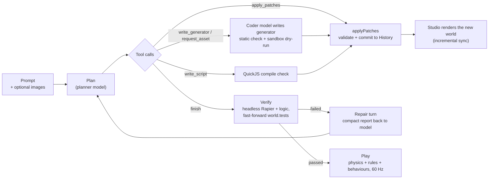

1. **Prompt.** Your text, plus optional reference images, goes to the planner
   together with a compact, deterministic text summary of the current world.
   The two are wrapped in explicit tags so the model can tell data from
   instructions.
2. **Plan.** The planner model gets a byte-stable system prompt (about 11k
   tokens, cached by the provider). It covers the World IR, every patch
   operation, the generator and behaviour catalogs, the rule docs, the test
   kinds and worked examples. It replies with a short plan and tool calls.
3. **Patches.** `apply_patches` sends typed operations through
   `applyPatches`, which never throws: each rejected patch comes back with its
   index and an LLM-readable reason. Accepted batches become one undoable
   History commit marked `agent`.
4. **Code where needed.** When no built-in generator fits, the coder model
   writes one. It is checked statically, dry-run in the Worker sandbox and
   retried once with the error. Behaviour scripts are test-compiled in QuickJS.
5. **Verify.** When the model calls `finish` after making edits, Aether runs
   `verify`. It builds an isolated headless physics world, attaches the
   world's rules and behaviours, and steps at a fixed 60 Hz until every test is
   decided, the time horizon is reached or the compute budget runs out.
   Static diagnostics run as well, and any error-level diagnostic (such as
   an interpenetration) fails verification.
6. **Repair.** On failure, a compact report goes back as a new turn ("1/30
   toppled within 10s; not: domino-1…", "crate-3 overlaps table by 0.12m").
   The loop is bounded by `maxRepairs`, `maxTurns` and a tool-call budget.
7. **Play.** Press Play: physics, logic and the player controller run on a
   fixed timestep. Stop restores the document exactly, because nothing that
   happens during play is written back to it.

## Architecture

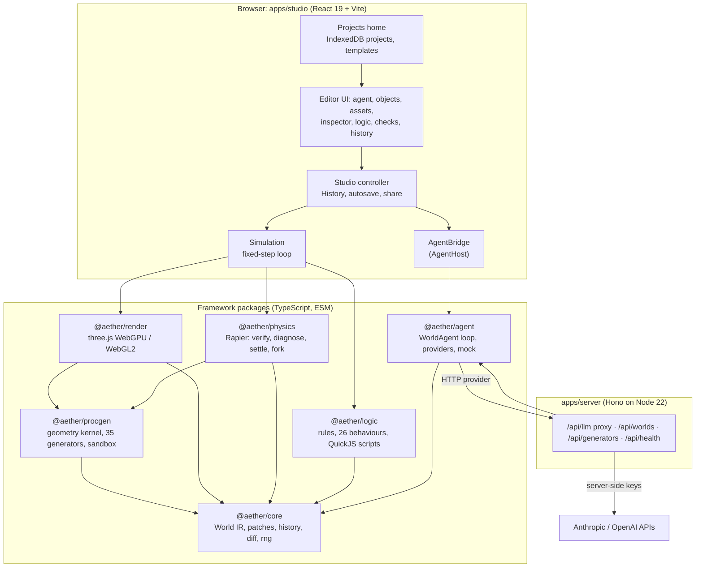

| Package | Responsibility |
| --- | --- |
| [`@aether/core`](packages/core) | World IR (zod), `applyPatches`, `invertPatches`, `diffWorlds`, `History` with branches, selectors, deterministic rng and hashes, world summaries for LLM context |
| [`@aether/procgen`](packages/procgen) | Typed-array geometry kernel (no three.js), noise, 36 built-in generators, `GeneratorApi`, LRU cache, Worker sandbox (browser) and `node:vm` sandbox (`@aether/procgen/node`, tests and server) |
| [`@aether/physics`](packages/physics) | Rapier 0.21 wrapper: incremental sync, joints, character controller, events, snapshots and forks, `verify`, `diagnose`, `settle` |
| [`@aether/logic`](packages/logic) | Deterministic gameplay runtime: rules engine, 26 behaviours, QuickJS script sandbox, host-agnostic through `LogicHost` |
| [`@aether/render`](packages/render) | `WorldRenderer`: WebGPU/WebGL2, incremental `SceneSync`, instanced scatter, environment, cameras, picking, ghost preview, debug overlays, screenshots |
| [`@aether/agent`](packages/agent) | `WorldAgent` plan → patch → verify → repair loop, tools, system prompt, Anthropic, OpenAI, HTTP and mock providers |
| [`apps/server`](apps/server) | LLM proxy with server-held keys, world share links, generator cache, static hosting, hardening |
| [`apps/studio`](apps/studio) | The editor and player |

The dependency graph has no cycles. `physics`, `logic`, `procgen` and `agent`
never import three.js or the DOM, so they run headless in Node (tests,
server, smoke) as well as in the browser. The full design, covering patch
semantics, history, the verification algorithm, sandbox layers, render sync,
the agent loop and providers, is in
**[docs/ARCHITECTURE.md](docs/ARCHITECTURE.md)**. The public API of each
package is pinned in [docs/CONTRACTS.md](docs/CONTRACTS.md).

## Security model

All LLM output and all user input are treated as untrusted.

- **Keys stay on the server.** The browser talks only to `/api/llm`. The
  server picks the model from an allowlisted role, so clients cannot choose
  arbitrary models. Upstream errors map to fixed codes and secrets are
  scrubbed from logs.
- **Validation at every boundary.** Patches, worlds, tool inputs, imports,
  share links, generator output and script intents are size-, depth- and
  node-capped, screened for `__proto__`, `constructor` and `prototype` keys,
  and then zod-validated.
- **Layered sandboxes for AI-written code:**
  - *Generators* go through a static token screen first. They then run in a
    Web Worker pool with shadowed globals, neutralised constructors, frozen
    intrinsics, no network and a watchdog that terminates runaway workers.
    Output is re-validated on the main thread (shape, NaN, vertex and size
    caps).
  - *Scripts* run in QuickJS/WASM with no host functions. `Date`, `Promise`,
    `Proxy` and `RegExp` are removed, `eval` and `Function` are stubbed, and
    `Math.random` is seeded. Each script gets a 2 ms call budget (disabled
    after repeated overruns), per-script memory and stack limits, and a shared
    heap budget. At most 32 validated intents are accepted per call.
  - *Server-side generator dry-runs* (`node:vm`, which is not a security
    boundary) are **off by default**. When enabled they run in a
    heap-capped `worker_threads` Worker with a terminate watchdog and a
    bounded queue.
- **Server hardening.** CORS allowlist and foreign-origin guard, per-IP token
  buckets, a daily token budget, per-route body limits, an upstream timeout
  with abort on client disconnect, a strict CSP (the physics verification
  worker gets a tighter one: WebAssembly and same-origin fetches only), `nosniff`, COOP,
  `X-Frame-Options: DENY`, HSTS in production, JSON-only errors with no stack
  traces, atomic and capped file storage, and share links with a hashed edit
  token.
- **Model URLs.** These must be same-origin, `blob:`, glTF `data:` or `https`
  on an explicit allowlist, which is empty by default.
- **The UI never renders AI text as HTML.**

## Performance

- **Buildings.** The static parts of a building (walls, floors, windows,
  furniture) merge per storey and material into a few dozen meshes, while
  every entity stays pickable and editable: a furnished two-bedroom
  apartment drops from 488 to 202 draw calls per pass. Lamps switch off in
  full daylight (no per-pixel cost for a dozen point lights), the studio
  render only refines while the view rests and then idles, and its
  pipeline releases every GPU texture it made (20 toggles: flat).
- **Instancing and scatter fields.** Small `scatter` layers are one
  instanced mesh; layers of 2 000+ instances become fields (packed 20-byte
  instances in ~128-instance chunks, QEM LOD levels, CPU chunk culling
  against a triangle budget, re-planned at most every 120 ms while the camera
  moves and re-uploaded only from the first changed chunk). A million pines:
  19 MB of instance data, 0.0–3.4 ms per re-plan, ≈ 70× fewer triangles than
  full detail under a 3 M budget.
- **Virtual geometry.** Parts with 20k+ triangles build a cluster LOD DAG in
  a worker (328k triangles: 1.5 s) and draw a 1 px-error cut: all instances
  of a mesh share one vertex buffer and one dynamic index buffer (≈ 2× the
  source indices); a cut costs 0.01–0.5 ms on the CPU and is watertight by
  construction (tested).
- **Zero-allocation hot loops.** Physics writes packed
  `[p, q]` transforms into a reused `Float32Array`, which the renderer
  consumes without allocating. Logic reuses per-tick scratch state, and script
  calls are round-robin capped per tick.
- **Incremental sync.** `diffWorlds` has a reference-equality fast path
  (patches share structure, so unchanged entities keep their identity).
  Render and physics rebuild only what changed. A pure move teleports a
  body, and colour-only edits never touch physics.
- **Caching.** Geometry and materials are reference-counted caches keyed by
  stable JSON. Generator output sits in an LRU cache keyed by id, params,
  seed and source hash, with in-flight dedupe.
- **Memory budgets.** Each GPU class gets a pixel-ratio cap (1.25 on
  integrated GPUs), an absolute drawing-buffer cap and a 2048² shadow map;
  bloom's render targets exist only while a world uses bloom. Low memory
  mode (automatic for devices with 4 GB or less, under heap pressure or
  after a lost GPU context) drops to ratio 1, about 1 MP, no MSAA or bloom,
  1024² shadows and a 40-entry undo history. Caches are bounded by bytes as
  well as entries. A lost GPU context is recovered with a fresh renderer.
- **Verification in workers.** Headless verification runs in up to two
  module workers (a protocol validated on both ends, cancellation, timeouts,
  a main-thread fallback). Independent tests are split across both workers
  and simulated in parallel; results stream into the UI as they are decided.
  While checks run on a rendered world, the longest main-thread task
  measured in the e2e run is 0 ms.
- **Responsive UI.** Rendering in edit mode happens on demand, and an idle
  editor (30 s without input) stops redrawing animated weather; the loop
  stops while the tab is hidden. Captures (critique views, thumbnails) read
  pixels back asynchronously, so a slow GPU never freezes the page. Rapier
  loads lazily (in the worker for verification, on the main thread only for
  Play) as a cached `.wasm` file compiled while streaming (the Rapier chunk
  went from 4.3 MB to 0.22 MB), and QuickJS only for worlds with scripts.
  Stats and HUD updates go to React at 4 Hz, never every frame.
- **Frame loop.** An allocation probe asserts the per-frame render path
  allocates nothing; large meshes raycast through a BVH (a 131k-triangle
  terrain: 0.03–0.05 ms per ray instead of 11–21 ms), identical static props
  are drawn instanced, and the resolution adapts while continuous rendering
  stays under 40 fps.
- **Measured.** 1000 dynamic boxes step in about 2.3 ms on average (8 ms
  budget). 1000 patches apply in about 40 ms. The 35 classic built-in generators run
  in about 0.4 s in total. A 1000-entity logic tick takes under 2 ms. The
  offline smoke run takes under a second per prompt.

## Testing

| Layer | Command | Coverage |
| --- | --- | --- |
| Unit and integration | `npm test` | About 1,640 Vitest tests across 118 files: patch semantics and inverses (including seeded random sequences), sandbox escapes, prototype-pollution payloads, physics benchmarks (domino chains topple and fail as expected), logic determinism, provider wire formats against a fake `fetch`, and server hardening, plus the art-direction policies (sky presets, fog, framing, materials) and the scale-geometry algorithms (watertight LOD cuts, simplifier invariants, budgeted field culling, allocation-free view planning). No test makes a network call. |
| Smoke | `npm run smoke` | The real `WorldAgent` with the mock provider runs on 18 prompts (4 of them block worlds), including all 9 templates (the million-tree showcase among them). Every resulting world is re-validated and re-verified independently. |
| End to end | `npm run build && npm run e2e` | Real browsers against the production server in mock mode. It boots, checks the canvas is not blank, runs four prompts (each verified in workers, with no other long main-thread script while a verification is in flight), runs the checks on a rendered world with no long task, plays with keyboard input, stops and checks exact restore, then undo/redo, inspector edit and export. Runs on Chromium (WebGPU and forced WebGL2) and then Firefox (WebGL2), one browser at a time, and any console error fails the run. |
| Layout | `npm run build && npm run e2e:layout` | Home, projects, docs and the editor (agent, assets + selection, play, phone sheet) at 1440×900, 1366×650, 1280×720, 1024×700, 900×700, 768×1024, 390×844 and 844×390, in Chromium and Firefox. Any element past the viewport outside a scroll container, a clipped control, text overflowing without an ellipsis, overlapping top-bar zones or overlapping viewport overlays fails the run. |
| Projects | `npm run build && npm run e2e:projects` | The projects home in Chromium and Firefox: template → editor → autosave → live thumbnail, rename, duplicate, delete with Undo, export/import round trip, search, sort, list view, reload persistence, command palette, legacy migration and the phone layout. |
| Architecture | `npm run build && npm run e2e:arch` | Chromium (WebGPU, WebGL2) and Firefox: the apartment prompt, every building view and the studio render (non-blank, refining), GPU objects flat over 20 view/quality cycles, floor-plan drawing as undoable checked edits, and a walkthrough that opens the front door with E and walks in, then night, lights and photo mode. |
| Memory | `npm run build && npm run e2e:memory` | Chromium (WebGPU) then Firefox (WebGL2): idle soak on the starter world (an idle editor must stop drawing), JS heap < 250 MB and tab process < 800 MB, then 20 agent runs + 20 play/stop cycles with no growth in heap, tab memory or reference-counted GPU resources; automatic low memory mode on a stubbed 2 GB device; recovery from a lost WebGL context. |
| Benchmark | `npm run build && npm run e2e:benchmark` | The showcase world in Chromium (WebGPU, WebGL2) and Firefox: scene vs drawn triangles, frame-time percentiles, CPU in the renderer and the view planner while the camera orbits; `--classic` for the full-detail engine, `--cycles=N` checks GPU objects stay flat across rebuilds. |
| Types | `npm run typecheck` | Strict TypeScript, zero errors (including `experiments/`) |

Install the browsers for e2e once with `npx playwright install chromium firefox`.

## Deployment

**Hosted copy (static).** The public copy of the studio is a static site:
`vercel.json` builds `apps/studio` (`npm run build -w @aether/studio`), serves
`apps/studio/dist` with a strict CSP and security headers, and has **no
`/api`**. Visitors bring their own AI: their own Codex / ChatGPT or Claude
Code login through the local bridge (`npx aether start --origin <hosted
address>`), their own API key (called straight from the browser), or the
offline planner. The site carries no key and never uses the operator's
account. `npm run build && npm run e2e:hosted` checks exactly this setup in
Chromium and Firefox.

- Point an uptime monitor at the hosted page, and tag every release so a
  deployment can be reproduced exactly.
- Every visitor path keeps working without any server: when a key or the
  bridge fails, the studio falls back to the offline planner.

**Self-hosted server (optional).** For your own team you can run the API and
the studio from one container:

```bash
docker build -f apps/server/Dockerfile -t aether .
docker run -p 8787:8787 -e AETHER_DAILY_TOKEN_BUDGET=2000000 -v aether-data:/data aether
```

The image is multi-stage on `node:22-slim`, runs as non-root and includes a
`HEALTHCHECK` on `/api/health`. SIGTERM drains requests gracefully. It uses
the offline mock planner unless you configure a server model
(`AETHER_PROVIDER` plus a key); a server key is spent by everyone who can
reach the server, so keep it off for public deployments. Fly.io, Render and
Railway notes are in [`apps/server/README.md`](apps/server/README.md#deploying)
(set `TRUST_PROXY_HOPS=1` and mount a volume at `/data`).

## Research inspirations

These papers shaped the *ideas* behind Aether. No code, models, weights,
datasets or assets were copied from any of them. Everything here is an
original TypeScript implementation.

| Work | What inspired us |
| --- | --- |
| PWM, [arXiv:2609.10540](https://arxiv.org/abs/2609.10540) | Explicit, code-defined world state and rules as the source of truth, separate from rendering. We render it in real time in the browser instead of with a video model. |
| CoDeR, [arXiv:2609.26458](https://arxiv.org/abs/2609.26458) | Agents write executable Three.js code for world rules and dynamics, with diffusion only rendering it. Aether keeps the code-defined world and renders it live instead. This inspired the patch IR and the generators written by the coder model. |
| SceneMosaic, [arXiv:2609.05594](https://arxiv.org/abs/2609.05594) | Generate, then validate and repair with physics stabilisation and a critic/actor loop. We use deterministic code for geometry and support checks and the LLM for semantics. |
| PAT3D, [arXiv:2511.21978](https://arxiv.org/abs/2511.21978) | A simulation-in-the-loop step settles a generated scene under gravity and removes intersections. This became `settle`. |
| SceneSmith, [arXiv:2602.09153](https://arxiv.org/abs/2602.09153) | Designer, critic and orchestrator agents build scenes in stages and estimate physical properties, keeping collisions low. This shaped the agent's plan, verify and repair loop. |
| Articraft, [arXiv:2605.15187](https://arxiv.org/abs/2605.15187) | An LLM writes code against a parts-and-joints SDK, and a test harness feeds results back in an edit-execute-repair loop. This shaped the joint spec (doors, wheels, drawbridges) and the generator repair loop. |
| ESG, [arXiv:2609.15392](https://arxiv.org/abs/2609.15392) | An LLM writes a machine-checkable scene graph with physical properties and a timeline of events, which simulation then makes happen on schedule. This inspired world tests such as `eventually` and `topples`. |
| WorldBench, [arXiv:2610.10622](https://arxiv.org/abs/2610.10622) | Grades LLM-written Three.js worlds by running them, and finds that evaluators who only read the code miss absent features. This led to "physics as unit tests": Aether runs every world headless before calling it done. |
| 3DCodeBench, [arXiv:2606.01057](https://arxiv.org/abs/2606.01057) | Finds that most failures in LLM-written 3D code are API mismatches and floating parts. This informed the small, typed `GeneratorApi` and the base-at-ground convention. |

## Licence, third parties and AI disclosure

- **Licence:** [MIT](LICENSE), © 2026 Aether contributors.
- **Third-party components:** every runtime and development dependency, with
  its exact version and licence, is listed in
  **[docs/THIRD_PARTY.md](docs/THIRD_PARTY.md)**. Everything shipped to users
  is permissively licensed (code under MIT or Apache-2.0, fonts under the SIL
  Open Font License 1.1).
- **Assets:** there are no third-party 3D models, textures, images or audio.
  Geometry is generated procedurally and sounds are synthesised with WebAudio
  oscillators. The UI is set in self-hosted Latin subsets of Inter and
  JetBrains Mono (OFL 1.1, licence files ship alongside). The screenshots
  in `docs/screenshots` were captured from this app.
- **AI disclosure:** this codebase was written with AI coding assistants
  (Claude Code and Codex) under human direction and review. At runtime the app
  calls Anthropic Claude and/or OpenAI models through the server proxy.
  AI-generated 3D content is produced at runtime *as code* (procedural
  generators and scripts) and runs sandboxed. Details are in
  [docs/THIRD_PARTY.md](docs/THIRD_PARTY.md#ai-disclosure).
