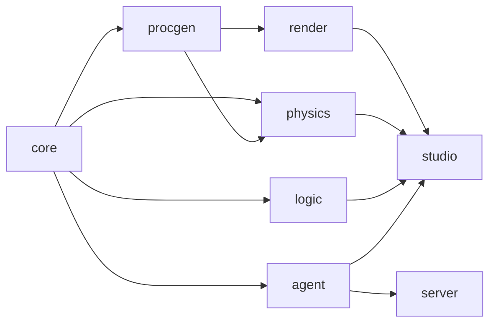
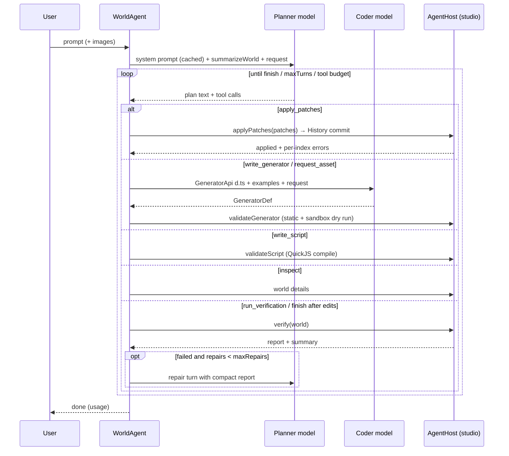

# Aether architecture

This document describes how Aether is built and why. The authoritative
contracts are [`packages/core/src/schema.ts`](../packages/core/src/schema.ts)
(the World IR) and [`docs/CONTRACTS.md`](CONTRACTS.md) (the public API of
each package). This document explains the design behind them.

- [1. Design principles](#1-design-principles)
- [2. Repository and package graph](#2-repository-and-package-graph)
- [3. The World IR](#3-the-world-ir)
- [4. Patch semantics](#4-patch-semantics)
- [5. History, undo, branches and time travel](#5-history-undo-branches-and-time-travel)
- [6. Procedural generation](#6-procedural-generation)
- [7. Physics and the verification algorithm](#7-physics-and-the-verification-algorithm)
- [8. Logic runtime](#8-logic-runtime)
- [9. Sandbox design](#9-sandbox-design)
- [10. Rendering and incremental sync](#10-rendering-and-incremental-sync)
- [11. The agent loop](#11-the-agent-loop)
- [12. Provider abstraction](#12-provider-abstraction)
- [13. Server](#13-server)
- [14. Studio runtime](#14-studio-runtime)
- [15. Determinism](#15-determinism)
- [16. Known limitations](#16-known-limitations)

---

## 1. Design principles

1. **One explicit, serialisable world state.** Everything that defines a world
   is plain JSON in a `WorldDoc`. Renderers, physics and logic are
   *projections* of that document and never sources of truth.
2. **The model edits through typed patches, never directly.** Every change is
   a validated, invertible operation. That makes AI edits reviewable,
   undoable, diffable and cheap to send.
3. **Verify, don't trust.** Worlds carry executable expectations (tests).
   Deterministic code checks geometry, collisions, support and reachability;
   the LLM handles semantics and repair.
4. **Untrusted by default.** All model output and user input crosses a
   validation boundary. Code written by a model only runs in a sandbox.
5. **Headless first.** `core`, `procgen`, `physics`, `logic` and `agent` have
   no three.js or DOM dependency, so the same code runs in the browser, in
   Workers, in Node tests, in the smoke script and on the server.
6. **Deterministic.** All randomness is seeded (`rng`, `hashString` from
   core). Same document, seed and inputs give the same world and the same
   gameplay.

## 2. Repository and package graph

```
packages/
  core      World IR, patches, history, diff, queries, rng, summaries
  procgen   geometry kernel, noise, built-in generators, generator sandbox
  physics   Rapier wrapper, verify / diagnose / settle, character controller
  logic     rules, behaviours, QuickJS script runner
  render    three.js WebGPU/WebGL2 renderer, scene sync, cameras, tools
  agent     WorldAgent loop, tools, system prompt, providers, offline mock
apps/
  server    Hono API: LLM proxy, share links, generator cache, static hosting
  studio    React 19 + Vite editor and player
scripts/smoke.ts        headless end-to-end agent run (mock provider)
tests/e2e/              Playwright browser run of the built studio
```



Arrows point from a dependency to its consumer. There are no cycles. The
packages use **source-level exports** (`"exports": {".": "./src/index.ts"}`),
so they have no build step: Vite bundles the studio and `tsx` runs the
server. `@aether/procgen/node` is a separate subpath so `node:vm` never
enters the browser bundle.

## 3. The World IR

`WorldDoc` (zod, version 1) is the single source of truth. Its conventions
are chosen to be easy for an LLM to produce correctly: metres, seconds and
kilograms; Y up; ground at y = 0; Euler rotations in **degrees** (XYZ order);
colours as `#rrggbb`; ids as lowercase slugs.

| Field | Contents |
| --- | --- |
| `entities` | Record by id. Each entity has `transform`, `shape` (`primitive`, `procedural`, `model`, `scatter` or `none`), `material` (22 presets plus overrides), `physics` (body type, collider, mass or density, friction, restitution, sensor, damping, CCD), `joint` (fixed, revolute, prismatic or spherical with limits and motor), `light`, `behaviors`, `state`, `parent`, `tags` and `template` |
| `rules` | WHEN (11 triggers: start, tick, timer, collision, enter, exit, key, click, state, event, fallBelow) / IF (state conditions) / THEN (17 actions: set, add, spawn, destroy, impulse, setVelocity, teleport, setProperty, enableBehavior, explode, setGravity, emit, message, sound, win, lose, reset) |
| `environment` | Sky preset, time of day, fog, weather, ambient and sun intensity, ground, gravity, bloom, exposure |
| `player` | Mode (orbit, firstPerson, thirdPerson or vehicle), spawn, controlled entity, speeds |
| `state`, `hud` | Global variables and the HUD bindings that display them |
| `generators`, `scripts` | Code written by the coder model (see §9) |
| `tests` | `stable`, `noOverlap`, `reaches`, `eventually`, `moves`, `topples`, `staysAbove` |

**Selectors** let rules, tests and behaviours refer to entities: `some-id`,
`#tag`, `player` and `*`. Templates are excluded from selector matches and
are only instantiated by `spawn`.

**Limits** (`LIMITS` in core) cap entities, rules, total scatter instances,
generators, scripts, tests, patches per call, hierarchy depth (64), state
keys, HUD entries, input depth, node count and string length.

## 4. Patch semantics

`applyPatches(world, patches, { atomic? })` is pure. It never mutates its
input and never throws.

**Pipeline for each patch:**

1. **Untrusted-input screen** before zod. Only plain objects are accepted.
   Any `__proto__`, `constructor` or `prototype` key at any depth is
   rejected, as are inputs that exceed the depth, node-count or string-length
   caps.
2. **Unknown-key detection.** Misspelt fields are rejected with a "did you
   mean" hint instead of being silently stripped. These lookups are capped at
   16 per batch, so hostile batches stay linear.
3. **zod validation** of the op.
4. **Application on a draft.** `update` deep-merges objects and replaces
   arrays. `null` deletes a key, and is stored only where the schema allows
   null. The entity is re-validated afterwards.
5. **Referential checks.** These cover: the parent exists, there are no
   cycles and depth stays within 64; joint targets and scatter `onSurface`
   targets exist; `player.controls` exists; selector syntax is valid; ids are
   not duplicated or reserved; and `removeGenerator` is refused while the
   generator is still in use.
6. **Forward references within a batch** are allowed. If a child is added
   before its parent, or `setPlayer` points at a later `add`, the patch is
   deferred and retried.

**Result:** `{ world, applied, errors }`, where each error is
`{ index, op, message }` written for the LLM to act on, for example
`entity 'car' update: physics.body must be one of static|dynamic|kinematic`.
With `atomic: true`, any error returns the original world. Entities that are
not touched keep **object identity** (structural sharing), and a batch that
changes nothing returns the very same world object. This is what makes
diffing and render sync cheap.

**Inversion.** `invertPatches(before, patches)` is built on
`patchesBetween(from, to)`, which emits steps in an order where every step
passes validation. It is exact for every op, including restoring rule order.
`removeGenerator` and `removeScript` exist (as additive schema members) so
that `defineGenerator` and `defineScript` can be inverted.

**Diffing.** `diffWorlds(a, b)` returns immediately when `a === b`, then
compares per entity by reference before falling back to a stable deep
compare. It reports added, removed and changed entities plus flags for the
environment, player, rules, generators, scripts, state, HUD, tests and meta.

## 5. History, undo, branches and time travel

`History` is a pure, serialisable data structure:

- Each entry stores the **resulting world** of its commit. Thanks to
  structural sharing this costs little, and undo, redo and checkout are
  pointer moves rather than patch replays.
- `commit(patches, message, source)` records `agent`, `user` or `system`
  edits. A batch that produces no change creates no entry.
- `checkout(entryId)` is non-destructive time travel. `branch(name)` creates
  a branch at the current position and switches to it (like
  `git switch -c`). `switchBranch` and `deleteBranch` complete the set.
- `maxEntries` pruning drops entries that can no longer be reached.
- `toJSON` stores the applied patches plus a full snapshot only for root
  entries. `fromJSON` re-validates everything and replays atomically, so a
  tampered save cannot smuggle in an invalid world.

## 6. Procedural generation

`@aether/procgen` produces plain typed-array meshes and collider
descriptions. It contains no three.js.

- **Kernel:** box, sphere, cylinder, cone, torus, capsule, plane, lathe,
  extrude (ear clipping), tube (parallel-transport frames), heightfield and
  faceted icosphere rocks. Normals stay correct under non-uniform scale and
  mirroring, displacement is seam-aware, and every call is capped by a
  vertex budget.
- **Noise:** its own seeded simplex implementation (`noise2`, `noise3`,
  `fbm2`, `ridged2`).
- **`GeneratorApi`:** the same small surface is handed to built-in and
  LLM-written generators. `add(mesh, material)` merges parts with equal
  materials, which reduces draw calls. `autoColliders('box' | 'hull')` and
  `build()` place the base on y = 0 and centre x and z (heightfield terrain
  keeps its frame).
- **36 built-in generators** in six categories (nature, architecture, props,
  vehicles, terrain, fx), each with 2 to 4 variants and typed params.
  `resolveParams` applies defaults, clamping and type coercion.
- **Heightfield colliders** use Rapier's native layout: heights normalised to
  [0, 1], X-major (`heights[ix*(rows+1)+iz]`), rows along Z and
  `size = [width, maxHeight, depth]`.
- **`generate(shape, world, { sandbox, cache })`** runs built-ins in-process
  (yielding first, so many generators do not block a frame). Custom
  generators **only** run through a `SandboxRunner`. A `GeneratorCache` (LRU)
  is keyed by generator id, stable params, seed and source hash, and
  in-flight requests are deduplicated. If generation fails, the renderer shows
  `fallbackOutput` (a visible crate) and records a warning.

## 7. Physics and the verification algorithm

`@aether/physics` wraps Rapier 0.21 (WASM).

**World construction.** Every non-template entity with a `physics` spec gets
one rigid body at its world transform. Shaped children without their own
physics become extra colliders on the nearest physics ancestor. `auto`
colliders map primitives to exact shapes, scaled by the entity's scale. A
torus becomes 12 convex segments and a plane a thin box. Non-uniform scales
that cannot be represented fall back to a hull. Procedural shapes use the
renderer's generator output (`ColliderProvider`) when one is available, and
otherwise run the built-in generator headlessly. Provider output is
validated and capped at 2048 colliders per shape. Scatter becomes one static
body with per-instance colliders, up to 2000 instances, using the **same
placement algorithm as the renderer** so what you see is what collides. The
ground is tiled (at most 100 m per tile) to avoid a float-precision sink in
the character controller.

**Stepping.** A fixed 1/60 s accumulator runs at most 5 substeps (to avoid a
spiral of death), and `alpha` is exposed for interpolation. Events are
de-duplicated per entity pair. Impulses come from contact-force events above
twice the body's weight. Entity ids are interned to small integers, so pair
keys are V8 small integers and draining a step's events builds no strings
and allocates nothing for steady contacts (an allocation probe asserts it).

**Incremental `sync(world, diff)`.** A body is rebuilt only when its physical
definition changes. A pure move teleports it, and colour edits are ignored.
Gravity and ground are updated, and joints whose target was rebuilt are
rebuilt too.

**`snapshot` / `restore` / `fork`.** The entity maps are stored as JSON in
front of Rapier's own snapshot. `restore` size-checks the snapshot, screens it
for prototype pollution and validates it with zod. A forked world matches the
original exactly after N steps (this is tested).

### `diagnose(world)` — static, at t = 0

Interpenetration (with the contact normal and the depth), floating dynamic
bodies, out-of-bounds bodies, too many bodies and invalid joints. Every
diagnostic names the entities and a concrete fix, for example
`crate-3 overlaps table by 0.12m` → `move crate-3 up to y=1.25`. Output is
capped per code to keep LLM context small.

### `settle(world)` — "drop and freeze"

Simulates dynamic bodies until they sleep (2 s by default), then writes rest
poses back as `update` patches relative to each entity's parent (rounded to
millimetres and 0.1°). Bodies that fell out of the world or are still moving
are reported instead of patched.

### `verify(world, { logic, maxSeconds, budgetMs })`

```
build an isolated headless PhysicsWorld from the document (never the live session)
attach gameplay logic through the LogicHook factory (rules + behaviours, headless host)
run diagnose() for static problems
turn every world.test into a running checker with its own simulated horizon
loop with fixed dt = 1/60:
    events = pw.stepFixed()
    logic.tick(dt, pw, events)
    for each undecided test: check(state) -> pass | fail | pending
    stop when all tests are decided, the horizon is reached, or the compute budget is spent
    every 8 ms of continuous stepping: yield to the event loop (keeps the UI responsive)
undecided tests time out with a descriptive failure
passed = every test passed AND no error-severity diagnostic
return { passed, results[], diagnostics[], simulatedSeconds, ms }
```

Verification passes only when every test passes **and** there is no
error-severity diagnostic. The compute budget counts world build,
diagnostics and stepping, but not time spent yielded to the host.
`verify` also takes `tests` (run only these indices: a shard), `diagnostics`
(skip the static checks), `signal` (abort at the next step) and `onResult`
(each test as soon as it is decided).
Because the simulation is headless and fixed-step, seconds of gameplay finish
in milliseconds. For example, 1000 dynamic boxes average about 2.3 ms per
step. `summarizeReport` turns the report into compact text for the repair
turn, for example "1/30 toppled within 10s; not: domino-1, …".

How each test kind is decided:

| Kind | Passes when |
| --- | --- |
| `stable` | Targets come to rest without drifting more than `maxDrift` |
| `noOverlap` | No dynamic pair starts interpenetrating |
| `reaches` | The target enters a zone (an entity's bounds plus a margin, or a sphere) within `within` seconds |
| `eventually` | A world or entity state condition becomes true (rules run headless) |
| `moves` | The target travels at least `distance` |
| `topples` | The target's tilt from upright exceeds `degrees` |
| `staysAbove` | The target never drops below `y` |

### Verification off the main thread

The studio never verifies on the UI thread. `VerificationService`
(`apps/studio/src/engine/verify/`) sends the world to a pool of module
workers (`verify.worker.ts`), each of which loads Rapier (and QuickJS, only
for worlds with scripts) on first use:

```
Studio / AgentBridge ──VerifyPool.verify(world, colliders)──▶ planShards(tests, lanes)
      ▲   ▲                        │ lane 1: tests [0, 3] + diagnostics ─▶ worker ─ progress … verified
      │   └ progress (per test) ◀──┤ lane 2: tests [1, 2]               ─▶ worker ─ progress … verified
      └──── merged report ◀────────┘ mergeShardReports (world.tests order)
```

- **Protocol.** zod on both ends, request ids, one terminal reply per
  request (`verified`, `failed` with `cancelled`, …), `progress` messages in
  between. The worker re-validates the world (`validateWorld`) and the
  colliders (typed arrays, counts, a 16 M-number cap). Renderer colliders
  are sent only for shapes the worker cannot rebuild from the document
  (model-written generators, imported models).
- **Fork verification.** With several tests and enough simulated time
  (≥ 3 s), the tests are split across lanes by their horizons
  (longest-processing-time first); every lane simulates the same
  deterministic world from t = 0, so a test's verdict does not depend on its
  lane (tested against a single run). Diagnostics run in the lightest lane.
- **Lanes.** At most 2 workers, 1 with fewer than 4 logical cores, ≤ 4 GB
  device memory or in low-memory mode. Idle workers are terminated after a
  minute; physics is prefetched in a worker 2.5 s after the first frame
  (idle callback, not in low-memory mode) and again when a prompt is sent.
- **Robustness.** Cancellation (`AbortSignal` → `cancel` message, checked
  at every 25 ms slice), a timeout per request (compute budget + 20 s cold
  start; the worker is then terminated), and a fallback to the cooperative
  main-thread verifier when module workers cannot start (old browsers, a
  CSP) or a worker crashes.
- **Live results.** Each decided test streams into the Verify panel and the
  viewport pill ("Checking 3/7…"), coalesced to one store update per 60 ms;
  the final line says how much physics was simulated, how fast and in how
  many parallel workers.

Measured (e2e, power-saving laptop, software GPU): while "Run checks"
simulates a rendered world in two workers, the longest main-thread task is
0 ms (Chromium) and the worst event-loop stall 53–62 ms; during agent turns
no main-thread script other than the renderer's frame callback runs longer
than 9 ms while a worker verifies.

## 8. Logic runtime

`LogicRuntime` is deterministic and host-agnostic. It talks to the outside
world only through `LogicHost`, which the studio implements with physics and
render, the headless verifier implements with physics only, and tests
implement with a recording fake.

- **Rules.** `once` and `enabled` flags and `if` conditions. `enter` and
  `exit` use sensor contacts or a containment fallback. `state` triggers fire
  when a condition goes from false to true. `emit` supports delays through a
  bounded queue. `spawn` clones templates into `template-N` ids with seeded
  spread.
- **Behaviours.** 26 built-in behaviours are documented in
  `BEHAVIOR_CATALOG`; the agent prompt is generated from that catalog. Moving
  behaviours on kinematic entities compose into one pose per tick (bob,
  spin and patrol stack instead of fighting each other). Dynamic bodies are
  steered by velocity.
- **Scripts.** The world state is serialized once per tick for all script
  calls (re-serialized only after a state write) and spliced into each
  snapshot, instead of being stringified for every call.
- **Safety rails.** At most 64 rule firings per tick, emit chains cut off at
  depth 8, 256 queued events, caps on spawns and zone checks, and unsafe
  property paths rejected. `tick` never throws; failures go to the log.
- **Trace.** `log` is a 500-entry ring buffer of readable lines, for example
  `rule 'coin-pickup' fired: … → score 2→3`. It powers the "why did this
  happen" view.
- **Hot reload.** `updateWorld` keeps state, `once` flags and spawned
  entities, and `reset` restores the start state.

## 9. Sandbox design

There are two kinds of model-written code, and each has its own isolation
stack.

### Generators (geometry code), `@aether/procgen/sandbox`

| Layer | Mechanism |
| --- | --- |
| 1. Schema | `GeneratorDef`: id regex, source ≤ 60 kB, typed params |
| 2. Static screen | `staticCheckSource` rejects `import`, `require`, `fetch`, `eval`, `Function`, `globalThis`, `postMessage`, timers and similar tokens anywhere, including in comments and strings. The rules are spelled out in `GENERATOR_API_DTS` so the model avoids them. |
| 3. Process isolation | Dedicated **Web Worker pool**, so code never runs on the UI thread |
| 4. Lockdown | Inside the worker, globals are shadowed, `Function` and related constructors are neutralised, intrinsics are frozen, and there is no network |
| 5. Watchdog | A per-run timeout terminates the worker and restarts the pool slot |
| 6. Output validation | `validateOutput` on the main thread checks shape, types, NaN or Infinity and the vertex cap (≤ 2M), and validates collider descriptions again in physics |

The `node:vm` variant (`@aether/procgen/node`) uses a cross-realm membrane. It
is for tests and optional server validation only, and its docs state that it
is **not** a security boundary. On the server it is off by default; when
enabled it runs in a `worker_threads` Worker with V8 heap caps, a terminate
watchdog and a bounded queue (overflow returns 503).

### Behaviour scripts, `@aether/logic/scripting`

| Layer | Mechanism |
| --- | --- |
| 1. Schema | `ScriptDef`: id regex, source ≤ 30 kB |
| 2. Interpreter isolation | **QuickJS compiled to WASM** (`quickjs-emscripten-core` with the single `@jitl/quickjs-wasmfile-release-sync` build, loaded lazily). Untrusted code is never `eval`'d by the host engine. |
| 3. Capability denial | No host functions are exposed. `Date`, `Promise`, `Proxy` and `RegExp` are removed, `eval` and `Function` are throwing stubs, and `Math.random` is seeded. |
| 4. Data-only boundary | A JSON snapshot goes in and a JSON list of intents comes out. No handles cross the boundary, and handles are disposed on every call. |
| 5. Resource limits | 8 MB memory per script by default, 128 KB stack (capped at 256 KB), a 128 MB shared heap budget, a 2 ms call budget, at most 24 calls per tick (round robin), and disable after 3 overruns or 10 errors |
| 6. Intent validation | At most 32 intents per call, validated in the runner and again in the runtime |

Interpreters that crash are abandoned rather than freed, because freeing them
would abort the module, and the module is recycled after 4 abandoned
runtimes.

## 10. Rendering and incremental sync

`WorldRenderer` (three.js r186) runs `WebGPURenderer` on its WebGPU backend
or, when the backend policy says so (or WebGPU is missing or fails to
initialise), on its WebGL2 backend. The policy prefers WebGPU on Chromium
and Safari and WebGL2 on Firefox, where WebGPU is used only for a known-good
discrete or Apple GPU outside Linux; a WebGPU start that never finished
disables WebGPU for the origin. Settings: ACES tone
mapping, sRGB output, environment-driven exposure, bloom plus a subtle
vignette through `RenderPipeline` (disabled automatically if it fails), PCF
shadows with a softened radius, and a sun shadow camera refitted to the
meaningful content.

**Memory budgets.** On a laptop with an integrated GPU, GPU memory *is* system
memory, and drawing-buffer pixels dominate it: a multisampled half-float
scene target, its resolves, the bloom chain and the swap chain cost roughly
100–140 bytes per pixel (measured). `classifyGpu` sorts the GPU (WebGL
renderer string or WebGPU adapter info) into discrete, integrated, software
or unknown, and `renderBudget` gives each class a pixel-ratio cap (1.5,
1.25, 1, 1.25), an absolute drawing-buffer cap (3.7, 2.1, 1.4, 2.1 MP), a
2048² (software: 1024²) sun shadow map, an instance budget and a generator
cache byte budget. Low-memory mode overrides the class: ratio 1, about 1 MP,
1024² shadows, no MSAA, no post pass, smaller caches. The post pipeline is
released whenever a world does not use bloom and rebuilt on demand. A lost
device or context stops drawing and is reported to the host, which replaces
the renderer on a fresh canvas.

**Art direction.** Every world should look composed in the first seconds,
whatever the model wrote, so the look is policy rather than per-world tuning:

- *Sky.* The preset (`day`, `dawn`, `sunset`, `night`, `overcast`, `space`,
  `studio`) is authoritative; `timeOfDay` moves the sun only inside the
  preset's window. The sun's compass bearing is chosen relative to the
  default camera, so a low sun rakes across the frame (warm lit faces, cool
  shade, long sideways shadows) instead of flattening the scene from behind
  the camera or silhouetting it from the front. Golden-hour skies are
  sampled a few degrees lower than the light; nights get a moon rim light, a
  starfield and a faint galactic band; space gets a procedural nebula.
- *Fog.* Densities are scaled to the content radius: the content's far edge
  stays under ~5 % fog from the framing distance, backdrop mountains fade to
  ~15–45 %, and only explicitly foggy worlds may go twice as thick. Fog,
  dome horizon and sky reflections share one horizon color.
- *Framing.* After a build, the camera frames the bounding boxes of the
  meaningful content (scenery, sky and huge terrain excluded, `focus`
  entities weighted) from an elevated three-quarter view, tilted up so a
  band of sky shows, never below the ground; edits only re-frame when the
  changed entities are off screen.
- *Materials.* Lava and water carry procedural, tileable detail (glowing
  Worley cracks, a ripple normal map) on box-projected metre UVs, so detail
  has the same scale on a pond and a sea. Mountains sink and trim their
  foothill plate and paint their foothills in the world's ground color.
- *Materialize.* New entities grow out of the ground in a ripple from the
  content center (content-group scale only; physics and bounds are
  untouched). Disabled for `prefers-reduced-motion`.

`npm run gallery` renders every smoke prompt (and `-- --skies`, the starter
world under each preset) to `docs/screenshots/gallery/` for visual review.

**`SceneSync`** applies `diffWorlds` output:

- Only added, removed and changed entities are touched, and unchanged
  objects keep their identity. Parent and child links are honoured, and
  templates are skipped.
- Geometry and materials come from **reference-counted caches** keyed by
  stable JSON (`proceduralOutputKey` is shared with generation). Each mesh
  has one private material whose values are mutated in place, so glowing or
  fading objects do not rebuild GPU programs.
- Procedural entities show a placeholder while their generator runs. Results
  that arrive for an outdated world are discarded. Old resources are released
  only after new content is mounted, so nothing flickers.
- **Scatter** uses instanced meshes with one shared matrix buffer, the same
  seeded placement as physics, `onSurface` projection onto terrain (re-placed
  when the terrain moves), device-dependent budgets, and no shadows on
  layers over 2000 instances.

**Runtime path.** `applyTransforms(packed, order)` consumes the physics
`Float32Array` without allocating, and handles bodies with parents.

**Frame-loop performance.**

- *Zero allocations per frame.* An allocation probe (V8 sampling heap
  profiler, collected objects included) drives the per-frame code headless —
  physics pose application for 500 bodies, camera rig, grow-in, highlighter,
  weather (5000 particles), sky, static batches, BVH ray misses, adaptive
  resolution — and asserts < 16 sampled bytes per frame from render code.
  It found and fixed array destructuring in the weather update, Map entry
  iteration in the highlighter and boxed doubles in the camera damping.
- *Raycasts through a BVH.* Meshes with ≥ 512 triangles (terrain, big
  generated props, editable meshes) raycast through a linear BVH (Morton
  order, built at the next idle moment, refitted when vertices move). On a
  131k-triangle terrain a ray costs 0.03–0.05 ms instead of 11–21 ms; this
  covers picking, gizmo snapping, brushes and the chase camera's per-frame
  occlusion ray.
- *Static-prop instancing.* At least six identical static props (same
  primitive, material and shadow flags) are drawn as one `InstancedMesh`.
  Member meshes stay in the scene on a layer that cameras skip but
  raycasters test, so picking, outlines, gizmos and runtime overrides work
  unchanged; a member that changes material, moves out or is removed leaves
  its batch.
- *Adaptive resolution.* While continuous rendering stays below 40 fps for
  1.5 s, the drawing buffer is scaled down in steps of 0.8 (to 0.5 of the
  budget); it is restored after 5 s above 56 fps, and an upscale that has to
  be undone doubles the wait. The scale only ever lowers the GPU budget's
  ratio (low-memory mode included).
- *Asynchronous captures.* Critique views and thumbnails render into a
  reused render target set as the renderer's *output* target (same tone
  mapping, color space and post pipeline as the screen) and are read back
  with `readRenderTargetPixelsAsync` (WebGPU buffer mapping, WebGL2 pixel
  buffer + fence), then encoded on a CPU-backed canvas with `toBlob`. A
  synchronous canvas readback used to wait for the GPU: 24–37 s on a
  software GPU, now none.
**Scale geometry.** Two systems let a world hold far more geometry than a
frame can draw. Both plan on the CPU and submit ordinary instanced or
indexed draws, so WebGPU, WebGL2 and Firefox behave the same; both are
re-planned in `draw()` whenever the camera (or a capture camera) changed,
throttled to one re-plan per 120 ms while the camera keeps moving, and are
allocation-free per frame (allocation probe).

- *Virtual geometry* (`virtual/`). Parts with ≥ 20 000 triangles are split
  into 128-triangle clusters; groups of four adjacent clusters are
  simplified to half with their outer border locked (our quadric-error,
  half-edge-collapse simplifier, so no vertex is ever created and all levels
  share one vertex buffer) and re-split, level after level, into a cluster
  DAG whose errors and bounding spheres are monotone. A cluster is drawn when
  its projected error is ≤ 1 px but its parents' is not; since every cluster
  made from one group shares that group's error and sphere, the cut is
  watertight. Hierarchies build in `dag.worker.ts` (validated messages,
  timeout, byte-capped cache); meanwhile the full-detail mesh stays on the
  raycast-only layer (picking, snapping and the chase camera use its BVH)
  and is never drawn. All instances of a mesh pack their cuts into one
  dynamic index buffer (uploaded from the first changed instance); a budget
  governor raises the error threshold when cuts exceed the GPU class's
  triangle budget. Shadow casters skip cluster frustum/back-face culling
  (off-screen parts can shadow the view); LOD still applies, and a caster
  keeps its cut while the camera moved < 1.5 % of its distance or while it
  is far outside the view. These buffers use *static* usage on purpose:
  three re-uploads `DynamicDrawUsage` buffers on every draw, so changes go
  up only through version bumps with accumulated update ranges.
- *Scatter fields* (`virtual/field-culler.ts`, `scatter-field.ts`). Layers
  of ≥ 2 000 instances (up to 1 000 000 per entity) are packed into 20-byte
  records, sorted into ~128-instance chunks and drawn through one instanced
  mesh per (LOD level, part). LOD levels come from the same simplifier
  (faceted generator meshes are re-flattened). Each re-plan culls chunks
  against a padded frustum, picks a level from the projected instance size
  (with hysteresis) and spends the field's share of the triangle budget
  front to back, demoting or dropping far chunks. Level buffers are written
  in stable chunk order and uploaded only from the first changed chunk.
  Vegetation fields use the `foliage` material variant: a TSL position node
  bends crowns in a procedural wind (vertex shader only).
- *Showcase.* The offline planner's "Canyon of Colossi" (prompt: "a canyon
  with a million trees and ancient statues") uses both: 1 M pines in two
  fields, 41 sculptures from the `colossus` generator sharing three meshes,
  and a canyon terrain (itself virtual geometry). The viewport badge shows
  scene vs drawn triangles; `npm run e2e:benchmark` measures it.
- *Grade.* The post pass applies a colour grade derived from the sky state
  (split tone toward the key light and the zenith, saturation, contrast
  pivot) in the same composite pass; uniforms only.
- *Camera director.* `startTour()` flies a loop around the content
  (`view/tour.ts`: keys from the framing sphere and the focus objects, low
  passes and high reveals, a Catmull-Rom spline with eased timing, starting
  and ending at the current view); any pointer or wheel input, or any camera
  command, stops it. The studio's camera button starts it.
- *Resolution governor.* `AdaptiveResolution` decides on the 90th-percentile
  frame time of the last 48 frames, so periodic stutter scales the buffer
  down even when the mean frame rate looks fine.

`setEntityProperty` accepts only validated paths. `addTransient` and
`removeTransient` handle runtime spawns. `clearRuntimeOverrides` resets the
scene when play stops.

**Tools.** Orbit, follow and first-person cameras; `focus` fly-to; picking
(scatter layers are picked by their bounds); selection boxes; a ghost preview
of a proposed world that shows only what it adds or changes; debug overlays
(colliders, bounds, diagnostics); and `screenshot` and `renderViews`
(top, front, side, iso) as JPEG data URLs for visual critique.

## 11. The agent loop

`WorldAgent.run(prompt, host, opts)` is an async generator of `AgentEvent`s
(`status`, `plan`, `patches`, `generator`, `verify`, `repair`, `message`,
`error`, `done`). It **never throws**. It always ends with exactly one `done`
event that carries token usage.



- **Tools.** `apply_patches`, `write_generator`, `write_script`, `inspect`,
  `run_verification`, `finish` and `request_asset`. Each has a hand-written
  JSON Schema for the model and a matching zod validator in the executor.
  Tool results are short and list each rejected patch by index and reason.
- **Context.** The world travels as `summarizeWorld` text: deterministic
  ordering, focus entities and truncation. The summary and the user request
  sit in explicit tags, and any copy of those tags inside untrusted text is
  neutralised. Prior chat history is reduced to text, and images are capped
  at 4.
- **System prompt.** Built from the live catalogs (generators, behaviours,
  rule docs, generator API d.ts, script API d.ts, examples) and byte-for-byte
  identical across builds, so provider prompt caching works.
- **Budgets.** `maxTurns`, `maxRepairs`, a total tool-call budget, input size
  limits and prompt abort (even mid-call) through `AbortSignal`.

**AgentHost in the studio (`AgentBridge`).** Patches become History commits
with source `agent`. Verification runs headless physics with the world's
logic attached through the same headless host used by `scripts/smoke.ts`.
Generators are dry-run in the Worker sandbox, scripts are compiled in
QuickJS, and screenshots come from the renderer.

## 12. Provider abstraction

```ts
interface Provider { readonly name: string; complete(req: CompletionRequest, signal?: AbortSignal): Promise<CompletionResponse>; }
```

A `CompletionRequest` names a **role** (`planner`, `coder` or `critic`), not a
model. That lets the server map roles to allowlisted models.

| Provider | Where | Notes |
| --- | --- | --- |
| `createAnthropicProvider` | Server only | Raw `fetch` to the Messages API. Cache breakpoints on the system prompt and the last tool, a per-role `effort` level, and thinking blocks passed back unchanged. Refusals and truncation map to stop reasons. |
| `createOpenAIProvider` | Server only | Raw `fetch` to the Responses API with `store: false`. Function calls map to `tool_use`. Encrypted reasoning items are carried across turns. |
| `createHttpProvider` | Browser | Posts to `/api/llm`, never sends a model id, and validates the reply with zod |
| `createMockProvider` | Anywhere | Deterministic offline planner: 18 themes, mood combinations (night, rain, fog, low gravity and more), edit commands and the generator library by name. It emits plan, `apply_patches` and `finish` calls just like a real model. |
| `createBridgeProvider` | Browser / Node | Posts to the local Aether Bridge (`/v1/complete`, bearer token from pairing); the bridge drives Codex or Claude Code headless |
| `createEmulatedProvider` | Anywhere | Tool use for text-only backends: asks for one JSON object `{thoughts, tool_calls, final_message}`, validates it with zod, re-asks once on invalid JSON, maps it to `tool_use` blocks |
| `createWebLlmProvider` | Browser | On-device model (WebLLM, lazy chunk, WebGPU) through the same emulation, with JSON-schema constrained output. These models hold 4,096 tokens (input and output), while the full planner prompt is about 15k, so the studio runs `WorldAgent` with the **compact prompt profile** (condensed IR, catalog ids only, one example, `apply_patches` + `finish`, short summary and history): measured against a 135-entity world with prior chat history, the first call is about 2.6k tokens (estimated at 3 characters per token) with the full 1,200-token answer budget, and the follow-up call about 3.0k with 1,026 left. Requests that still do not fit are refused before generating and fall back with an explanation |
| `createFallbackProvider` | Anywhere | Wraps any primary: on failure (offline, not signed in, rate limited, timeout) it reports once and continues with the offline planner |

All three networked providers retry up to 3 times with exponential backoff and
jitter on 429, 5xx, 529 and network errors, and honour `retry-after`. Other
4xx errors are never retried. Each attempt has its own timeout combined with
the caller's abort signal, and responses are size-capped.

**Selection.** The studio's AI connection manager (`apps/studio/src/ai/`)
resolves the preferred mode per project: `auto` uses a paired, signed-in
bridge, else a live server, else the offline planner; `offline`, `server`,
`bridge`, `webllm` and `byok` force one. Every networked choice is wrapped in
the fallback provider, so a failure never leaves a blank world or a stuck
spinner: the chat shows a notice and the offline planner finishes the turn.
On the server, `AETHER_PROVIDER` defaults to `mock`; `codex` / `claude-code`
use this machine's signed-in CLI through the same locked-down backends as the
bridge; `anthropic` / `openai` need a key and are never used by default.

### 12.1 Zero-cost connections: the Aether Bridge

Hosted pages cannot reach a user's CLI, and the project owner must not pay
per prompt, so the bridge runs on the user's own computer:

```
browser studio ──(pair: code → 256-bit token)──▶ 127.0.0.1:8790 Aether Bridge
      │  POST /v1/complete {backend, model, effort, request}       │
      │  Origin allowlist · CORS + PNA preflight · ≤ 16 MiB         ├─ Codex   (@openai/codex-sdk, ChatGPT sign-in)
      ◀── CompletionResponse (tool_use blocks via emulation) ───────┴─ Claude Code (`claude -p`, user's sign-in)
```

World content is untrusted (prompt injection can hide in names, notes or
images), so each run happens in a fresh empty temp directory that is deleted
afterwards, with an allowlisted environment (no keys or tokens), approval
`never`, a read-only sandbox, network and web search off, and every tool,
shell, patch, MCP server, plugin and browser feature disabled. Codex output
is constrained by a strict JSON Schema and any tool event aborts the run;
Claude Code runs with an empty tool list plus a deny list, no MCP, no
settings, no session persistence. The model can only return text, which the
emulation layer validates. One job per backend runs at a time (≤ 4 queued),
identical requests hit a content-hash cache, and timeouts or a cancelled
request kill the child process.

Measured on the development machine (one call each, low effort, the full
planner prompt plus a two-tool request): Codex (`gpt-5.6-sol`) 22.3 s,
Claude Code (`haiku`) 6.1 s. The offline planner answers in under 0.2 s.
A whole studio turn through the bridge (`npm run e2e:bridge`, prompt "a small
lighthouse on a rocky islet at sunset", refine off: plan, a new generator,
patches, verification, repairs and the quality pass), latest run in
Chromium: Claude Code `haiku` 54 s (one repair round), Codex `gpt-6.1-sol`
140 s (two repair rounds); an earlier run took 28 s with Claude Code and 59 s
with Codex `gpt-5.6-sol`, and 81 s with Claude Code in Firefox. The spread
comes from how many repair rounds the model needs. Every world was verified,
with quality scores of 88–95.

The studio reconciles the saved model with the catalog the bridge reports
(`effectiveBridgeChoice`): a model that the signed-in CLI no longer lists is
replaced by that backend's default instead of failing every call.

Browsers: from a hosted https page, Chromium and Firefox may call
`http://127.0.0.1` (Chromium may first ask for local-network access, and the
bridge answers the Private Network Access preflight). WebKit (Safari and all
iOS browsers) blocks it as mixed content, so the setup pane says so and
points to running the studio locally.

### 12.4 Local AI on this computer and the coding-agent worker

When the Aether server runs on the user's own machine (development, or
`npm run start` without hosting markers), it offers local AI under
`/api/local/*`, and the studio prefers it automatically: Codex first, then
Claude Code, then the paired bridge, the server model, a loaded on-device
model and finally the offline planner. Hosted deployments never offer it
(`AETHER_LOCAL_AI` is `off` in production and on hosting platforms, and the
routes refuse anything but direct loopback requests without proxy headers),
so nobody's subscription is ever spent on behalf of visitors.

```
studio ──/api/local/complete──▶ server ──spawn──▶ worker process (one per call, own process group)
   │                                 │               └─ locked-down Codex / Claude Code completion (as the bridge)
   │                                 │
   └──/api/local/jobs (+ SSE events)─┴─ JobManager (durable, one at a time) ──spawn──▶ worker process
                                                       └─ coding agent in a throwaway workspace:
                                                          write out/generator.json → node check.mjs → fix → …
```

- **Crash isolation.** Every call and every build runs in a fresh Node
  process with an allowlisted environment (no keys), detached in its own
  process group. A timeout or a cancel sends SIGTERM to the group, then
  SIGKILL; the host stops every worker on shutdown. Progress arrives as
  validated `AETHER_PROGRESS` lines on stderr; the result is one JSON object
  on stdout.
- **Quick completions** reuse the bridge's locked-down backends (read-only,
  tool-less). Conversations are resumed per project: the server keeps the
  Codex thread id or Claude session id for `p-<projectId>` (LRU, 6 h) and
  sends only the new part of the conversation; deleting the project forgets
  it. The chat's last line names the models that answered and the tokens
  used.
- **Deep builds.** With "Deep build" on (the default when local AI is
  connected), a new asset requested by the agent is built by a coding agent
  instead of one single-shot reply. The workspace is a private temp folder
  holding only the generator API, worked examples, the task and `check.mjs`
  (bundled once with esbuild from `check-entry.ts`: schema, static screen,
  sandbox runs for three seeds, size/grounding/silhouette heuristics and a
  four-view `preview.png`). Codex runs in its `workspace-write` sandbox with
  network off, approval `never` and a core-only environment, on one thread
  across rounds; Claude Code runs restricted to Read/Write/Edit and
  `node check.mjs`, with every tool call screened. After each round the host
  runs the checker and feeds failures back, up to the budget shown in the
  composer (rounds and minutes). The checker runs generator code only under
  the Node permission model (workspace read, `out/` write, no processes or
  workers); it confines itself when the agent starts it, and the host runs
  its own untouched copy. Only the final artifact is read (no links
  followed), screened and validated by the confined checker, then once more
  by the studio's generator sandbox; the workspace is always deleted. If
  the build fails, the agent falls back to the quick single-shot coder.
- **Durable queue.** Build jobs are persisted (record + capped JSONL event
  log, files 0600) and streamed as server-sent events with an `after` cursor,
  so the studio reconnects without losing or repeating progress. Provider,
  account, model and effort are frozen when a job is queued; jobs interrupted
  by a restart are marked failed.
- **Sign-in and accounts.** The settings pane runs the CLIs' own sign-in
  flows (`codex login --device-auth`, `claude auth login --claudeai`) and
  shows only the verification link and one-time code they print; Aether
  never reads, stores or transmits credential files. Extra Codex accounts are
  separate `CODEX_HOME` folders (0700) listed in a token-free registry
  (0600); switching is manual and waits for running jobs. The paired bridge
  offers the same sign-in buttons through `/v1/auth/*`.

### 12.2 Generator library

`packages/procgen/library/*.json` holds 40+ generators for common objects the
built-ins do not cover. `npm run library` asks Codex for each object (one call
at a time, bounded budget, one repair attempt with the checker's error) and
keeps only generators that pass static checks, sandboxed runs with three
seeds, output validation and a CPU silhouette check. The catalog
(`library-index.ts`) is small and eager; each source file is its own lazy
chunk. The offline planner and the model prompt both see the catalog, and
`WorldAgent` defines a library generator in the world just before the first
patch that uses it, so it then behaves like any custom generator (sandboxed,
saved with the world, shareable).

### 12.3 Quality loop

After the agent finishes, the studio renders four views (top, front, side,
iso) into a corner of the existing drawing buffer (viewport + scissor, one
reused crop canvas, then the frame is redrawn), so a capture never
reallocates the canvas buffers, computes view statistics (coverage, edge density, contrast,
colourfulness) and scores the world against the rubric with deterministic
heuristics (grounding, overlaps, emptiness / density, scale sanity, palette
harmony, lighting for the mood, framing, prompt coherence). With a
vision-capable connection the views also go to a critic call whose JSON
verdict is blended in. Below the threshold (72) and within the per-project
refine budget, targeted improvements are applied (re-grounding, separating
overlaps, densifying sparse scenes, night lighting, golden-hour sky, palette
correction) or the agent gets a focused refine instruction. `npm run eval`
reports the same scores per prompt and model.

## 13. Server

`apps/server` is a Hono app on Node 22. `createApp(config, deps)` receives
every side effect (provider, clock, client IP, generator check, shutdown
signal), so the whole server is tested offline.

- **Routes:** `GET /api/health`, `POST /api/llm`,
  `GET/PUT /api/generators/:hash` (content-addressed by
  `sha256(stableStringify(GeneratorDef.parse(def)))`),
  `PUT/POST /api/worlds` and `GET/PUT /api/worlds/:id` (random 12-character
  base62 ids, with overwrite protected by a hashed `X-Edit-Token`).
- **Middleware order:** request id → access log (no bodies) → CORS allowlist
  and foreign-origin guard → per-IP token-bucket rate limit (separate buckets
  for `/api/llm` and generator uploads; health is exempt) → per-route body
  limit (JSON 413) → security headers. Errors are always
  `{ error, message?, issues? }` and never include stack traces.
- **Abuse controls:** a daily token budget (in memory, resets at midnight
  UTC), an upstream timeout, abort on client disconnect and capped output
  tokens.
- **Storage:** atomic temp-file-then-rename writes inside `DATA_DIR`, with
  regex-validated ids, re-checked resolved paths, capped entry counts, and a
  slot reserved before each write to avoid races.
- **Production:** serves `apps/studio/dist` with immutable caching for
  `/assets/*`, `no-cache` for HTML, an SPA fallback and correct
  `application/wasm` types.

Full details are in [`apps/server/README.md`](../apps/server/README.md).

## 14. Studio runtime

- **Verification** runs in workers (see §7, "Verification off the main
  thread"); the cooperative main-thread verifier is only the fallback.
- **`Simulation`** owns the renderer and, in play mode, the physics world,
  the logic runtime and the player character controller. It runs a fixed
  60 Hz loop outside React: `physics.step` → `logic.tick` →
  `renderer.applyTransforms` → `renderer.render`. Edit mode renders on
  demand. Play snapshots the document by reference (documents are
  immutable). Stop discards every runtime change and restores the pre-play
  world exactly. Rapier is imported lazily (on the main thread
  only on the first Play; verification loads it inside its worker) and
  QuickJS only when a world with scripts runs or is validated. Neither is
  modulepreloaded: the first frame never waits for them. Rapier's WebAssembly
  ships as a hashed `.wasm` file shared by the page and the workers and is
  compiled with `instantiateStreaming` (a build plugin replaces the 4 MB
  base64 string of `rapier3d-compat` after checking the shipped file is
  byte-identical); the main Rapier chunk went from 4.3 MB to 0.22 MB. The loop
  stops while the page is hidden; after 30 s without input an edit-mode
  viewport also stops redrawing animated weather.
- **Memory.** Low-memory mode (`src/lib/memory.ts`) is a setting
  (auto, on, off). Auto turns it on when `navigator.deviceMemory` is 4 GB or
  less, under JS heap pressure, or after a lost GPU context, and shows a
  "Low memory" badge. It applies the renderer's low-memory budget and caps
  undo history at 40 entries (150 otherwise). A lost context remounts the
  viewport canvas with a new renderer (WebGL2 after a lost WebGPU device), at
  most three times in two minutes. Generator outputs are cached under a
  byte budget, idle generator sandbox workers are terminated after a minute,
  and `npm run e2e:memory` asserts the budgets in Chromium and Firefox.
- **`Studio`** is the controller React calls into, one per opened project.
  It handles autosave (debounced, serialized writes through the projects
  repository, with a save indicator), import and export, share links,
  verification, thumbnails, asset placement, camera presets, gizmo edits and
  agent streaming with a Stop button. A boot marker detects a world that
  crashed the tab on start-up and opens the starter world instead, keeping
  the old one one Undo away.
- **Editor.** `Editor` (`src/engine/editor/`) owns selection (click,
  shift/ctrl toggle, marquee), the multi-selection gizmo (a pivot proxy that
  moves the objects live and commits once on release; local/world space,
  pivot modes, grid/angle/surface/vertex snapping), align/distribute,
  duplicate, copy/paste between projects, group/ungroup, reparenting, hide
  and lock. Procedural parameters regenerate in a module worker
  (`ComputeClient`, debounced) and "Bake to mesh" turns generator output into
  an editable mesh asset that keeps a link to its source. Mesh edit mode,
  sculpt, vertex paint and scatter paint run their heavy work in the same
  worker and preview on the GPU (partial attribute uploads) before writing
  one undoable commit per operation or stroke; physics rebuilds the collider
  of a changed mesh. Locked entities are skipped by editor tools and the
  agent alike, and the agent is told which entities the user edited by hand
  so "make the tower I just moved taller" resolves to the right object.
- **Projects** (`src/projects/`) live in IndexedDB: small metadata records
  for the home page, the world + chat body loaded only when a project opens,
  and WebP thumbnails. Everything read back is validated (zod for metadata,
  `validateWorld` for worlds, `reviveChat` for transcripts); writes are
  size-capped and quota errors become actionable messages. Without IndexedDB
  (some private modes) an in-memory backend keeps the session working.
- **Shell.** Hash routes switch between the projects home and the editor;
  the editor and the engine (three.js, physics glue, agent) are a lazy chunk
  prefetched on intent (hover / focus of a card), so the home page loads
  about 460 KB of JS. The layout has four modes by width (wide, medium,
  tablet, phone; `src/lib/layout.ts`) and the viewport never remounts when
  the mode changes. Camera-dependent overlays (axis gizmo, labels) are
  updated outside React from the simulation's view listener, only on frames
  that redraw. One fixed-position tooltip element serves every `data-tip`.
  The design system is in `src/styles/` (OKLCH tokens, light and dark).
- **State** lives in a Zustand store. It skips unchanged values, and stats
  and HUD updates arrive at 4 Hz.
- **Rendering of AI text** goes through a small rich-text renderer that never
  emits HTML.

## 15. Determinism

- Seeded `rng` (sfc32 seeded through splitmix32) and FNV-1a `hashString` for
  every generator, scatter layout, behaviour and spawn spread.
- Fixed-step physics and logic.
- The mock provider and the system prompt are byte-stable.
- One known exception: a script cut off by its wall-clock budget can make a
  replay differ.

## 16. Known limitations

- The first frame after a new world or new lighting compiles three.js node
  materials on the main thread (measured 0.7–4 s on a power-saving laptop
  with a software GPU); verification and captures no longer add to it.
- Static-prop instancing covers identical static primitives only; generated
  (procedural) props are unique per seed. Distant scatter uses QEM LOD
  levels (no impostor billboards).
- Virtual geometry and scatter fields plan on the CPU: re-plan frames while
  the camera moves cost a few milliseconds (p90 above p50); GPU compute
  culling would remove that on WebGPU only. Ghost previews (proposed worlds)
  draw sculptures at full detail. On software rasterizers (SwiftShader) the
  showcase is GPU-bound at about one frame per second.
- `spawn` copies the template entity but not its children.
- Prismatic joints between bodies with different starting orientations align
  the slide axis only approximately.
- Rate-limit and token-budget counters are in memory and per instance, which
  is suitable for a single hosted deployment.
- A `null` stored inside free-form JSON state cannot be restored by
  `invertPatches`, because `null` means "delete" in updates. History undo is
  unaffected because it does not replay inverse patches.
