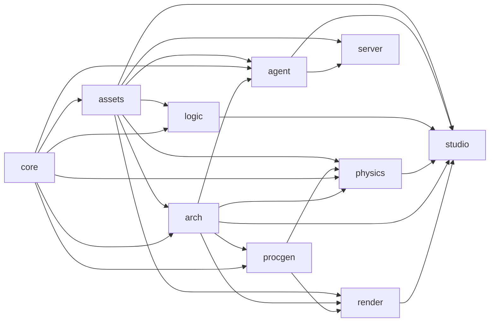
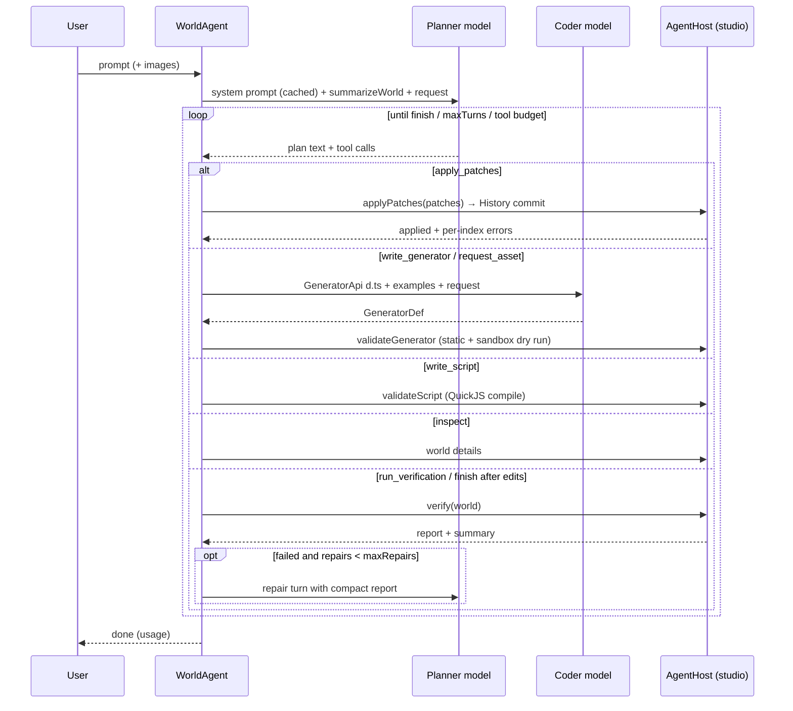
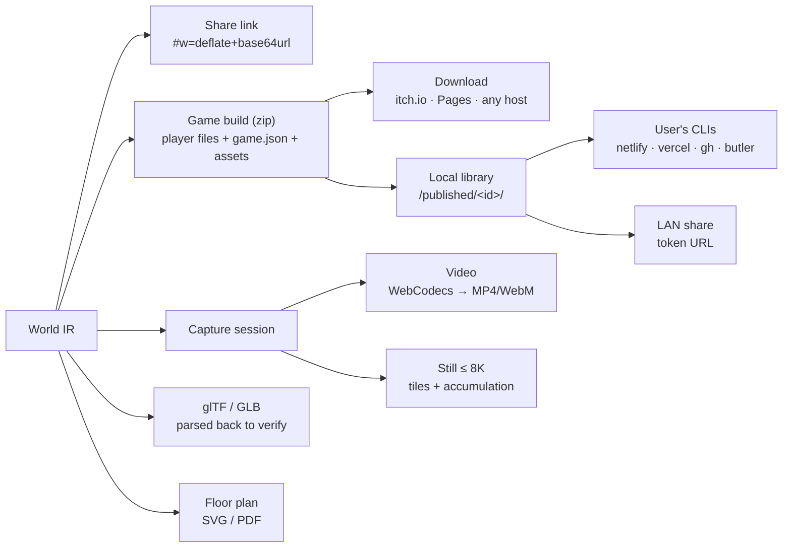
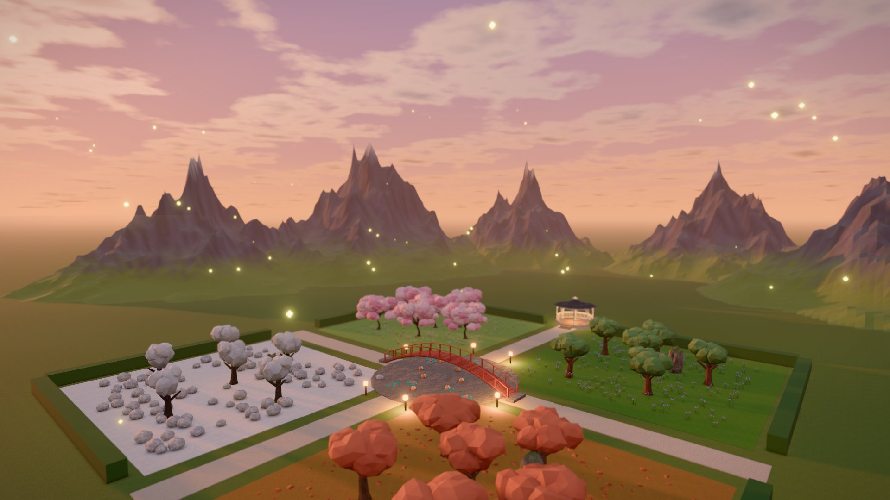
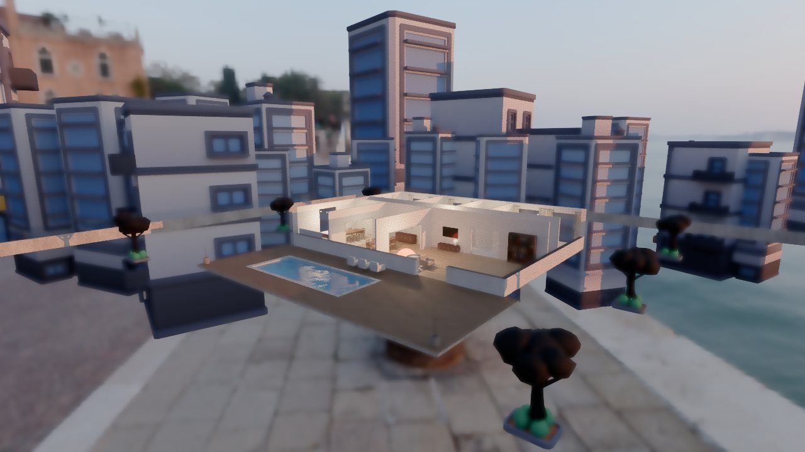

# Aether architecture

This document describes how Aether is built and why. The authoritative
contracts are [`packages/core/src/schema.ts`](../packages/core/src/schema.ts)
(the World IR) and [`docs/CONTRACTS.md`](CONTRACTS.md) (the public API of
each package). This document explains the design behind them.

- [1. Design principles](#1-design-principles)
- [2. Repository and package graph](#2-repository-and-package-graph)
- [3. The World IR](#3-the-world-ir)
- [4. Patch semantics](#4-patch-semantics)
- [5. History, undo, branches and time travel](#5-history-undo-branches-and-time-travel)
- [6. Procedural generation](#6-procedural-generation)
- [7. Physics and the verification algorithm](#7-physics-and-the-verification-algorithm)
- [8. Logic runtime](#8-logic-runtime)
- [9. Sandbox design](#9-sandbox-design)
- [10. Rendering and incremental sync](#10-rendering-and-incremental-sync)
- [11. The agent loop](#11-the-agent-loop)
- [12. Provider abstraction](#12-provider-abstraction)
- [13. Server](#13-server)
- [14. Studio runtime](#14-studio-runtime)
- [15. Determinism](#15-determinism)
- [16. Known limitations](#16-known-limitations)
- [20. Publishing](#20-publishing)
- [21. The verified-playable flow](#21-the-verified-playable-flow)

---

## 1. Design principles

1. **One explicit, serialisable world state.** Everything that defines a world
   is plain JSON in a `WorldDoc`. Renderers, physics and logic are
   *projections* of that document and never sources of truth.
2. **The model edits through typed patches, never directly.** Every change is
   a validated, invertible operation. That makes AI edits reviewable,
   undoable, diffable and cheap to send.
3. **Verify, don't trust.** Worlds carry executable expectations (tests).
   Deterministic code checks geometry, collisions, support and reachability;
   the LLM handles semantics and repair.
4. **Untrusted by default.** All model output and user input crosses a
   validation boundary. Code written by a model only runs in a sandbox.
5. **Headless first.** `core`, `procgen`, `physics`, `logic` and `agent` have
   no three.js or DOM dependency, so the same code runs in the browser, in
   Workers, in Node tests, in the smoke script and on the server.
6. **Deterministic.** All randomness is seeded (`rng`, `hashString` from
   core). Same document, seed and inputs give the same world and the same
   gameplay.

## 2. Repository and package graph

```
packages/
  core      World IR, patches, history, diff, queries, rng, summaries
  procgen   geometry kernel, noise, built-in generators, generator sandbox
  physics   Rapier wrapper, verify / diagnose / settle, character controller
  logic     rules, behaviours, QuickJS script runner
  render    three.js WebGPU/WebGL2 renderer, scene sync, cameras, tools
  agent     WorldAgent loop, tools, system prompt, providers, offline mock
  arch      parametric buildings: plans, walls, openings, roofs, stairs, furniture, nav checks
  voxel     block terrain, meshing, streaming, the block game kit
  assets    asset catalog (search, LOD, credits), import validation, image→3D provider
apps/
  server    Hono API: LLM proxy, share links, generator cache, static hosting
  studio    React 19 + Vite editor and player
scripts/smoke.ts        headless end-to-end agent run (mock provider)
tests/e2e/              Playwright browser run of the built studio
```



Arrows point from a dependency to its consumer. There are no cycles. The
packages use **source-level exports** (`"exports": {".": "./src/index.ts"}`),
so they have no build step: Vite bundles the studio and `tsx` runs the
server. `@aether/procgen/node` is a separate subpath so `node:vm` never
enters the browser bundle.

## 3. The World IR

`WorldDoc` (zod, version 1) is the single source of truth. Its conventions
are chosen to be easy for an LLM to produce correctly: metres, seconds and
kilograms; Y up; ground at y = 0; Euler rotations in **degrees** (XYZ order);
colours as `#rrggbb`; ids as lowercase slugs.

| Field | Contents |
| --- | --- |
| `entities` | Record by id. Each entity has `transform`, `shape` (`primitive`, `procedural`, `model`, `scatter` or `none`), `material` (22 presets plus overrides), `physics` (body type, collider, mass or density, friction, restitution, sensor, damping, CCD), `joint` (fixed, revolute, prismatic or spherical with limits and motor), `light`, `behaviors`, `state`, `parent`, `tags` and `template` |
| `rules` | WHEN (11 triggers: start, tick, timer, collision, enter, exit, key, click, state, event, fallBelow) / IF (state conditions) / THEN (17 actions: set, add, spawn, destroy, impulse, setVelocity, teleport, setProperty, enableBehavior, explode, setGravity, emit, message, sound, win, lose, reset) |
| `environment` | Sky preset, time of day, fog, weather, ambient and sun intensity, ground, gravity, bloom, exposure |
| `player` | Mode (orbit, firstPerson, thirdPerson or vehicle), spawn, controlled entity, speeds |
| `state`, `hud` | Global variables and the HUD bindings that display them |
| `generators`, `scripts` | Code written by the coder model (see §9) |
| `tests` | `stable`, `noOverlap`, `reaches`, `eventually`, `moves`, `topples`, `staysAbove` |

**Selectors** let rules, tests and behaviours refer to entities: `some-id`,
`#tag`, `player` and `*`. Templates are excluded from selector matches and
are only instantiated by `spawn`.

**Limits** (`LIMITS` in core) cap entities, rules, total scatter instances,
generators, scripts, tests, patches per call, hierarchy depth (64), state
keys, HUD entries, input depth, node count and string length.

## 4. Patch semantics

`applyPatches(world, patches, { atomic? })` is pure. It never mutates its
input and never throws.

**Pipeline for each patch:**

1. **Untrusted-input screen** before zod. Only plain objects are accepted.
   Any `__proto__`, `constructor` or `prototype` key at any depth is
   rejected, as are inputs that exceed the depth, node-count or string-length
   caps.
2. **Unknown-key detection.** Misspelt fields are rejected with a "did you
   mean" hint instead of being silently stripped. These lookups are capped at
   16 per batch, so hostile batches stay linear.
3. **zod validation** of the op.
4. **Application on a draft.** `update` deep-merges objects and replaces
   arrays. `null` deletes a key, and is stored only where the schema allows
   null. The entity is re-validated afterwards.
5. **Referential checks.** These cover: the parent exists, there are no
   cycles and depth stays within 64; joint targets and scatter `onSurface`
   targets exist; `player.controls` exists; selector syntax is valid; ids are
   not duplicated or reserved; and `removeGenerator` is refused while the
   generator is still in use.
6. **Forward references within a batch** are allowed. If a child is added
   before its parent, or `setPlayer` points at a later `add`, the patch is
   deferred and retried.

**Result:** `{ world, applied, errors }`, where each error is
`{ index, op, message }` written for the LLM to act on, for example
`entity 'car' update: physics.body must be one of static|dynamic|kinematic`.
With `atomic: true`, any error returns the original world. Entities that are
not touched keep **object identity** (structural sharing), and a batch that
changes nothing returns the very same world object. This is what makes
diffing and render sync cheap.

**Inversion.** `invertPatches(before, patches)` is built on
`patchesBetween(from, to)`, which emits steps in an order where every step
passes validation. It is exact for every op, including restoring rule order.
`removeGenerator` and `removeScript` exist (as additive schema members) so
that `defineGenerator` and `defineScript` can be inverted.

**Diffing.** `diffWorlds(a, b)` returns immediately when `a === b`, then
compares per entity by reference before falling back to a stable deep
compare. It reports added, removed and changed entities plus flags for the
environment, player, rules, generators, scripts, state, HUD, tests and meta.

## 5. History, undo, branches and time travel

`History` is a pure, serialisable data structure:

- Each entry stores the **resulting world** of its commit. Thanks to
  structural sharing this costs little, and undo, redo and checkout are
  pointer moves rather than patch replays.
- `commit(patches, message, source)` records `agent`, `user` or `system`
  edits. A batch that produces no change creates no entry.
- `checkout(entryId)` is non-destructive time travel. `branch(name)` creates
  a branch at the current position and switches to it (like
  `git switch -c`). `switchBranch` and `deleteBranch` complete the set.
- `maxEntries` pruning drops entries that can no longer be reached.
- `toJSON` stores the applied patches plus a full snapshot only for root
  entries. `fromJSON` re-validates everything and replays atomically, so a
  tampered save cannot smuggle in an invalid world.

## 6. Procedural generation

`@aether/procgen` produces plain typed-array meshes and collider
descriptions. It contains no three.js.

- **Kernel:** box, sphere, cylinder, cone, torus, capsule, plane, lathe,
  extrude (ear clipping), tube (parallel-transport frames), heightfield and
  faceted icosphere rocks. Normals stay correct under non-uniform scale and
  mirroring, displacement is seam-aware, and every call is capped by a
  vertex budget.
- **Noise:** its own seeded simplex implementation (`noise2`, `noise3`,
  `fbm2`, `ridged2`).
- **`GeneratorApi`:** the same small surface is handed to built-in and
  LLM-written generators. `add(mesh, material)` merges parts with equal
  materials, which reduces draw calls. `autoColliders('box' | 'hull')` and
  `build()` place the base on y = 0 and centre x and z (heightfield terrain
  keeps its frame).
- **36 built-in generators** in six categories (nature, architecture, props,
  vehicles, terrain, fx), each with 2 to 4 variants and typed params.
  `resolveParams` applies defaults, clamping and type coercion.
- **Heightfield colliders** use Rapier's native layout: heights normalised to
  [0, 1], X-major (`heights[ix*(rows+1)+iz]`), rows along Z and
  `size = [width, maxHeight, depth]`.
- **`generate(shape, world, { sandbox, cache })`** runs built-ins in-process
  (yielding first, so many generators do not block a frame). Custom
  generators **only** run through a `SandboxRunner`. A `GeneratorCache` (LRU)
  is keyed by generator id, stable params, seed and source hash, and
  in-flight requests are deduplicated. If generation fails, the renderer shows
  `fallbackOutput` (a visible crate) and records a warning.

## 7. Physics and the verification algorithm

`@aether/physics` wraps Rapier 0.21 (WASM).

**World construction.** Every non-template entity with a `physics` spec gets
one rigid body at its world transform. Shaped children without their own
physics become extra colliders on the nearest physics ancestor. `auto`
colliders map primitives to exact shapes, scaled by the entity's scale. A
torus becomes 12 convex segments and a plane a thin box. Non-uniform scales
that cannot be represented fall back to a hull. Procedural shapes use the
renderer's generator output (`ColliderProvider`) when one is available, and
otherwise run the built-in generator headlessly. Provider output is
validated and capped at 2048 colliders per shape. Scatter becomes one static
body with per-instance colliders, up to 2000 instances, using the **same
placement algorithm as the renderer** so what you see is what collides. The
ground is tiled (at most 100 m per tile) to avoid a float-precision sink in
the character controller.

**Stepping.** A fixed 1/60 s accumulator runs at most 5 substeps (to avoid a
spiral of death), and `alpha` is exposed for interpolation. Events are
de-duplicated per entity pair. Impulses come from contact-force events above
twice the body's weight. Entity ids are interned to small integers, so pair
keys are V8 small integers and draining a step's events builds no strings
and allocates nothing for steady contacts (an allocation probe asserts it).

**Incremental `sync(world, diff)`.** A body is rebuilt only when its physical
definition changes. A pure move teleports it, and colour edits are ignored.
Gravity and ground are updated, and joints whose target was rebuilt are
rebuilt too.

**`snapshot` / `restore` / `fork`.** The entity maps are stored as JSON in
front of Rapier's own snapshot. `restore` size-checks the snapshot, screens it
for prototype pollution and validates it with zod. A forked world matches the
original exactly after N steps (this is tested).

### `diagnose(world)` — static, at t = 0

Interpenetration (with the contact normal and the depth), floating dynamic
bodies, out-of-bounds bodies, too many bodies and invalid joints. Every
diagnostic names the entities and a concrete fix, for example
`crate-3 overlaps table by 0.12m` → `move crate-3 up to y=1.25`. Output is
capped per code to keep LLM context small.

### `settle(world)` — "drop and freeze"

Simulates dynamic bodies until they sleep (2 s by default), then writes rest
poses back as `update` patches relative to each entity's parent (rounded to
millimetres and 0.1°). Bodies that fell out of the world or are still moving
are reported instead of patched.

### `verify(world, { logic, maxSeconds, budgetMs })`

```
build an isolated headless PhysicsWorld from the document (never the live session)
attach gameplay logic through the LogicHook factory (rules + behaviours, headless host)
run diagnose() for static problems
turn every world.test into a running checker with its own simulated horizon
loop with fixed dt = 1/60:
    events = pw.stepFixed()
    logic.tick(dt, pw, events)
    for each undecided test: check(state) -> pass | fail | pending
    stop when all tests are decided, the horizon is reached, or the compute budget is spent
    every 8 ms of continuous stepping: yield to the event loop (keeps the UI responsive)
undecided tests time out with a descriptive failure
passed = every test passed AND no error-severity diagnostic
return { passed, results[], diagnostics[], simulatedSeconds, ms }
```

Verification passes only when every test passes **and** there is no
error-severity diagnostic. The compute budget counts world build,
diagnostics and stepping, but not time spent yielded to the host.
`verify` also takes `tests` (run only these indices: a shard), `diagnostics`
(skip the static checks), `signal` (abort at the next step) and `onResult`
(each test as soon as it is decided).
Because the simulation is headless and fixed-step, seconds of gameplay finish
in milliseconds. For example, 1000 dynamic boxes average about 2.3 ms per
step. `summarizeReport` turns the report into compact text for the repair
turn, for example "1/30 toppled within 10s; not: domino-1, …".

How each test kind is decided:

| Kind | Passes when |
| --- | --- |
| `stable` | Targets come to rest without drifting more than `maxDrift` |
| `noOverlap` | No dynamic pair starts interpenetrating |
| `reaches` | The target enters a zone (an entity's bounds plus a margin, or a sphere) within `within` seconds |
| `eventually` | A world or entity state condition becomes true (rules run headless) |
| `moves` | The target travels at least `distance` |
| `topples` | The target's tilt from upright exceeds `degrees` |
| `staysAbove` | The target never drops below `y` |

### Verification off the main thread

The studio never verifies on the UI thread. `VerificationService`
(`apps/studio/src/engine/verify/`) sends the world to a pool of module
workers (`verify.worker.ts`), each of which loads Rapier (and QuickJS, only
for worlds with scripts) on first use:

```
Studio / AgentBridge ──VerifyPool.verify(world, colliders)──▶ planShards(tests, lanes)
      ▲   ▲                        │ lane 1: tests [0, 3] + diagnostics ─▶ worker ─ progress … verified
      │   └ progress (per test) ◀──┤ lane 2: tests [1, 2]               ─▶ worker ─ progress … verified
      └──── merged report ◀────────┘ mergeShardReports (world.tests order)
```

- **Protocol.** zod on both ends, request ids, one terminal reply per
  request (`verified`, `failed` with `cancelled`, …), `progress` messages in
  between. The worker re-validates the world (`validateWorld`) and the
  colliders (typed arrays, counts, a 16 M-number cap). Renderer colliders
  are sent only for shapes the worker cannot rebuild from the document
  (model-written generators, imported models).
- **Fork verification.** With several tests and enough simulated time
  (≥ 3 s), the tests are split across lanes by their horizons
  (longest-processing-time first); every lane simulates the same
  deterministic world from t = 0, so a test's verdict does not depend on its
  lane (tested against a single run). Diagnostics run in the lightest lane.
- **Lanes.** At most 2 workers, 1 with fewer than 4 logical cores, ≤ 4 GB
  device memory or in low-memory mode. Idle workers are terminated after a
  minute; physics is prefetched in a worker 2.5 s after the first frame
  (idle callback, not in low-memory mode) and again when a prompt is sent.
- **Robustness.** Cancellation (`AbortSignal` → `cancel` message, checked
  at every 25 ms slice), a timeout per request (compute budget + 20 s cold
  start; the worker is then terminated), and a fallback to the cooperative
  main-thread verifier when module workers cannot start (old browsers, a
  CSP) or a worker crashes.
- **Live results.** Each decided test streams into the Verify panel and the
  viewport pill ("Checking 3/7…"), coalesced to one store update per 60 ms;
  the final line says how much physics was simulated, how fast and in how
  many parallel workers.

Measured (e2e, power-saving laptop, software GPU): while "Run checks"
simulates a rendered world in two workers, the longest main-thread task is
0 ms (Chromium) and the worst event-loop stall 53–62 ms; during agent turns
no main-thread script other than the renderer's frame callback runs longer
than 9 ms while a worker verifies.

## 8. Logic runtime

`LogicRuntime` is deterministic and host-agnostic. It talks to the outside
world only through `LogicHost`, which the studio implements with physics and
render, the headless verifier implements with physics only, and tests
implement with a recording fake.

- **Rules.** `once` and `enabled` flags and `if` conditions. `enter` and
  `exit` use sensor contacts or a containment fallback. `state` triggers fire
  when a condition goes from false to true. `emit` supports delays through a
  bounded queue. `spawn` clones templates into `template-N` ids with seeded
  spread.
- **Behaviours.** 26 built-in behaviours are documented in
  `BEHAVIOR_CATALOG`; the agent prompt is generated from that catalog. Moving
  behaviours on kinematic entities compose into one pose per tick (bob,
  spin and patrol stack instead of fighting each other). Dynamic bodies are
  steered by velocity.
- **Scripts.** The world state is serialized once per tick for all script
  calls (re-serialized only after a state write) and spliced into each
  snapshot, instead of being stringified for every call.
- **Safety rails.** At most 64 rule firings per tick, emit chains cut off at
  depth 8, 256 queued events, caps on spawns and zone checks, and unsafe
  property paths rejected. `tick` never throws; failures go to the log.
- **Trace.** `log` is a 500-entry ring buffer of readable lines, for example
  `rule 'coin-pickup' fired: … → score 2→3`. It powers the "why did this
  happen" view.
- **Hot reload.** `updateWorld` keeps state, `once` flags and spawned
  entities, and `reset` restores the start state.

## 9. Sandbox design

There are two kinds of model-written code, and each has its own isolation
stack.

### Generators (geometry code), `@aether/procgen/sandbox`

| Layer | Mechanism |
| --- | --- |
| 1. Schema | `GeneratorDef`: id regex, source ≤ 60 kB, typed params |
| 2. Static screen | `staticCheckSource` rejects `import`, `require`, `fetch`, `eval`, `Function`, `globalThis`, `postMessage`, timers and similar tokens anywhere, including in comments and strings. The rules are spelled out in `GENERATOR_API_DTS` so the model avoids them. |
| 3. Process isolation | Dedicated **Web Worker pool**, so code never runs on the UI thread |
| 4. Lockdown | Inside the worker, globals are shadowed, `Function` and related constructors are neutralised, intrinsics are frozen, and there is no network |
| 5. Watchdog | A per-run timeout terminates the worker and restarts the pool slot |
| 6. Output validation | `validateOutput` on the main thread checks shape, types, NaN or Infinity and the vertex cap (≤ 2M), and validates collider descriptions again in physics |

The `node:vm` variant (`@aether/procgen/node`) uses a cross-realm membrane. It
is for tests and optional server validation only, and its docs state that it
is **not** a security boundary. On the server it is off by default; when
enabled it runs in a `worker_threads` Worker with V8 heap caps, a terminate
watchdog and a bounded queue (overflow returns 503).

### Behaviour scripts, `@aether/logic/scripting`

| Layer | Mechanism |
| --- | --- |
| 1. Schema | `ScriptDef`: id regex, source ≤ 30 kB |
| 2. Interpreter isolation | **QuickJS compiled to WASM** (`quickjs-emscripten-core` with the single `@jitl/quickjs-wasmfile-release-sync` build, loaded lazily). Untrusted code is never `eval`'d by the host engine. |
| 3. Capability denial | No host functions are exposed. `Date`, `Promise`, `Proxy` and `RegExp` are removed, `eval` and `Function` are throwing stubs, and `Math.random` is seeded. |
| 4. Data-only boundary | A JSON snapshot goes in and a JSON list of intents comes out. No handles cross the boundary, and handles are disposed on every call. |
| 5. Resource limits | 8 MB memory per script by default, 128 KB stack (capped at 256 KB), a 128 MB shared heap budget, a 2 ms call budget, at most 24 calls per tick (round robin), and disable after 3 overruns or 10 errors |
| 6. Intent validation | At most 32 intents per call, validated in the runner and again in the runtime |

Interpreters that crash are abandoned rather than freed, because freeing them
would abort the module, and the module is recycled after 4 abandoned
runtimes.

## 10. Rendering and incremental sync

`WorldRenderer` (three.js r186) runs `WebGPURenderer` on its WebGPU backend
or, when the backend policy says so (or WebGPU is missing or fails to
initialise), on its WebGL2 backend. The policy prefers WebGPU on Chromium
and Safari and WebGL2 on Firefox, where WebGPU is used only for a known-good
discrete or Apple GPU outside Linux; a WebGPU start that never finished
disables WebGPU for the origin. Settings: ACES tone
mapping, sRGB output, environment-driven exposure, bloom plus a subtle
vignette through `RenderPipeline` (disabled automatically if it fails), PCF
shadows with a softened radius, and a sun shadow camera refitted to the
meaningful content.

**Memory budgets.** On a laptop with an integrated GPU, GPU memory *is* system
memory, and drawing-buffer pixels dominate it: a multisampled half-float
scene target, its resolves, the bloom chain and the swap chain cost roughly
100–140 bytes per pixel (measured). `classifyGpu` sorts the GPU (WebGL
renderer string or WebGPU adapter info) into discrete, integrated, software
or unknown, and `renderBudget` gives each class a pixel-ratio cap (1.5,
1.25, 1, 1.25), an absolute drawing-buffer cap (3.7, 2.1, 1.4, 2.1 MP), a
2048² (software: 1024²) sun shadow map, an instance budget and a generator
cache byte budget. Low-memory mode overrides the class: ratio 1, about 1 MP,
1024² shadows, no MSAA, no post pass, smaller caches. The post pipeline is
released whenever a world does not use bloom and rebuilt on demand. A lost
device or context stops drawing and is reported to the host, which replaces
the renderer on a fresh canvas.

**Art direction.** Every world should look composed in the first seconds,
whatever the model wrote, so the look is policy rather than per-world tuning:

- *Sky.* The preset (`day`, `dawn`, `sunset`, `night`, `overcast`, `space`,
  `studio`) is authoritative; `timeOfDay` moves the sun only inside the
  preset's window. The sun's compass bearing is chosen relative to the
  default camera, so a low sun rakes across the frame (warm lit faces, cool
  shade, long sideways shadows) instead of flattening the scene from behind
  the camera or silhouetting it from the front. Golden-hour skies are
  sampled a few degrees lower than the light; nights get a moon rim light, a
  starfield and a faint galactic band; space gets a procedural nebula.
- *Fog.* Densities are scaled to the content radius: the content's far edge
  stays under ~5 % fog from the framing distance, backdrop mountains fade to
  ~15–45 %, and only explicitly foggy worlds may go twice as thick. Fog,
  dome horizon and sky reflections share one horizon color.
- *Framing.* After a build, the camera frames the bounding boxes of the
  meaningful content (scenery, sky and huge terrain excluded, `focus`
  entities weighted) from an elevated three-quarter view, tilted up so a
  band of sky shows, never below the ground; edits only re-frame when the
  changed entities are off screen.
- *Materials.* Lava and water carry procedural, tileable detail (glowing
  Worley cracks, a ripple normal map) on box-projected metre UVs, so detail
  has the same scale on a pond and a sea. Mountains sink and trim their
  foothill plate and paint their foothills in the world's ground color.
- *Materialize.* New entities grow out of the ground in a ripple from the
  content center (content-group scale only; physics and bounds are
  untouched). Disabled for `prefers-reduced-motion`.

`npm run gallery` renders every smoke prompt (and `-- --skies`, the starter
world under each preset) to `docs/screenshots/gallery/` for visual review.

**`SceneSync`** applies `diffWorlds` output:

- Only added, removed and changed entities are touched, and unchanged
  objects keep their identity. Parent and child links are honoured, and
  templates are skipped.
- Geometry and materials come from **reference-counted caches** keyed by
  stable JSON (`proceduralOutputKey` is shared with generation). Each mesh
  has one private material whose values are mutated in place, so glowing or
  fading objects do not rebuild GPU programs.
- Procedural entities show a placeholder while their generator runs. Results
  that arrive for an outdated world are discarded. Old resources are released
  only after new content is mounted, so nothing flickers.
- **Scatter** uses instanced meshes with one shared matrix buffer, the same
  seeded placement as physics, `onSurface` projection onto terrain (re-placed
  when the terrain moves), device-dependent budgets, and no shadows on
  layers over 2000 instances.

**Runtime path.** `applyTransforms(packed, order)` consumes the physics
`Float32Array` without allocating, and handles bodies with parents.

**Frame-loop performance.**

- *Zero allocations per frame.* An allocation probe (V8 sampling heap
  profiler, collected objects included) drives the per-frame code headless —
  physics pose application for 500 bodies, camera rig, grow-in, highlighter,
  weather (5000 particles), sky, static batches, BVH ray misses, adaptive
  resolution — and asserts < 16 sampled bytes per frame from render code.
  It found and fixed array destructuring in the weather update, Map entry
  iteration in the highlighter and boxed doubles in the camera damping.
- *Raycasts through a BVH.* Meshes with ≥ 512 triangles (terrain, big
  generated props, editable meshes) raycast through a linear BVH (Morton
  order, built at the next idle moment, refitted when vertices move). On a
  131k-triangle terrain a ray costs 0.03–0.05 ms instead of 11–21 ms; this
  covers picking, gizmo snapping, brushes and the chase camera's per-frame
  occlusion ray.
- *Static-prop instancing.* At least six identical static props (same
  primitive, material and shadow flags) are drawn as one `InstancedMesh`.
  Member meshes stay in the scene on a layer that cameras skip but
  raycasters test, so picking, outlines, gizmos and runtime overrides work
  unchanged; a member that changes material, moves out or is removed leaves
  its batch.
- *Adaptive resolution.* While continuous rendering stays below 40 fps for
  1.5 s, the drawing buffer is scaled down in steps of 0.8 (to 0.5 of the
  budget); it is restored after 5 s above 56 fps, and an upscale that has to
  be undone doubles the wait. The scale only ever lowers the GPU budget's
  ratio (low-memory mode included).
- *Asynchronous captures.* Critique views and thumbnails render into a
  reused render target set as the renderer's *output* target (same tone
  mapping, color space and post pipeline as the screen) and are read back
  with `readRenderTargetPixelsAsync` (WebGPU buffer mapping, WebGL2 pixel
  buffer + fence), then encoded on a CPU-backed canvas with `toBlob`. A
  synchronous canvas readback used to wait for the GPU: 24–37 s on a
  software GPU, now none.
**Scale geometry.** Two systems let a world hold far more geometry than a
frame can draw. Both plan on the CPU and submit ordinary instanced or
indexed draws, so WebGPU, WebGL2 and Firefox behave the same; both are
re-planned in `draw()` whenever the camera (or a capture camera) changed,
throttled to one re-plan per 120 ms while the camera keeps moving, and are
allocation-free per frame (allocation probe).

- *Virtual geometry* (`virtual/`). Parts with ≥ 20 000 triangles are split
  into 128-triangle clusters; groups of four adjacent clusters are
  simplified to half with their outer border locked (our quadric-error,
  half-edge-collapse simplifier, so no vertex is ever created and all levels
  share one vertex buffer) and re-split, level after level, into a cluster
  DAG whose errors and bounding spheres are monotone. A cluster is drawn when
  its projected error is ≤ 1 px but its parents' is not; since every cluster
  made from one group shares that group's error and sphere, the cut is
  watertight. Hierarchies build in `dag.worker.ts` (validated messages,
  timeout, byte-capped cache); meanwhile the full-detail mesh stays on the
  raycast-only layer (picking, snapping and the chase camera use its BVH)
  and is never drawn. All instances of a mesh pack their cuts into one
  dynamic index buffer (uploaded from the first changed instance); a budget
  governor raises the error threshold when cuts exceed the GPU class's
  triangle budget. Shadow casters skip cluster frustum/back-face culling
  (off-screen parts can shadow the view); LOD still applies, and a caster
  keeps its cut while the camera moved < 1.5 % of its distance or while it
  is far outside the view. These buffers use *static* usage on purpose:
  three re-uploads `DynamicDrawUsage` buffers on every draw, so changes go
  up only through version bumps with accumulated update ranges.
- *Scatter fields* (`virtual/field-culler.ts`, `scatter-field.ts`). Layers
  of ≥ 2 000 instances (up to 1 000 000 per entity) are packed into 20-byte
  records, sorted into ~128-instance chunks and drawn through one instanced
  mesh per (LOD level, part). LOD levels come from the same simplifier
  (faceted generator meshes are re-flattened). Each re-plan culls chunks
  against a padded frustum, picks a level from the projected instance size
  (with hysteresis) and spends the field's share of the triangle budget
  front to back, demoting or dropping far chunks. Level buffers are written
  in stable chunk order and uploaded only from the first changed chunk.
  Vegetation fields use the `foliage` material variant: a TSL position node
  bends crowns in a procedural wind (vertex shader only).
- *Showcase.* The offline planner's "Canyon of Colossi" (prompt: "a canyon
  with a million trees and ancient statues") uses both: 1 M pines in two
  fields, 41 sculptures from the `colossus` generator sharing three meshes,
  and a canyon terrain (itself virtual geometry). The viewport badge shows
  scene vs drawn triangles; `npm run e2e:benchmark` measures it.
- *Grade.* The post pass applies a colour grade derived from the sky state
  (split tone toward the key light and the zenith, saturation, contrast
  pivot) in the same composite pass; uniforms only.
- *Camera director.* `startTour()` flies a loop around the content
  (`view/tour.ts`: keys from the framing sphere and the focus objects, low
  passes and high reveals, a Catmull-Rom spline with eased timing, starting
  and ending at the current view); any pointer or wheel input, or any camera
  command, stops it. The studio's camera button starts it.
- *Resolution governor.* `AdaptiveResolution` decides on the 90th-percentile
  frame time of the last 48 frames, so periodic stutter scales the buffer
  down even when the mean frame rate looks fine.

`setEntityProperty` accepts only validated paths. `addTransient` and
`removeTransient` handle runtime spawns. `clearRuntimeOverrides` resets the
scene when play stops.

**Tools.** Orbit, follow and first-person cameras; `focus` fly-to; picking
(scatter layers are picked by their bounds); selection boxes; a ghost preview
of a proposed world that shows only what it adds or changes; debug overlays
(colliders, bounds, diagnostics); and `screenshot` and `renderViews`
(top, front, side, iso) as JPEG data URLs for visual critique.

## 11. The agent loop

`WorldAgent.run(prompt, host, opts)` is an async generator of `AgentEvent`s
(`status`, `plan`, `patches`, `generator`, `verify`, `repair`, `message`,
`error`, `done`). It **never throws**. It always ends with exactly one `done`
event that carries token usage.



- **Tools.** `apply_patches`, `write_generator`, `write_script`, `inspect`,
  `run_verification`, `finish` and `request_asset`. Each has a hand-written
  JSON Schema for the model and a matching zod validator in the executor.
  Tool results are short and list each rejected patch by index and reason.
- **Context.** The world travels as `summarizeWorld` text: deterministic
  ordering, focus entities and truncation. The summary and the user request
  sit in explicit tags, and any copy of those tags inside untrusted text is
  neutralised. Prior chat history is reduced to text, and images are capped
  at 4.
- **System prompt.** Built from the live catalogs (generators, behaviours,
  rule docs, generator API d.ts, script API d.ts, examples) and byte-for-byte
  identical across builds, so provider prompt caching works.
- **Budgets.** `maxTurns`, `maxRepairs`, a total tool-call budget, input size
  limits and prompt abort (even mid-call) through `AbortSignal`.

**AgentHost in the studio (`AgentBridge`).** Patches become History commits
with source `agent`. Verification runs headless physics with the world's
logic attached through the same headless host used by `scripts/smoke.ts`.
Generators are dry-run in the Worker sandbox, scripts are compiled in
QuickJS, and screenshots come from the renderer.

## 12. Provider abstraction

```ts
interface Provider { readonly name: string; complete(req: CompletionRequest, signal?: AbortSignal): Promise<CompletionResponse>; }
```

A `CompletionRequest` names a **role** (`planner`, `coder` or `critic`), not a
model. That lets the server map roles to allowlisted models.

| Provider | Where | Notes |
| --- | --- | --- |
| `createAnthropicProvider` | Server, or browser with the user's own key | Raw `fetch` to the Messages API. Cache breakpoints on the system prompt and the last tool, a per-role `effort` level, and thinking blocks passed back unchanged. Refusals and truncation map to stop reasons. |
| `createOpenAIProvider` | Server, or browser with the user's own key | Raw `fetch` to the Responses API with `store: false`. Function calls map to `tool_use`. Encrypted reasoning items are carried across turns. |
| `createChatCompletionsProvider` | Browser (user's own key) / Node | OpenAI-compatible Chat Completions with function tools, for OpenRouter and Google Gemini. Tool results become `tool` messages, images become `image_url` parts |
| `createHttpProvider` | Browser | Posts to `/api/llm`, never sends a model id, and validates the reply with zod |
| `createMockProvider` | Anywhere | Deterministic offline planner: 18 themes, mood combinations (night, rain, fog, low gravity and more), edit commands and the generator library by name. It emits plan, `apply_patches` and `finish` calls just like a real model. |
| `createBridgeProvider` | Browser / Node | Posts to the local Aether Bridge (`/v1/complete`, bearer token from pairing); the bridge drives Codex or Claude Code headless |
| `createEmulatedProvider` | Anywhere | Tool use for text-only backends: asks for one JSON object `{thoughts, tool_calls, final_message}`, validates it with zod, re-asks once on invalid JSON, maps it to `tool_use` blocks |
| `createWebLlmProvider` | Browser | On-device model (WebLLM, lazy chunk, WebGPU) through the same emulation, with JSON-schema constrained output. These models hold 4,096 tokens (input and output), while the full planner prompt is about 15k, so the studio runs `WorldAgent` with the **compact prompt profile** (condensed IR, catalog ids only, one example, `apply_patches` + `finish`, short summary and history): measured against a 135-entity world with prior chat history, the first call is about 2.6k tokens (estimated at 3 characters per token) with the full 1,200-token answer budget, and the follow-up call about 3.0k with 1,026 left. Requests that still do not fit are refused before generating and fall back with an explanation |
| `createFallbackProvider` | Anywhere | Wraps any primary: on failure (offline, not signed in, rate limited, timeout) it reports once and continues with the offline planner |

All three networked providers retry up to 3 times with exponential backoff and
jitter on 429, 5xx, 529 and network errors, and honour `retry-after`. Other
4xx errors are never retried. Each attempt has its own timeout combined with
the caller's abort signal, and responses are size-capped.

**Selection.** The studio's AI connection manager (`apps/studio/src/ai/`)
resolves the preferred mode per project: `auto` uses Codex / Claude Code on
this computer, else a paired, signed-in bridge, else a live server, else the
user's own API key, else a loaded on-device model, else the offline planner; `offline`, `server`,
`bridge`, `webllm` and `byok` force one. Every networked choice is wrapped in
a provider chain (`apps/studio/src/ai/chain.ts`), so a failure never leaves a
blank world or a stuck spinner: the chat shows a notice with the precise reason
(the bridge classifies CLI failures into model unavailable, context too large,
network, rate limit, sign-in, or an excerpt of the real error with paths and
tokens removed), the run retries with the user's other signed-in assistant
(Codex then Claude Code, or the reverse) and only then does the offline planner
finish the turn. A dead bridge or expired pairing skips the second assistant
(it sits behind the same door).
On the server, `AETHER_PROVIDER` defaults to `mock`; `codex` / `claude-code`
use this machine's signed-in CLI through the same locked-down backends as the
bridge; `anthropic` / `openai` need a key and are never used by default.

### 12.1 Zero-cost connections: the Aether Bridge

Hosted pages cannot reach a user's CLI, and the project owner must not pay
per prompt, so the bridge runs on the user's own computer:

```
browser studio ──(pair: code → 256-bit token)──▶ 127.0.0.1:8790 Aether Bridge
      │  POST /v1/complete {backend, model, effort, request}       │
      │  Origin allowlist · CORS + PNA preflight · ≤ 16 MiB         ├─ Codex   (@openai/codex-sdk, ChatGPT sign-in)
      ◀── CompletionResponse (tool_use blocks via emulation) ───────┴─ Claude Code (`claude -p`, user's sign-in)
```

World content is untrusted (prompt injection can hide in names, notes or
images), so each run happens in a fresh empty temp directory that is deleted
afterwards, with an allowlisted environment (no keys or tokens), approval
`never`, a read-only sandbox, network and web search off, and every tool,
shell, patch, MCP server, plugin and browser feature disabled. Codex output
is constrained by a strict JSON Schema and any tool event aborts the run;
Claude Code runs with an empty tool list plus a deny list, no MCP, no
settings, no session persistence. The model can only return text, which the
emulation layer validates. One job per backend runs at a time (≤ 4 queued),
identical requests hit a content-hash cache, and timeouts or a cancelled
request kill the child process.

Measured on the development machine (one call each, low effort, the full
planner prompt plus a two-tool request): Codex (`gpt-5.6-sol`) 22.3 s,
Claude Code (`haiku`) 6.1 s. The offline planner answers in under 0.2 s.
A whole studio turn through the bridge (`npm run e2e:bridge`, prompt "a small
lighthouse on a rocky islet at sunset", refine off: plan, a new generator,
patches, verification, repairs and the quality pass), latest run in
Chromium: Claude Code `haiku` 54 s (one repair round), Codex `gpt-6.1-sol`
140 s (two repair rounds); an earlier run took 28 s with Claude Code and 59 s
with Codex `gpt-5.6-sol`, and 81 s with Claude Code in Firefox. The spread
comes from how many repair rounds the model needs. Every world was verified,
with quality scores of 88–95.

The studio reconciles the saved model with the catalog the bridge reports
(`effectiveBridgeChoice`): a model that the signed-in CLI no longer lists is
replaced by that backend's default instead of failing every call.

Browsers: from a hosted https page, Chromium and Firefox may call
`http://127.0.0.1` (Chromium may first ask for local-network access, and the
bridge answers the Private Network Access preflight). WebKit (Safari and all
iOS browsers) blocks it as mixed content, so the setup pane says so and
points to running the studio locally.

### 12.4 Local AI on this computer and the coding-agent worker

When the Aether server runs on the user's own machine (development, or
`npm run start` without hosting markers), it offers local AI under
`/api/local/*`, and the studio prefers it automatically: Codex first, then
Claude Code, then the paired bridge, the server model, a loaded on-device
model and finally the offline planner. Hosted deployments never offer it
(`AETHER_LOCAL_AI` is `off` in production and on hosting platforms, and the
routes refuse anything but direct loopback requests without proxy headers),
so nobody's subscription is ever spent on behalf of visitors.

```
studio ──/api/local/complete──▶ server ──spawn──▶ worker process (one per call, own process group)
   │                                 │               └─ locked-down Codex / Claude Code completion (as the bridge)
   │                                 │
   └──/api/local/jobs (+ SSE events)─┴─ JobManager (durable, one at a time) ──spawn──▶ worker process
                                                       └─ coding agent in a throwaway workspace:
                                                          write out/generator.json → node check.mjs → fix → …
```

- **Crash isolation.** Every call and every build runs in a fresh Node
  process with an allowlisted environment (no keys), detached in its own
  process group. A timeout or a cancel sends SIGTERM to the group, then
  SIGKILL; the host stops every worker on shutdown. Progress arrives as
  validated `AETHER_PROGRESS` lines on stderr; the result is one JSON object
  on stdout.
- **Quick completions** reuse the bridge's locked-down backends (read-only,
  tool-less). Conversations are resumed per project: the server keeps the
  Codex thread id or Claude session id for `p-<projectId>` (LRU, 6 h) and
  sends only the new part of the conversation; deleting the project forgets
  it. The chat's last line names the models that answered and the tokens
  used.
- **Deep builds.** With "Deep build" on (the default when local AI is
  connected), a new asset requested by the agent is built by a coding agent
  instead of one single-shot reply. The workspace is a private temp folder
  holding only the generator API, worked examples, the task and `check.mjs`
  (bundled once with esbuild from `check-entry.ts`: schema, static screen,
  sandbox runs for three seeds, size/grounding/silhouette heuristics and a
  four-view `preview.png`). Codex runs in its `workspace-write` sandbox with
  network off, approval `never` and a core-only environment, on one thread
  across rounds; Claude Code runs restricted to Read/Write/Edit and
  `node check.mjs`, with every tool call screened. After each round the host
  runs the checker and feeds failures back, up to the budget shown in the
  composer (rounds and minutes). The checker runs generator code only under
  the Node permission model (workspace read, `out/` write, no processes or
  workers); it confines itself when the agent starts it, and the host runs
  its own untouched copy. Only the final artifact is read (no links
  followed), screened and validated by the confined checker, then once more
  by the studio's generator sandbox; the workspace is always deleted. If
  the build fails, the agent falls back to the quick single-shot coder.
- **Durable queue.** Build jobs are persisted (record + capped JSONL event
  log, files 0600) and streamed as server-sent events with an `after` cursor,
  so the studio reconnects without losing or repeating progress. Provider,
  account, model and effort are frozen when a job is queued; jobs interrupted
  by a restart are marked failed.
- **Sign-in and accounts.** The settings pane runs the CLIs' own sign-in
  flows (`codex login --device-auth`, `claude auth login --claudeai`) and
  shows only the verification link and one-time code they print; Aether
  never reads, stores or transmits credential files. Extra Codex accounts are
  separate `CODEX_HOME` folders (0700) listed in a token-free registry
  (0600); switching is manual and waits for running jobs. The paired bridge
  offers the same sign-in buttons through `/v1/auth/*`.

### 12.2 Generator library

`packages/procgen/library/*.json` holds 40+ generators for common objects the
built-ins do not cover. `npm run library` asks Codex for each object (one call
at a time, bounded budget, one repair attempt with the checker's error) and
keeps only generators that pass static checks, sandboxed runs with three
seeds, output validation and a CPU silhouette check. The catalog
(`library-index.ts`) is small and eager; each source file is its own lazy
chunk. The offline planner and the model prompt both see the catalog, and
`WorldAgent` defines a library generator in the world just before the first
patch that uses it, so it then behaves like any custom generator (sandboxed,
saved with the world, shareable).

### 12.3 Quality loop

After the agent finishes, the studio renders four views (top, front, side,
iso) into a corner of the existing drawing buffer (viewport + scissor, one
reused crop canvas, then the frame is redrawn), so a capture never
reallocates the canvas buffers, computes view statistics (coverage, edge density, contrast,
colourfulness) and scores the world against the rubric with deterministic
heuristics (grounding, overlaps, emptiness / density, scale sanity, palette
harmony, lighting for the mood, framing, prompt coherence). With a
vision-capable connection the views also go to a critic call whose JSON
verdict is blended in. Below the threshold (72) and within the per-project
refine budget, targeted improvements are applied (re-grounding, separating
overlaps, densifying sparse scenes, night lighting, golden-hour sky, palette
correction) or the agent gets a focused refine instruction. `npm run eval`
reports the same scores per prompt and model.

## 13. Server

`apps/server` is a Hono app on Node 24. `createApp(config, deps)` receives
every side effect (provider, clock, client IP, generator check, shutdown
signal), so the whole server is tested offline.

- **Routes:** `GET /api/health`, `POST /api/llm`,
  `GET/PUT /api/generators/:hash` (content-addressed by
  `sha256(stableStringify(GeneratorDef.parse(def)))`),
  `PUT/POST /api/worlds` and `GET/PUT /api/worlds/:id` (random 12-character
  base62 ids, with overwrite protected by a hashed `X-Edit-Token`).
- **Middleware order:** request id → access log (no bodies) → CORS allowlist
  and foreign-origin guard → per-IP token-bucket rate limit (separate buckets
  for `/api/llm` and generator uploads; health is exempt) → per-route body
  limit (JSON 413) → security headers. Errors are always
  `{ error, message?, issues? }` and never include stack traces.
- **Abuse controls:** a daily token budget (in memory, resets at midnight
  UTC), an upstream timeout, abort on client disconnect and capped output
  tokens.
- **Storage:** atomic temp-file-then-rename writes inside `DATA_DIR`, with
  regex-validated ids, re-checked resolved paths, capped entry counts, and a
  slot reserved before each write to avoid races.
- **Production:** serves `apps/studio/dist` with immutable caching for
  `/assets/*`, `no-cache` for HTML, an SPA fallback and correct
  `application/wasm` types.

Full details are in [`apps/server/README.md`](../apps/server/README.md).

## 14. Studio runtime

- **Verification** runs in workers (see §7, "Verification off the main
  thread"); the cooperative main-thread verifier is only the fallback.
- **`Simulation`** owns the renderer and, in play mode, the physics world,
  the logic runtime and the player character controller. It runs a fixed
  60 Hz loop outside React: `physics.step` → `logic.tick` →
  `renderer.applyTransforms` → `renderer.render`. Edit mode renders on
  demand. Play snapshots the document by reference (documents are
  immutable). Stop discards every runtime change and restores the pre-play
  world exactly. Rapier is imported lazily (on the main thread
  only on the first Play; verification loads it inside its worker) and
  QuickJS only when a world with scripts runs or is validated. Neither is
  modulepreloaded: the first frame never waits for them. Rapier's WebAssembly
  ships as a hashed `.wasm` file shared by the page and the workers and is
  compiled with `instantiateStreaming` (a build plugin replaces the 4 MB
  base64 string of `rapier3d-compat` after checking the shipped file is
  byte-identical); the main Rapier chunk went from 4.3 MB to 0.22 MB. The loop
  stops while the page is hidden; after 30 s without input an edit-mode
  viewport also stops redrawing animated weather.
- **Memory.** Low-memory mode (`src/lib/memory.ts`) is a setting
  (auto, on, off). Auto turns it on when `navigator.deviceMemory` is 4 GB or
  less, under JS heap pressure, or after a lost GPU context, and shows a
  "Low memory" badge. It applies the renderer's low-memory budget and caps
  undo history at 40 entries (150 otherwise). A lost context remounts the
  viewport canvas with a new renderer (WebGL2 after a lost WebGPU device), at
  most three times in two minutes. Generator outputs are cached under a
  byte budget, idle generator sandbox workers are terminated after a minute,
  and `npm run e2e:memory` asserts the budgets in Chromium and Firefox.
- **`Studio`** is the controller React calls into, one per opened project.
  It handles autosave (debounced, serialized writes through the projects
  repository, with a save indicator), import and export, share links,
  verification, thumbnails, asset placement, camera presets, gizmo edits and
  agent streaming with a Stop button. A boot marker detects a world that
  crashed the tab on start-up and opens the starter world instead, keeping
  the old one one Undo away.
- **Editor.** `Editor` (`src/engine/editor/`) owns selection (click,
  shift/ctrl toggle, marquee), the multi-selection gizmo (a pivot proxy that
  moves the objects live and commits once on release; local/world space,
  pivot modes, grid/angle/surface/vertex snapping), align/distribute,
  duplicate, copy/paste between projects, group/ungroup, reparenting, hide
  and lock. Procedural parameters regenerate in a module worker
  (`ComputeClient`, debounced) and "Bake to mesh" turns generator output into
  an editable mesh asset that keeps a link to its source. Mesh edit mode,
  sculpt, vertex paint and scatter paint run their heavy work in the same
  worker and preview on the GPU (partial attribute uploads) before writing
  one undoable commit per operation or stroke; physics rebuilds the collider
  of a changed mesh. Locked entities are skipped by editor tools and the
  agent alike, and the agent is told which entities the user edited by hand
  so "make the tower I just moved taller" resolves to the right object.
- **Projects** (`src/projects/`) live in IndexedDB: small metadata records
  for the home page, the world + chat body loaded only when a project opens,
  and WebP thumbnails. Everything read back is validated (zod for metadata,
  `validateWorld` for worlds, `reviveChat` for transcripts); writes are
  size-capped and quota errors become actionable messages. Without IndexedDB
  (some private modes) an in-memory backend keeps the session working.
- **Shell.** Hash routes switch between the projects home and the editor;
  the editor and the engine (three.js, physics glue, agent) are a lazy chunk
  prefetched on intent (hover / focus of a card), so the home page loads
  about 460 KB of JS. The layout has four modes by width (wide, medium,
  tablet, phone; `src/lib/layout.ts`) and the viewport never remounts when
  the mode changes. Camera-dependent overlays (axis gizmo, labels) are
  updated outside React from the simulation's view listener, only on frames
  that redraw. One fixed-position tooltip element serves every `data-tip`.
  The design system is in `src/styles/` (OKLCH tokens, light and dark).
- **State** lives in a Zustand store. It skips unchanged values, and stats
  and HUD updates arrive at 4 Hz.
- **Rendering of AI text** goes through a small rich-text renderer that never
  emits HTML.

## 15. Determinism

- Seeded `rng` (sfc32 seeded through splitmix32) and FNV-1a `hashString` for
  every generator, scatter layout, behaviour and spawn spread.
- Fixed-step physics and logic.
- The mock provider and the system prompt are byte-stable.
- One known exception: a script cut off by its wall-clock budget can make a
  replay differ.

## 16. Known limitations

- The first frame after a new world or new lighting compiles three.js node
  materials on the main thread (measured 0.7–4 s on a power-saving laptop
  with a software GPU); verification and captures no longer add to it.
- Static-prop instancing covers identical static primitives only; generated
  (procedural) props are unique per seed. Distant scatter uses QEM LOD
  levels (no impostor billboards).
- Virtual geometry and scatter fields plan on the CPU: re-plan frames while
  the camera moves cost a few milliseconds (p90 above p50); GPU compute
  culling would remove that on WebGPU only. Ghost previews (proposed worlds)
  draw sculptures at full detail. On software rasterizers (SwiftShader) the
  showcase is GPU-bound at about one frame per second.
- `spawn` copies the template entity but not its children.
- Prismatic joints between bodies with different starting orientations align
  the slide axis only approximately.
- Rate-limit and token-budget counters are in memory and per instance, which
  is suitable for a single hosted deployment.
- A `null` stored inside free-form JSON state cannot be restored by
  `invertPatches`, because `null` means "delete" in updates. History undo is
  unaffected because it does not replay inverse patches.
- Publishing: a QR code fits share links up to about 2.9 KB (most worlds
  are larger and share the link itself); Firefox opens links up to about
  1 MB, Chromium up to the player's 1.5 MB cap. Videos are ≤ 120 s and
  ≤ 1920 px; MP4 is chosen only where the browser can also play H.264
  back, else WebM; browsers without WebCodecs record in real time with MediaRecorder,
  dropping frames on a slow device. glTF exports what the camera draws
  (scatter fields and virtual geometry at their current detail). Deploys
  to the user's hosting need the local app (or a hosted studio paired with
  it); GitHub Pages can take a minute to go live after the first deploy.

## 17. Block worlds (voxel terrain and the game kit)

A world can carry block terrain in `world.voxel`: a seeded generator
preset, custom blocks, an ordered list of document edits (boxes, spheres,
structures, pixel art, text …) and game-kit settings. The document stays
small (a castle is one edit, not 200 000 blocks); everything else is
derived deterministically from it.

**Engine (`@aether/voxel`, no three.js).** Chunks are 16 × 16 columns of
the full 128-block height, stored palette-compressed (an index of 0–16
bits per cell; typical terrain packs into 2–4 bits). Terrain mixes
continentalness, hills and ridged mountains into six biomes, carves
spaghetti and cheese caves from an interpolated 3D noise field, places ore
veins and trees/cacti/flowers per chunk (structures that cross a border are
evaluated from their origin and clipped, so seams never show). Document
edits compile once into bounded samplers and only the edits that touch a
chunk run for it. Light is a breadth-first flood over the 3 × 3 chunk
region (sky light falls straight down then spreads; torches, glowstone and
lava emit block light), so the centre chunk and its border are exact.
Meshing is greedy per face direction; every visible face gets four corner
ambient-occlusion levels and smoothed sky/block light, and only faces with
identical corners merge, so merging never changes shading. Quads split
along the brighter diagonal. Output is three typed-array passes (opaque,
alpha-cutout, liquid) in a compact vertex format.

**Threads.** Generation and meshing run in up to two module workers
(one on devices reporting ≤ 4 GB or ≤ 2 cores); messages are zod-validated
both ways and every reply is checked (palette ids, word counts, index
ranges, vertex bounds) before it reaches storage or the GPU. Jobs carry
the terrain key, so results computed for an outdated configuration are
dropped; a worker that crashes or times out is replaced and after three
failures jobs run inline. The streamer walks a precomputed spiral around
the camera (edit mode) or player (play), generating within view + 1,
meshing within view, hiding meshes beyond view and unloading data beyond
view + 2, so memory is bounded by the view distance. Edited chunks are
remeshed urgently ahead of streaming work (their neighbours too when the
edit touches a border or changes light). Agent edits that only append or
remove document edits regenerate just the chunks those edits touch; the
old meshes stay until the new ones arrive.

**Rendering.** The voxel layer (a lazily loaded chunk of `@aether/render`)
wraps transferred arrays directly in buffer geometries with tight bounds
(per-chunk frustum culling) and draws them with TSL materials that run on
WebGPU and WebGL2 alike. The look is a shader-pack look built from CC0
photographs: every procedural tile is bound (`packages/voxel/src/pbr.ts`,
`buildTileTable`) to an ambientCG material of the block sheets, decoded once
into texture arrays (albedo, tangent normals, occlusion / roughness / height;
mipmaps, anisotropy), re-coloured towards the block's own colour, offset
randomly per block so nothing repeats; the 16 px atlas stays for sprites,
glass and book spines (bilinear, so they read as soft shapes). Light is
physically flavoured: a warm sun with cascaded soft shadows ray-marched over
a column-height texture (`SunShadowField`, filled by the meshing worker with
256 solid and 256 foliage tops per chunk), a sky hemisphere, vertex AO and
smooth light baked into the mesh, torch and lava light that bounces warm,
GGX-style highlights and analytic sky reflections, wet shores, lake-bed
caustics, depth-tinted translucent water with ripples, glints and foam,
leaves with wind and light shining through, grass drawn as blades, emissive
lava, glowstone and flames, in-scattered haze toward the sun. Fog ends at
the view distance and the sky dome melts into it, so streaming edges are
never visible. The shaders are built per render tier (`low` baked light only,
`medium` cascaded shadows, `high` parallax and caustics, `ultra` the longest
and softest shadows), so the software-GPU path pays for nothing it skips;
the bloom, grade, AO and TAA of the post chain apply on top. Animals are
soft rounded forms with fur bump; zombies are rigged people from the cast
(the same rig as every NPC).

**Game kit (`@aether/voxel/game`).** Pure and deterministic: swept AABB
collision against blocks (axis by axis, every layer between start and end
is scanned, so no tunnelling; one-block auto-step; swimming), DDA ray
casting for the crosshair, break times from hardness × tool × tier,
drops with pickup magnetism, an inventory with stacks, shapeless recipes,
health / hunger / exhaustion, fall, lava and drowning damage, respawn, a
day/night clock that drives the sky and sky light, and mobs (sheep, pig,
chicken by day on grass; zombies and spiders at night) using the
wander / flee / chase vocabulary of the logic behaviours. Dynamic Rapier
bodies collide with terrain through merged 8³ brick colliders built only
around them.

**Studio.** `VoxelSession` (loaded on the first voxel world) mirrors the
document, streams chunks and, in play mode, runs the game at the fixed
60 Hz step with its own input (pointer lock where available, drag-to-look
otherwise), poses the camera directly (first/third person), and pushes a
HUD snapshot to the store only when something visible changed. Player
changes are saved per modified chunk (compressed) to IndexedDB every few
seconds, on unload and on stop, and load again on the next play — also
after a reload. Saves can be exported and imported as files.

## 18. Real-life architecture and the studio render

**Model.** A building is a `BuildingPlan` (`@aether/arch`, zod): storeys of
rooms (rectangles or polygons whose edges are wall centrelines; neighbours
share edges), doors between rooms or to the outside, windows, stairs,
railings, a roof and optional site works. The plan is the single source of
truth: it is stored on the building entity (`arch.plan`) and compiled into
ordinary World IR entities — walls, slabs, ceilings, door frames and leaves
(with the `door` behaviour), windows, stairs, roof, furniture, lamps with
real light sources and switches — every one tagged with `arch` metadata. So
physics, logic, verification, undo, sharing and the renderer need no
special case. Edits (`applyArchOps`, used by the agent's
`build_architecture` tool and by the studio's plan tools) change the plan,
re-compile the building and emit the minimal patch list.

**Geometry without CSG.** The wall network merges collinear segments,
solves L-corner mitres and T-junction butts, and each wall tiles its side
faces into rectangles around its openings, with reveal faces for jambs,
heads and sills. UVs are in metres, so tiling finishes keep their real
scale on any wall. Colliders are boxes for the solid parts only: doorways
stay walkable, window holes stay closed. Door swing and window interior
sides are sampled geometrically from the room outlines, because a merged
facade passes several rooms.

**Usability, proven.** `checkBuilding` rasterises each storey into a 5 cm
navigation grid from the document (walls, door linings, floor furniture,
inflated by half the walkway width), floods it from the entrance through
doorways and up the stairs, and checks that every room is reached, every
swing leaf's quarter disc is free and every piece of furniture stands on
the floor without overlaps. The `navigable` world test runs it in the
verification worker; the agent gets the issues back with concrete fixes.

**Wall space.** Everything hung on a wall (art, mirror, TV, whiteboard, sconce,
switch, curtain) goes through one rule set (`wall-space.ts`): a wall is a line
of metres with blockers on it (corners, door and window openings with their
heights, pieces already hanging, floor furniture standing against it), each
kind of piece wants a margin from each kind of blocker, and a piece takes the
nearest clear stretch or is skipped (art and mirrors shrink first; a request for
a wall piece falls through to the other walls). Curtains are the one kind that
may touch a window: anchored to a specific window, a panel each side with the
rod reaching past the frame, never over a door, a corner, another window or a
tall piece. `RoomLayout.onWall` / `onAnyWall` / `hangCurtain` place with it,
and `placement.ts` (`analyzeRoomPlacements`) audits a finished document with the
same rules: it resolves every wall piece onto its wall face, reports pieces
over an opening, over each other or (curtains) not beside a window, with the
wall's compass side, offsets, entity ids and a minimal fix (a new position on
the same wall, or removal). `checkBuilding` includes those issues, so the
`navigable` test and the agent's repair turn flag them. The agent's world
summary lists, under each building, every wall face with its doors, windows and
wall pieces plus `placement-issue` lines carrying the fix, so a model (or the
offline planner) can answer "why is the curtain over the door" and repair it
with one `update` patch instead of asking which wall.

**Views.** `ArchView` (render) applies view state to the scene graph only:
a cutaway sections the exterior walls between the camera and the building,
"walls down" sections every wall, storeys explode apart or show one at a
time, x-ray swaps structure materials for glass, and a section plane clips
the scene (lazily loaded `ClippingGroup`). Sectioned walls are rebuilt by
the wall generator with a view-only `cut` param (a runtime override, never
in the document), which also draws the dark cut cap. The decision per
entity is a pure function; nothing allocates per frame.

**Studio render.** A second post pipeline: a single-sampled pre-pass writes
packed view normals, velocity and depth; GTAO (half resolution, temporally
filtered) darkens only the indirect light through three's AO context; the
scene pass, bloom and grade follow; TRAA resolves jitter and noise. The
renderer keeps drawing a few dozen refinement frames after the view rests
(then idles again), doubles the sun shadow map and softens it. Low-memory
mode (no post budget) and pipeline failures fall back to the realtime look.
Lamps (`arch.role` "light") are dimmed by daylight and switched off in full
sun, which keeps a dozen point lights from costing per-pixel work.

**Draw calls.** Every wall, slab and piece of furniture is its own entity,
so a furnished apartment is several hundred meshes. `StaticMerges` merges
the static ones per storey and material into a few dozen meshes parented to
the storey (exploded and single-storey views move and hide them for free);
the entities' own meshes stay in the scene on a raycast-only layer, so
picking, selection, physics and overrides are untouched. A member that
moves, changes material, rebuilds or hides is evicted and draws itself; its
group is re-merged without it. Merging pauses while content grows in.

**Studio.** The building bar switches 3D and the SVG floor plan (read back
with `floorPlan2d`, so manual edits show up), wall and storey modes, x-ray,
section, the daylight study (an environment override) and the studio
render. The plan tools draw rectangle and polygon rooms, doors and windows
as ordinary undoable edits that are compiled and checked like the agent's.
Playing a world with a building is a walkthrough: first person facing the
entrance, E for doors and light switches, 1–4 time of day, L all lights, R
finish swap, V view, P photo mode.

## 19. Asset pipeline

The curated library ([ASSETS.md](ASSETS.md)) is **data, not code**: an
offline build (`scripts/assets/*`, glTF-Transform + meshoptimizer, Node)
turns pinned, checksummed CC0 sources into content-hashed files under
`assets/lib/` and a zod-validated `assets/catalog.json`. The app never
parses source formats at run time.

- **One shape kind, one fallback chain.** `{kind:'asset', id}` names a
  catalog entry or a user import. Render and physics resolve it through
  `@aether/assets` `assetInfo` and agree on the chain: model / poster →
  generator asset → the shape's `fallback` → a box of the asset's size.
  Library models are normalised at build time (metres, base on y = 0,
  centred), so instances need no measuring; colliders come from the catalog
  (box, capsule, or a hull of 26 support points), which also works in the
  verification workers and in Node.
- **Lazy everywhere.** The catalog (36 KB gzip) loads after the editor's
  first frame (and in a worker only when its world uses assets); GLTFLoader,
  the meshopt decoder, `SkeletonUtils`, `HDRLoader`, the animator, the asset
  panel, the forge and credits dialogs and the ZIP code load on first use.
  Models are refcounted per URL; LOD files carry geometry only and share LOD
  0's materials, so textures download once.
- **Animation from simulation.** Characters do not run behaviours of their
  own: the animator reads each animated entity's world-space speed (physics
  or the logic runtime moved it) and cross-fades idle / walk / run, scaling
  the gait to the speed. Movers face −Z (the engine's forward axis), props
  +Z — fixed at build time so behaviours, layouts and drops agree.
- **Untrusted inputs.** Imports, packages and image→3D results pass header /
  chunk checks, the JSON guard, zod, budgets, external-URI and extension
  allowlists and name sanitisation before three.js sees them; packages are
  checked entry by entry while inflating; user files stay in the browser.
- **The forge** reuses the generator sandbox: the model's output is code, so
  a forged object is as safe, editable and diffable as any generator. The
  loop (observe → spec → build → render four views → critique → patch) is
  pure orchestration in `@aether/agent` with injected provider, sandbox
  check and renderer, shared by the studio (private off-screen WebGL2
  renderer) and the offline hero script (headless Chromium).


## 20. Publishing

One **Publish** hub in the editor turns the open world into a game, a video,
a still, a 3D model, a floor plan or a link. The product is local-first and
its hosted copy is a static site with no storage, so publishing never relies
on a server the owner pays for: everything is produced in the browser, and
anything that goes online goes to the user's own accounts.



- **The link is the game.** A share link carries the world (with its
  generator and script source) in the URL fragment, compressed with the
  platform's `CompressionStream` — typically a few tens of kilobytes.
  Browsers never send the fragment to a server, so sharing costs nothing,
  stores nothing and needs no account. The player decodes it under strict
  caps (1.5 MB fragment, 8 MB inflated, enforced while inflating) and runs
  model-written code only in the existing sandboxes. Worlds too large for a
  link are published as builds instead.
- **A player without the editor.** `play.html` is a second Vite entry:
  renderer, physics (lazy), logic, the block game and a small player UI —
  no editor and no agent code; a build-time guard fails the build if editor
  chunks become reachable. All its URLs are relative, so the same files run
  at `/play`, from a sub-folder on itch.io or GitHub Pages, or from the
  local library. A build-time manifest lists exactly the files the player
  can load; the studio zips those files with `game.json`, the world's
  library assets, the user's imports, covers and icons, a web-app manifest
  and a service worker for offline play — all client-side, with our own zip
  writer.
- **Your hosting, your login.** In the local app, a deploy copies a library
  build to a throwaway folder and runs the user's own CLI with argument
  arrays, an allow-listed environment (no tokens or API keys), per-step
  timeouts in their own process groups, and no stdin. GitHub Pages uses the
  Git Data API through `gh api --input` (no git, no shell). The public URL
  is read from the CLI's output and only well-known hosting domains are
  shown as links.
- **Capture sessions.** Video and stills take the renderer over exclusively:
  the drawing buffer is resized once to the capture size, decorations hide,
  and each frame is posed, advanced by the frame time (animations, weather)
  and read back asynchronously into one reused buffer. Videos are rendered
  offline frame by frame — never dropped frames — and encoded with
  WebCodecs into our own MP4 (H.264 + Opus) or WebM (VP9/VP8 + Opus)
  muxers; browsers without WebCodecs record in real time with
  MediaRecorder. Stills larger than one draw are rendered as overlapping
  tiles through camera view offsets (temporal AA jitter composes with
  them), and the vignette is applied once to the assembled image.
- **Directing the camera.** A shot is a keyframed path (Catmull–Rom through
  eyes and targets, per-segment easing, cuts). Words become shots through a
  small shot language (`dolly`, `orbit`, `rise`, …) resolved against the
  scene's rooms, buildings and named objects; a connected language model
  may write the shot plan, but only the resolver turns it into
  coordinates. The path is drawn in the viewport and edited on a timeline.
- **History and versions.** Every publish is recorded in an IndexedDB
  library of its own (files kept for re-download within a budget), and the
  project gets a version snapshot that restores as one undoable change.

## 21. Default projects and flagship worlds

The projects home ships finished worlds as default projects. They are data,
not code paths: one manifest, two static files per entry, and the same
offline planner that answers prompts.

```text
apps/studio/src/showcase/manifest.ts   SHOWCASE: slug, title, prompt, kind, curation, origin
        │  (eager: a few KB, part of the home bundle)
        ├── public/templates/<slug>.webp          card thumbnail, ≤ 30 KB, eager on the home page
        └── public/templates/worlds/<slug>.json   saved world, fetched only when opened
                    ▲
npm run showcase:bake   agent loop + mock provider on each prompt → validate → Rapier/logic verify → write
npm run showcase:thumbs flagship covers from art-directed cameras (docs/screenshots/showcase)
```

- **Curation.** `curation: 'featured'` puts an entry in the home row, at the
  top of the Templates page and in the agent's empty state; `'candidate'`
  lists it under "More worlds"; `'hidden'` keeps the files and old links
  (`#/new/<slug>`) without showing it. Array order is display order.
- **Flagships are planner output.** Each flagship is a deterministic plan in
  `packages/agent/src/providers/mock/showcase/` composed from the
  framework's parts (terrain variants, instanced scatter with hand-placed
  points, library generators and assets, behaviours, rules, joints and
  motors, `build_architecture`, voxel edits) with verification tests and a
  title card. Typing the card's prompt in the chat rebuilds the same world;
  the baked file is that output, re-verified.
- **Opening a template** fetches the saved world through the import path
  (size cap, timeout, prototype-pollution guard, schema validation), creates
  the project with the card's thumbnail and a chat that starts with the
  original prompt, and falls back to rebuilding from the prompt offline when
  the file is unavailable.
- **Title cards.** A world's `intro` holds the play session before its first
  tick (physics and logic do not advance, the scene keeps rendering) until
  the player presses Start.
- **Proof.** `packages/agent/test/showcase.test.ts` builds every flagship
  plan; `apps/studio/test/showcase.test.ts` checks the manifest against the
  shipped files; `apps/studio/test/showcasePlaytest.test.ts` plays the games
  with a bot (capsule or vehicle, keyboard-like input, real physics and
  logic) to the win screen; `npm run e2e:showcase` opens and plays every
  featured world in Chromium and Firefox.

## 24. Photoreal finishing



The viewport, stills and exports share one finishing chain. It is built from pure,
unit-tested decisions (`gpu/finishing.ts`, `gpu/render-quality.ts`) and a TSL pipeline
(`gpu/post.ts`) that only runs what the tier asks for.

**Tiers.** `low` draws the scene directly (worlds with bloom keep a bloom-only composite),
`medium` runs the composite with grain, `high` adds screen-space ambient occlusion (GTAO as an AO
context of the scene pass) and temporal AA, `ultra` adds screen-space reflections, sun shafts
(ray-marched through the sun's shadow map and blended depth-aware), halation and chromatic
aberration. `auto` picks from the GPU class and memory budget (software GPUs and low-memory mode
stay low). Each effect can be switched on or off in Settings, Graphics. An effect that fails to
build on a device is dropped by a fixed degradation order instead of failing the viewport; the
failures are reported by `failedEffectNames`.

**Stills.** `RenderQuality` is `realtime`, `studio` or `final`. A still is planned with
`stillPlan` (supersampling 1 or 2 where the GPU allows it, tile size, accumulated frames; depth of
field only for `final`) and drawn through capture sessions: one draw when the image fits the tile
size, otherwise overlapping tiles. Supersampled images are filtered down in linear light. The first
capture after a pipeline is built can come out as one flat colour on some software GPUs; it is
detected and rendered once more.

**Path-traced stills (beta).** `view/pathtrace.ts` wraps `three-gpu-pathtracer` 0.0.27 (MIT). It
was chosen after comparing the options: it is the only maintained tracer that runs on WebGL2, so
it works in Firefox and on software GPUs, and the WebGPU variant upstream is not needed. The module,
the BVH library and the UV unwrapper are lazy chunks (`pathtrace` about 8 kB plus `pathtracer`
about 214 kB), downloaded only when a path-traced still is requested. The tracer runs on a private
WebGL2 context, so the viewport's context, tier and post pipeline are untouched; the viewport pauses
while it runs. The scene is converted from the live scene (opaque materials only for traced
look-alikes, area and IES-profile lights copied across), capped at 2 000 000 triangles and 4096 px,
traced progressively with a yield between samples (and while shaders compile), filtered for
fireflies on the GPU, denoised with a bundled BSD-2 smart denoise, and downsampled like any other still.

**Materials, light and sky.** Photographed ambientCG finishes are the detail layer of the stylised
presets (`PRESET_DETAIL`); isotropic finishes use a stochastic second texture lookup so tiling is not
visible (`materials/anti-tile.ts`, off on software GPUs and in low-memory mode). Organic presets get
creased-angle soft normals (`geometry/soften.ts`). Area lights are `RectAreaLight`s (LTC data loaded
on first use); spot profiles are IES textures. The high and ultra tiers light with a photographed
sky chosen from the sky preset, rotated so its sun lines up with the world's sun and clamped so the
sun disc cannot burn shadows. Procedural clouds, round weather sprites and a darker, opaque water
while reflections run complete the look.

**GPU resources.** Everything the chain creates is released with the pipeline: the temporal AA
history and placeholders, the render-to-texture inputs of shafts, aberration and depth of field, and
the automatic sky map is parked and reused when a tier switches off and on (a leak the leak check
found). A resized sun shadow map reallocates its textures; a pipeline built against the old ones is
dropped and rebuilt rather than left sampling destroyed textures.

**Tooling.** `npm run e2e:render` (tiers, effect toggles, a final still, area-light brightness, a
small path trace, a 12-switch leak check and a console-error check; flags `--chromium`, `--webgl2`,
`--firefox`, `--no-pathtrace`), `npm run e2e:photoreal` (before/after captures of any world, labs
for lights, materials, water, area lights and the sun, `--pt` for path-traced stills) and
`npm run e2e:render-bench` (uncapped orbit benchmark per tier and effect). Set `AETHER_E2E_GPU=1`
to use the machine's GPU in Chromium instead of SwiftShader; Firefox needs a display with WebGL
(on a headless machine run it under `xvfb-run`).



## Aether as an MCP server (`apps/cli/src/mcp`)

`aether mcp` puts the same loop behind the Model Context Protocol so other
agents can drive it. It adds no new engine: a session wraps a core `History`
(every change is a patch, so every tool action is one undo step), the
`WorldAgent` over an `AgentHost` (offline planner or the local server's
providers), the headless physics and logic runtime for `verify` and
`playtest`, and a scene builder over the procgen kernel that feeds a software
renderer (`render_still`) and a glTF writer (`export`). The project folder is
the only thing the server reads or writes. See [MCP.md](MCP.md) for the tools,
client configuration and safety model.


## 22. Intelligent characters

Characters are data (`entity.npc`) executed by one deterministic system in the
logic loop, proven by the same headless verification as everything else, and
authored from language by the planner.

```text
prompt ──▶ planner (offline kinds + clause parser │ LLM with the Characters prompt) ──▶ add / update patches
                                                                                       │
entity.npc (zod, capped) ◀─────────────────────────────────────────────────────────────┘
   │
   ▼ per tick, after physics, inside LogicRuntime.tick
NpcSystem.beginTick     noise of the player, neighbour hash, speech bubbles, E / 1–6 / dialogue lifecycle
NpcBrain.update ×N      perceive (staggered) → senses → graph transition → mode behaviour → steer → animate
   │                    nav grid (A*, LOS) · separation · stuck handling · kinematic pose or dynamic velocity
   ▼
host.setKinematic / setVelocity     entity state (npcState, npcAnim, health …)     NpcFrame → React overlay
```

**Behaviour graph.** Each archetype expands into a prioritised list of
transitions over nine states; an NPC's own `transitions` come first, so they win
ties. The first edge whose `from` matches and whose condition holds fires (a
self-edge is a "hold" that blocks lower-priority edges). Conditions read a small
`Senses` record (sees / hears / remembers a foe, foe distance, fear nearby,
health fraction, time in state, hour, talk requested, following, distance from
home, world flags) filled by the brain. Conversations override the graph and
restore the previous state; resting hours (`activeHours`) force idle.

**Why a grid.** The logic package must run without a renderer or a physics
engine (workers, tests, headless verification), so navigation and sight are
computed from the document (plus optional host bounds). That also makes the
static half of the `npcs` test possible: reachability of patrol points is a
path query on the same grid the NPC uses.

**Proof.** The `npcs` test runs `analyzeNpcs` at t = 0, then lets the NPCs run in
the forked physics world for `seconds`: no falls, no sticking, patrols progress.
A scripted bot plays The Hollow Gate through real physics and logic with every
character active and reaches the win condition.

**Free conversation** is deliberately outside the logic package: the runtime
exposes `chatContext()` and `freeReply()`, and the studio decides whether a model
is connected, applies the caps and sanitises the reply (see `docs/CONTRACTS.md`).


---

## 23. The verified-playable flow

Aether's claim is that the AI *proves* what it built works. The physics tests
of section 7 prove the world is stable; the playtest agent
(`packages/playtest`) proves it is **playable**: a bot plays the game, or
walks the house, in front of the user, and a sealed proof shows the result.

```
World IR ──deriveGoals──▶ objectives, doors + openers, hazards, movers
   │
   ├─ isolated physics world (doors in their open pose) ──▶ NavGraph
   │     grid of downward rays → capsule-fit test → walk edges (two-way),
   │     jump / drop edges for ledges (validated by simulating the controller),
   │     portal nodes on every doorway (a 2 cm slack is below the grid)
   │
   └─ live physics world + logic runtime + bot capsule (the studio's own
      CharacterController, fixed 1/60 s step, keys pressed like a person):
        loop: Dijkstra to the nearest reachable pending objective
              (win objectives last) → walk the path (look-ahead, door opening
              by proximity or key press, crawl through tight doorways,
              hop / sidestep / replan when stuck) → touch it (stand, then
              jump) → the logic reacts → repeat
        report: won, time, path, trace, unreachable / blocked objectives,
                locked doors, unwinnable conditions, soft-locks, falls
```

- **Isolation.** The bot never touches the editor session: it builds its own
  physics world from the document. It runs in a module worker
  (`engine/playtest/playtest.worker.ts`) with a simulated-time cap (240 s), a
  wall-clock budget (20 s), cooperative yielding (so cancel works) and a
  progress stream; a main-thread fallback exists for browsers without module
  workers.
- **Honest verdicts.** `passed` requires the win (or every room) to have
  *happened* in the run. A failure names the cause in one sentence ("the key at
  12,3 is unreachable: 4.2 m from the nearest place the player can stand and
  3.1 m too high"). Worlds the bot cannot drive are `unsupported`; a gap that a
  moving lift may bridge is a caution, not a verdict. The badge is green only
  for a passed run that was *proven* for the history entry on screen
  (`lib/playtestView.ts`).
- **Self-repair.** Findings map to the smallest patch that removes them: move
  the small platform a pickup sits on (with what stands on it) or the pickup
  itself within reach; open an unlockable door by proximity; lower a win target
  that needs more pickups than exist; add a "win when everything is collected"
  rule; move the spawn out of a wall; widen a building door the player's body
  cannot pass (door, frame, wall opening and the building plan stay in step);
  give a countdown the time the bot measured plus a margin. Each repair is one
  ordinary, undoable history entry (`Playtest fix: …`), then the bot plays
  again (3 rounds at most) and the user gets one sentence in the chat.
  Findings without a safe fix (soft-locks, stuck points) are reported, never
  guessed at.
- **Characters.** A conversation the game depends on is an objective too
  (`talk`): when a character's dialogue tree can write a state key the game
  needs (a key sold, a door unlocked with `openDoor`, a win), the bot walks to
  where that character stands now, waits for the "press E" hint, presses E and
  the numbered option keys like a person, and the objective is done when the
  state really changed. The options a conversation needs (gold to pay with)
  make those pickups required. A tree that cannot deliver is a `talk_failed`
  finding. The Hollow Gate is won this way in about 4 s of wall time.
- **One proof, one story.** The bot's run does not travel as a second badge.
  Sealing (`@aether/verifier` `createProof({ playtest })`) embeds the passed
  run as `playtest` evidence in the replay seal, so the content hash and the
  Ed25519 signature cover it and it rides in the same places (share link,
  `game.json`, `proof.json`). The evidence keeps a thinned trace (at most 400
  frames and 20 events) so a sealed Hollow Gate proof is about 6 KB. The player
  shows one badge: *Sealed playable* (the author's claim, with a sentence about
  the bot's win and "Watch the bot's run"), and *Check it yourself*
  re-simulates the world with the verifier and has the bot play it again on the
  viewer's device (`checkProof({ playtest })`; `aether-verify` does the same in
  Node). Both are deterministic replay checks, not formal proofs.
- **Replay.** `GhostRun` draws the recorded path and a translucent player over
  the real rendered world; the replay bar has play / pause, speed (0.5–8×) and
  a scrub bar with a tick per pickup, door and goal. The physics proof seal of
  section 7 is reused: in the studio the bot's verdict appears as its own seal (a live run on this device); only a passed run on exactly the world on screen is ever sealed into a published proof.

Measured on the offline planner's worlds (software GL, one core): the coin
hunt (8 coins) verifies in about 2 s of wall time (22 s of play), the key-and-
door vault in 4 s, a 6-room apartment walkthrough in 3 s (20 s of walking).

Known limits: moving platforms and lifts are planned on their starting pose;
pressure plates that must stay pressed are visited, not held; custom scripts
run but their goals are not derived; vehicles, block worlds and avatar
entities are `unsupported`; narrow snug doorways (clear width within a
centimetre of the player's body) are crossed at a crawl and can still fail.

## 24. The AI is the brain: plan first, place by tools, review with eyes

For buildings (and, through the same interfaces, worlds) the connected assistant (the user's Codex or
Claude Code login first, any LLM provider otherwise) is the decision-maker at every step. Deterministic code
is its measuring instrument and its parts library; it never decides a layout when an assistant is connected.
The offline planner remains a labelled fallback and a fixture generator only.

```
prompt ─▶ design_plan  ─▶ shell built at the planned positions, read back with built opening ids
          place_items  ─▶ pieces from the parts library, each measured and accepted or refused with a reason
          edit_items   ─▶ move / rotate / resize / remove / snap / anchor / centre, same refusals
          query_scene  ─▶ wall, measure, list, parts, shell, review (checks + agreement with the plan)
 finish ─▶ verification (physics, walkability) ─▶ REVIEW LOOP
              checker findings + numbered renders ─▶ the model fixes with the tools ─▶ re-check … ─▶ it approves, or progress stalls
```

- **Plan first.** `design_plan` is validated against `DesignPlan` (zod) and `validateDesign`: rooms that
  overlap or do not connect, openings that do not fit their wall or overlap each other, a missing entrance,
  unreachable rooms, unknown kinds are refused with the range that would work and nothing is built. The
  accepted plan compiles to a shell with the openings at their exact `along` positions and no preset
  furnishing (`designToBuildingPlan`), and is stored on the building (`DesignRecord`: brief, programme,
  circulation, every piece with its relations, and the plan's opening ids mapped to the built ones).
  Resending the plan revises the shell; pieces placed by the tools survive a re-compile while their room exists.
- **Placement by tool calls.** `place_items` / `edit_items` run the functions of `@aether/arch/scene`
  (`placeItem`, `moveItem`, `snapToWall`, `anchorToOpening`, `centerOver`, …) on a working copy of the document,
  audit the result with the same checks the review uses, and refuse a change that overlaps, crosses a wall,
  covers a door or window, blocks a doorway or its swing, or walls a room in. A batch keeps going after a
  refusal and commits the accepted steps as one undo step. The existing generators (furniture, windows,
  doors, curtains, frames) are the parts library; the model picks kind, size parameters and position.
- **Eyes.** `reviewPoses` gives corner-to-corner views, each wall straight on, and a top-down plan per level
  with the ceilings removed; `projectMarks` projects every piece, door and window into each image as a numbered
  box, and the same numbers appear in a legend beside the images ("14 = nightstand home-ns-left, north wall
  t 0.46..0.94"). The studio renders the poses with the live renderer (`WorldRenderer.capturePoses`) and draws
  the marks with canvas 2D; the CLI, MCP server and eval render them with the deterministic software renderer
  (`apps/cli/src/mcp/review.ts`) and `drawMarksRgba`.
- **Review loop** (`WorldAgent`, option `review`). After every run that leaves a building in the world, whether
  generation or an edit or a chat question, the model gets the findings (errors first, each with a fix) and the
  images, fixes with the tools, and the loop repeats. It ends when the model calls `finish` in a round where it
  changed nothing and the checker reports no error (`approved`), or when `StallTracker` sees the same findings
  for `stallRounds` rounds, no better score over `stallRounds + 1` rounds, or only cosmetic edits on a clean
  building (`stalled`). **Subscription backends (bridge, local Codex / Claude Code) have no round cap**: the
  calls are not metered, so only approval or a stall stops the loop; paid API keys keep a finite cap
  (`REVIEW_ROUNDS_METERED`). Progress is streamed (`review` events: checking, found, fixing, approved,
  stalled, limit) and shown in the chat; cancel stops it. The first result is visible while the loop refines
  it in place with small patch groups.
- **Diagnosis and chat.** "Why is the curtain over the door?" is answered by the model with `query_scene`, then
  fixed with `edit_items` and explained; the summary lists every wall face with its openings and pieces, and
  the prompt says never to ask the user for a fact that can be looked up.
- **Providers.** Codex has no native tool calls here, so the tools travel over the existing JSON protocol of
  `emulation/` (`tool_calls` with validated inputs); Claude and OpenAI-compatible providers use native tool
  calls. A failing provider is reported with its real reason (a Codex usage limit is named as such, not as
  "exited with code 1"), the run is retried on the user's other signed-in assistant, and only then on the
  offline planner, which says so in the UI and skips the review.
- **Games and worlds.** The pattern is domain-neutral: the tool layer is typed `(document, input) → patches +
  facts | refusal`, the review is `(document) → findings`, the images are `pose + numbered marks`. A game or
  outdoor world adopts it by adding its own measuring tools (terrain height and slope at a point, clearance
  around a spawn, line of sight) and parts, and by passing `review` to `WorldAgent`; `reviewPoses` /
  `projectMarks` need only entity boxes.
- **Evaluation.** `scripts/eval-design.ts` runs 44 room and house prompts through both paths (the AI-first
  loop and the generator-decides offline planner), measures checker violations and, live, has a vision model
  judge software-rendered stills against a five-criterion rubric. Recorded transcripts in
  `tests/fixtures/aifirst` replay deterministically in CI; the numbers are in `docs/EVAL_AIFIRST.md`, including
  where AI-first loses.

Security: every model output (plans, tool inputs, review replies) is zod-validated with size caps, ids are
slugs, numbers are finite and bounded, objects are checked for prototype keys, and nothing is evaluated.

## 25. Realistic, genuinely playable games

The game side of the framework follows the same rule as the architecture side: the assistant decides, the code
measures. Four pieces make a game that looks like a game and plays to the end.

```
prompt ─▶ plan (assistant) ─▶ place_level_items / query_level ─▶ world ─▶ verified-playable bot ─▶ sealed proof
                              ground, slope, clearance,          layered terrain, foliage cards,   plays to the win screen
                              sight lines, reach (walk,          realistic characters, game feel   (headless, then in Chromium)
                              jump, lift) from the spawn
```

- **Level tools** (`@aether/playtest/level`). `query_level` and `place_level_items` are typed
  `(document, input) -> facts + patches | refusal` like the architecture tools. Ground, clearance and sight lines
  are Rapier ray casts on the document; *reach* is the verified-playable bot's own walking map (jumps, drops and
  lifts included), so a pickup that no jump can reach is refused while the assistant is still placing it, with the
  gap in metres and the nearest standable spot. The studio and the CLI hand the tool runner to `WorldAgent`
  (`AgentOptions.levelTools`); the measuring code loads on first use. `scripts` and the tests exercise it with the
  scripted-model loop (`packages/playtest/test/level-agent.test.ts`).
- **Review for levels.** The review loop of section 24 runs on a game too: `query_level review` measures the win
  condition, the spawn, every objective's reach and the pacing, names the cameras (the whole level from above, the
  player's first view, the worst problem up close), the studio renders them, and the assistant fixes with the same
  tools until it approves or progress stalls. Scenery with no gameplay is left alone.
- **The bot plays what people play.** It rides lifts, presses a key where a rule chain needs it (the Kyoto bell), plays
  goals a rule switches on later (the Lantern Isles summit), crosses low-gravity gaps and maps levels of 300 m. Every
  shipped game that the bot can drive is played to its win and sealed in `apps/studio/test/gamesVerified.test.ts`,
  and `tests/e2e/gameplay.e2e.ts` replays the bot's route in Chromium, through the on-screen controls with the real
  controller, to the real win screen (Highland Trail in about 95 s, Neon Rain City in 67 s, Kyoto Temple in 46 s).
  Real defects found this way and fixed: Orbital Lab spawned the player inside a pod and had a roof only a 5 m jump
  could reach; the bot could not see 160 m from the spawn.
- **Realistic outdoors.** Terrain generators write four layer weights per vertex (grass, rock, dry ground, snow,
  from the same height and slope rules as their vertex colours); the renderer blends the photographed surfaces by
  them per pixel (height blend, anti-tiling, triplanar rock). Vegetation is cards: a quad shows a cut-out leaf
  cluster, needle spray, blade tuft or fern frond (procedural, alpha-tested, so it needs no sorting and casts leaf
  shadows), with soft crown normals and vertex colours that darken toward the inside of a crown. A broadleaf tree is
  about 3 k triangles instead of 11 k of loose leaves. `tree-broadleaf`, `tree-birch`, `tree-spruce`, `shrub`,
  `fern`, `meadow-grass` and `boulder` are in the generator catalog; a request that says realistic gets them in
  place of the stylised parts.
- **Game feel.** The player's controller accelerates and stops firmly, forgives a ledge for 0.11 s, buffers a jump
  for 0.12 s and hops lower when jump is released early; the bot and the replay verifier keep the instant controller,
  so proofs stay comparable.
- **Highland Trail** is the realism reference: a misty river valley with a flat, walkable floodplain and a clear
  waterline, a gravel trail draped over the ground as one mesh (`groundRibbon`, no seams or floating slabs), a
  footbridge as long as the river is wide, six survey stakes and a summit cairn chosen by a flood fill over measured
  slopes, a hiker with a rucksack, a camp with a person to talk to, river sensors that cover the whole wet width and
  both ends of the valley (the bridge is the only way over, the bot and the real-time driver both use it) and a
  daylight timer. The verified bot wins it in 79 s of play and the real-time driver in about 90 s.
- **Outdoor flagships, the same engine fixes everywhere.** Clouds are billowing smooth puffs, not faceted blobs; water
  crests are domain-warped so they stop reading as stripes; the canoe is a modelled hull with a seated paddler (the
  character `pose: "sit"`, the `paddle` prop); a railway is two draped meshes with sleepers and steel rails; bare winter
  trees come from `leaf: 0`. Four-Seasons Garden and Painterly Meadow became walks with people, stops and a goal that a
  rule switches on, and the bot plays both (a rule that enables a goal now makes what it reads required).

Known limits: the foliage cards are alpha-tested (no translucency, shimmer at a distance without TAA); the layered
terrain makes about 28 texture reads per pixel, so software rasterisers and low-memory mode keep the vertex colours
(`MaterialCache.layeredTerrain`); conversation and lift games
are walked by the headless bots and the sealed replay, not by the real-time driver; Blockfall, Kart Canyon and
Sakura River are driven by their own hand-written bots.

## 25. A room from a photograph: reconstruct, never template

A picture of a room with a prompt about it ("make this bedroom in 3D", or the composer's "Recreate this image")
rebuilds that room. There is no preset theme in this path and no generic room with decor laid on top: the photo
is the only source of layout, and everything the model decides goes through the section 24 tools.

```
photo ─▶ vision model ─▶ describe_room (zod: footprint, camera, walls, openings, pieces with wall-relative
                          positions, light, palette, ASSUMPTIONS with confidence and an "adjust" sentence)
      ─▶ deriveBuild ─▶ design_plan (shell only: exactly the described rectangle and openings, assumed door
                          behind the camera when none is visible)
                       ─▶ place_items in phases: floor pieces large to small, surface pieces, wall pieces
                          (pictures hung above the piece beneath), curtains anchored to their window, cornices
      ─▶ compare rounds: render from the photo's own camera (numbered marks) + a clean render
                          model: report_verdicts for EVERY checklist id, then fixes with edit_items / place_items
                          host: objective similarity (colour, SSIM, edges), keep the best round, roll back a worse one
      ─▶ verification, final message with the measured score and the assumptions as one-tap chips
```

- **Checklist before building.** `buildChecklist` lists what the photo shows (room proportions, wall colour, floor,
  cornice, each opening, each piece, light) with the structural items (shell, windows, the main piece of furniture)
  marked. The judge answers pass or fail per id against the PHOTO; unjudged ids fail; a structural failure is
  reported whatever the pass rate.
- **Honest numbers.** The final score is always the verdict of a render that was actually judged: when the last
  round changed the room, one judge-only call measures it before it is kept; a round that scores worse than the
  best (0.7 × pass rate + 0.3 × objective similarity, margin 0.03) is rolled back with `restorePatches` before any
  further change.
- **Photo estimates are rarely exact**, so `fitOpening` brings a window under the ceiling and inside its wall (and says
  so) rather than losing the run to a refused shell; a shell the builder still refuses goes back to the model once with
  the reason.
- **No vision model, no guess.** The offline planner, a connection without image input, or a chain that falls back
  to the offline planner mid-run builds nothing: the user gets the palette and brightness read from the picture,
  a plain statement that the layout needs a connected assistant, and an offer to build from words.
- **Cost.** One analysis call (about 2 more when a description is refused), then one call per compare round in the
  usual case (verdicts and fixes travel in the same reply), one judge-only call at the end when needed. Rounds are
  capped (6 on subscription backends, 4 on paid keys) and stop early on approval or stall. Provider failures are
  shown with the provider's own reason; the studio's connection chain moves to the user's other assistant first.
- **Editing afterwards.** The assumptions are listed as chips ("make the room 4.2 m wide"); a tap sends the sentence
  through the ordinary minimal-patch edit path.
- **Second pass (engine gaps that repeated).** Real-world priors repair an implausible description before it is built
  (`applyReality`: socket and picture heights, pieces standing in each other, plants and TVs that cannot be what was
  described, words such as "four-poster" or "zigzag" mapped to part options); the camera is fitted to the boxes
  (`calibrateCamera`) and then each piece's place along its wall (`fitLayout`, small bounded moves through `edit_items`);
  photo-matched exposure, white balance and tone (`grade.ts`) grade the render before it is compared and set the
  environment's exposure and additive `grade`; windows can glow (`daylight`), ceilings can be vaulted with exposed
  trusses, beds, side tables, plants and rugs have the options the photos needed. Review stills come from the studio on
  the GPU (`scripts/lib/gpu-room.ts`, `eval-photo --render=gpu`).
- **Known limits.** One room per photo; the shell is a rectangle with a flat or gable ceiling (no hips, sloping walls,
  open stairs); the part library decides what a piece can look like; one photo cannot give depth, so room size and the
  camera are always assumptions; walls of one room share one colour in the shell; the vision judge is noisy (the same
  room can score 30 points apart between runs), which is why the final score is always a judged render and rounds that
  get worse are rolled back.


## 25. Architecture realism and interactive rooms

What a generated building is made of, and what you can do in it. (Contracts: `docs/CONTRACTS.md`, "Architecture realism and interactive rooms".)

**Surfaces are fields, not baked colours.** A room has `finish` (every wall face), `walls` (one wall by the compass side it is on seen from inside:
"the bedroom's back wall") and `dado` (a panelled lower half with a chair rail); the finish library gained five wallpapers (plain, stripe, floral,
damask, geometric), shaker panelling, timber slats and foliage, all synthesised procedurally and tintable. Treated rooms keep their walls as pieces
of their own so a papered wall never runs on into the next room. Every furniture kind publishes named material slots (`FURNITURE_SLOTS`), so
"dark green velvet sofa" resolves to `sofa.upholstery` and "brass legs" to `sofa.legs` and becomes a minimal parameter patch.

**Detail that reads as real.** Recessed downlights (trim ring, flush lens, switched with the room's lights), cornice and cove, skirting, panelled dado
with rails, windows with an opening casement, wide sliding patio doors, drawers with a tray, fridge doors, a kitchen tap with a stream of water, books
and mugs, olive / cypress / umbrella-pine trees, a mediterranean style kit (limewash, terracotta tile, oak and wrought iron).

**Everything that should open does, and it is physics.** Drawers slide on their rail, cabinet and fridge doors swing on their hinges, window casements
swing inward, taps run, and swing doors are dynamic leaves on revolute joints with limits and a spring motor (the player's capsule pushes a door;
a door stops against the player instead of passing through). Each is its own entity with an `interact` verb; `operable` / `toggle` behaviors drive
them, headless verification drives the same joints, and the playtest bot plans through doors as before. In play mode a crosshair ray from the eye
finds the piece (through overlapping colliders), the HUD shows "E · Open drawer", E acts on exactly that piece, a mug can be picked up, carried in
front of you, thrown with a click and lands with its own mass, and a sofa can be sat on (capsule off, eye down, walk to stand).

**Plan to 3D.** The Architecture bar's Reveal draws the plan in ink on paper (walls, openings, furniture outlines, room names and areas), then the
walls rise out of it as an animated section cut while the camera descends from overhead. The pure timeline and the ink strokes live in
`apps/studio/src/lib/reveal.ts`; `ArchController.scrubReveal(t)` shows any single frame (stills, tests).

**Flagship.** *Casa del Patio*, a courtyard house in the hills above Sintra: seven rooms ring a stone patio with a lap pool and a pergola, sliding glass
from every room, a papered library with a panelled dado, a panelled living room, a damask-papered master bedroom, golden hour, an olive grove, cypress
drive and the serra behind. Flat roofs stop at the courtyard.

**Known limits.** (The blotchy ceiling patches this section used to list were a material bug, fixed: see section 27.) Terrain and far hills are the plain heightfield generators; vegetation uses procedural foliage masses, not alpha-textured
cards; seats are sit-and-stand only (no pose animation for the body in third person); physical doors are not pushed by thrown objects hard enough
to open them (the motor wins over a book).

## 27. Interior and architecture look

**The blotchy ceilings: root cause.** Not the sun, the shadow map, AO, TAA, reflection probes or the HDRI (each was switched off in isolation: the blotches stayed).
They appeared only when point lights stood near the ceiling and vanished when the ceiling's material lost its normal map. The `paint` finish carried a
very low-frequency relief (`subtle` pattern, bump 0.04): its slopes were far below one 8-bit step of the normal map, so the normal map became hard-edged bands.
A pendant 0.4 m under a ceiling lights it at a grazing angle, where N·L is tiny, so every one-step change of the normal is a large relative change in light: the
bands read as camouflage patches around each lamp. Fix: paint is dead flat (`bump: 0`, no normal map bound at all); the `subtle` pattern (ceramic glaze, glass)
keeps only fine grain and a soft albedo wash. Regression tests: `packages/procgen/test/finish-smooth-normals.test.ts`.

**Light without a path tracer.** (1) *Floor bounce*: in worlds with a building the environment rig adds one hemisphere light with a black sky half and a warm
ground half (`environment/bounce.ts`, strength from the sun's elevation and intensity), which is what makes a ceiling take the colour of the sunlit floor.
(2) *Neutral fill*: a warm-white hemisphere light, a third of its strength outdoors, all of it when the eye is under a ceiling. (3) *Eye adaptation*
(`view/eye-adapt.ts`): ceilings' footprints are cached; the interior factor of the camera (0 outdoors, 1 under a ceiling, faded over 0.9 m of the edge) is smoothed
over 0.55 s and raises the exposure by 0.45 stop and eases the sky image light to 60 %, so bright windows and dark corners hold in the same frame without a pixel
read-back. All three cost a few uniforms and work on every tier including the software GPU. (4) Ambient occlusion is full-resolution GTAO (radius 0.9 m, thickness
1.2): half resolution speckled walls. (5) Screen-space GI (`gi`, three's SSGI) is wired as an opt-in effect, off in every tier: its single bounce is noisy
(visible grain on ceilings even after temporal AA), and the analytic terms above give most of the benefit.

**Hero shots.** The default framing of a building is a 21 degree three-quarter view from the garden side (toward the terrace or pool, else the entrance), swung
aside by the candidate azimuth with the clearest sight line to the house (no tree in the foreground; `pickClearAzimuth`). Backdrop scenery is excluded from
framing as before, so the lake, the mountains and the skyline are in the picture.

**First-person start.** `compileBuilding` places the player 1.4 to 2.2 m inside the main entrance and `PlayerSpec.yaw` turns them toward the most inviting
sight line within 110 degrees of straight ahead: long, through an archway, ending on a door (reachable) or a window (a view). The front door is behind them.

**Flagships.** Dusk House by the Lake uses the leaf-card spruce and broadleaf generators and meadow grass, lighter fog so the mountains read; Skyline Penthouse
has 64 towers 105 to 230 m away, 60 to 115 m high, rising above the deck.

## 26. Honest offline mode, failure states and people with bodies (`qafix`)

- **Offline honesty.** The offline planner answers a prompt it does not map with a plain "I did not understand" message, the limits of offline mode, examples and the connect-AI action, and builds nothing (`notUnderstood` in `providers/mock/planner.ts`). It reports quantities it cannot honour ("1000 trees") instead of silently ignoring them. Offline turns show no model calls or token counts, and a check or quality claim with no run behind it gets a note (`packages/agent/src/honesty.ts`).
- **Failure states.** `components/ErrorBoundary.tsx` wraps the app, the editor panels and every lazy chunk: a failed chunk load (offline) shows a friendly state with Retry instead of a white page. Every malformed share link ends on the same "this world link can't be opened" page.
- **History while the agent builds.** Undo, redo and time travel are disabled and refused while a turn runs (`Studio.undo` and friends), so the summary can never describe a world that is not there. A stopped turn that already changed the world is labelled as partial.
- **Touch.** The play intro lists touch controls on a coarse pointer (`lib/touchHints.ts`) and the card, joystick, buttons and Tweak pill do not overlap at 360x640, 390x844 and landscape.
- **People always have bodies.** `@aether/core` `people.ts` recognises an entity that stands for a person (id, name, tags or NPC role) but is a capsule, cylinder or box of a person's size with no `character`. The executor attaches a rigged character after every tool edit (own undo step, the model is told), the review snapshot reports a `person-without-character` warning and the physics `diagnose` reports `noCharacter`, so a capsule human cannot ship.
- **Scatter budgets.** When several huge scatter fields together exceed the renderer's field budget, one field may take at most 45 percent of it, so ground cover is not starved by forests mounted before it.
- **Imports.** An imported JSON file must carry at least one world field; `{"hello":"world"}` is refused instead of becoming an empty world.
- **Memory.** `npm run e2e:switch` opens seven worlds in one tab for several rounds, plays and stops each and compares the JS heap after a forced collection at the home page.

## 28. Outdoor look, part A: a physical sky, vegetation variety and natural cover (`outdoora`)

**Sky.** `environment/atmosphere.ts` integrates single scattering (Rayleigh, Mie, and a thin ozone layer, which is what turns a dusk zenith deep blue instead of
green) along each view ray through a spherical atmosphere, with the sunlight attenuated on its way in. It runs on the CPU, per dome vertex (96 x 48), only when the
environment changes (about 10 to 80 ms; nothing per frame), so the dome stays a plain vertex-coloured classic mesh that draws the same on WebGPU, WebGL2 and a
software rasteriser. A luminance exposure curve, a saturation lift and a small correction for the green cast that single scattering leaves on a long daytime
horizon turn radiance into display colour. `computeSkyState` takes the zenith, horizon, sun colour and fog colour from the same model, so ambient light, reflections,
fog and clouds agree with the sky. Night keeps its keyed colours (the model is physically black there; moonlit sky is art-directed) and the stars and nebula.
Sun, moon (a textured disc with maria, craters and a phase) and the crepuscular rays are small additive or alpha sprites.

**Clouds.** Two layers: the cumulus deck bakes self-shadowing into its texture (optical depth along five steps toward the sun, rebuilt only when the cover or the
sun's azimuth, quantised to 15 degrees, changes), and a high cirrus veil of long wisps. Clouds are per-vertex lit and melt into the horizon haze as before.
Cloud shadows on the ground were not done (a cookie on the sun light costs a texture lookup per lit fragment on every tier; the sun-shadow map already carries the
real occluders).

**Vegetation.** Every flagship except the deliberately painterly one now builds with the realistic generators (`Builder.realisticNature`): the stylised oak and
pine, bushes, grass, rocks and the hero cherry tree are exchanged for the leaf-card trees, spruce, shrubs, meadow grass, boulders and a blossoming broadleaf. New
`blossom` and `flower` card kinds and a `wildflowers` generator add species; ground cover is laid out by a cluster process (tussocks, drifts and a few lone plants)
instead of uniform scatter. Far trees use card-aware LOD levels (a share of the cards, grown to keep the crown's coverage) in place of a QEM collapse of loose quads.
Wind sway, bark, leaf shadows and the soft crown normals were already there.

**Terrain.** The layered terrain colour gets world-space macro variation (90 m patches, 11 m mottle, warm-cool drift) so a large lawn is not one tint.

**Tiers.** The low tier (software rasterisers, low-memory mode) drops the cirrus veil and the rays (`SkyDome.setDetail(false)`: two full-screen blended layers);
the dome, the cumulus deck, sun, moon and stars stay, so the sky keeps its physical colours everywhere. The layered terrain was already off on that tier.
God rays through the shadow map remain the ultra tier's (`effects.shafts`).

## 29. Water, animals and ambient life (`outdoorb`)

Water is a shader, not a blue plane. `materials/water.ts` (TSL, so one description runs on WebGPU and WebGL2) turns the `water` preset into: four crossing waves whose heading and steepness
come from the scale class (`waterKind`: puddle, pond, stream, river, lake, sea) and from `environment.wind`; a scrolling ripple normal map; expanding rings where something enters (the
`WaterSystem` watches moving bodies and the avatar and writes `RippleField`); absorption per colour channel along the view ray through the water measured from the scene depth buffer, so
any shore, bank or bed works without bespoke geometry; refraction through the wave normal with a guard against objects in front of the water; shoreline and crest foam (shore foam is
measured from depth, not painted); caustics on a shallow bed; Fresnel reflection of the sky from the PBR environment. A body laid on flat ground (a disc "pond") reads as deep as its
class through `WaterClass.basin`, while a carved basin keeps its real depth. Tiers: `simple` (software rasterisers, low memory: no scene reads), `standard` (every real GPU), `high`
(adds `PlanarMirror`, the scene drawn from the camera mirrored about the dominant water height, an opt-in). Below the surface the world fades into the water's colour with its clarity
(`EnvironmentRig.setUnderwater`). Wind is one set of uniforms shared by the water and the vegetation sway shader.

Animals are real models: `scripts/assets/sdf.ts` sculpts a body as a smooth union of spheres, ellipsoids and tapered capsules and polygonises it with surface nets; every vertex is
skinned to the bones by the distance to each bone's flesh; coats are painted per vertex (belly and back gradients, face masks, spots, stripes, contact shading from the field);
ears, antlers, wings, fins and tails are rigid plates on bones; clips are bone rotations over time (the walk's period follows from the leg length so the feet plant). Species are numbers
(`living.ts`). The result is a skinned GLB with idle, walk and run roles that the existing animator already plays by speed.

Life is placed with the level tools: the assistant names a species, a count and an area (`place_level_items` role `life`), `planLife` (core) scatters candidates and the host measures
each (ground slope, water above, clear air, water depth and distance to the bank) before accepting it. Bundled worlds use the same planner through a terrain sampler
(`showcase/life.ts`) with colliders off, so animals never block the verified route.
